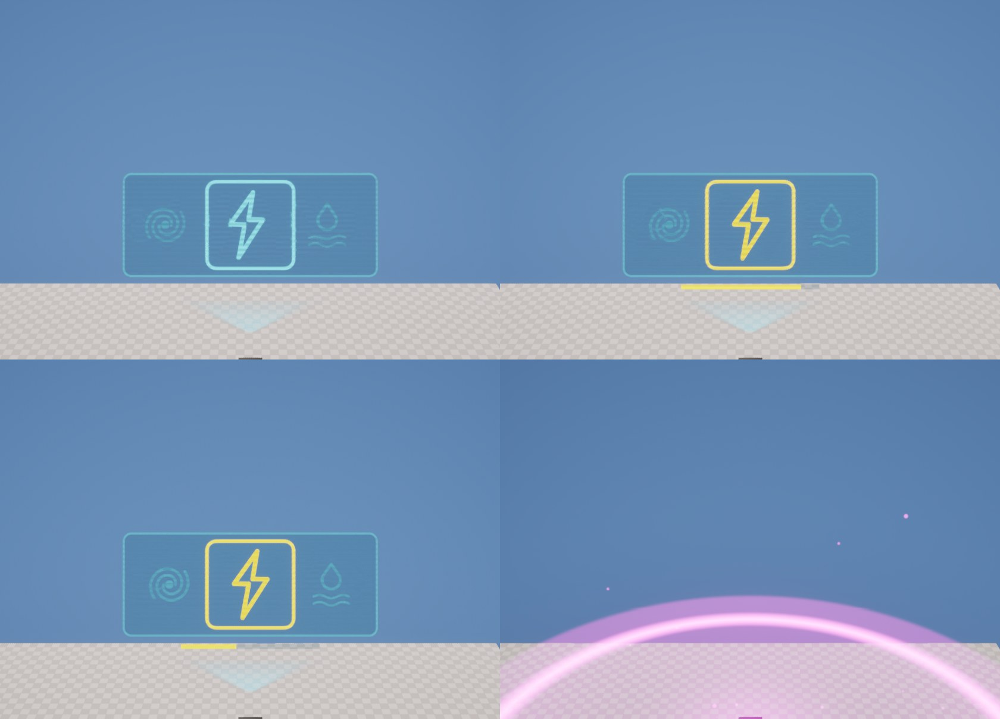
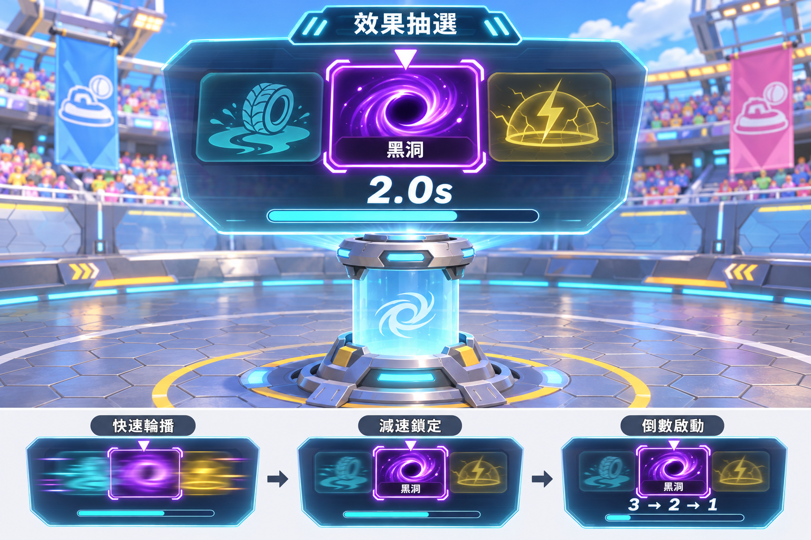

# 場地效果柱子生成器

## 2026-11-25 圖示列停下前的減速（用戶實玩回饋）

用戶以雙開獨立視窗實玩後要求：轉盤即將選中時要有轉速變慢的效果。原先Rolling 1.5秒等速、Revealing只有0.6秒，且舊的Hermite曲線在停點較遠時中途會再加速，減速感不明顯。

改動：
- `ForecastPosition`的Revealing改為純減速曲線`p = Start + D×(1-(1-s)^n)`，`n = 滾動速度×RevealSeconds÷D`，因此離開Rolling時速度連續，之後只減不增，最後停在權威結果上。停點取「Start＋速度×RevealSeconds÷1.6」以內最後一個對應結果的整數格（n≥1.6，均勻煞車、收尾乾脆）；若距離小於「速度×RevealSeconds÷3.2」（會先急煞再爬行）則再往後一圈。n夾在1.5～4。
- 結果仍在Rolling結束時才由伺服器抽出，所以減速只能發生在Revealing。速度×RevealSeconds需≥約10.4格（8格／秒時約1.3秒）才放得下一整圈的選擇範圍；更短的Revealing會夾住n，離開Rolling時有小幅速度跳變。
- `BP_HALArenaEffectGenerator` Class Defaults：`Settings.RollSeconds` 1.5→0.8、`Settings.RevealSeconds` 0.6→1.3（Editor Python修改、編譯並保存）。鎖定前總長維持2.1秒；柱子下沉動畫橫跨Reveal＋Hint＋Delay，因此由3.1秒變為3.8秒、提早0.7秒開始下沉。原生C++預設仍為1.5／0.6。

驗證：UE 5.8.4 Editor增量編譯成功；獨立無頭行程`HAL.FutureCreation.ArenaGenerator` 6/6通過、0警告（`Saved/ArenaGenerator/20261125/Slowdown_Native_R2`）。`ForecastRow`新增1.3秒Reveal案例，並斷言足夠長的Reveal以滾動速度起步（誤差2%內）且200個取樣的速度單調不增。**新曲線未實拍、未實玩**：`Slowdown_PIE_R1`拍的是前一版參數（÷2、n 2～5），當時後段近乎靜止，因而改為現值；雙端Network測試本次未重跑（改動只在純函數與BP時序）。減速手感需用戶／團隊實玩確認。

## 2026-11-25 全息圖示列預示（已編譯、自動化與測試圖PIE實拍通過；正式機位待調）

**狀態：UE 5.8.4（CL58902052）Win64 Development Editor經`BuildAndLaunch.cmd -NoLaunch`增量編譯成功（`Saved/BuildTool/BuildAndLaunch_20261125_185019_379_a1b4bd`）。獨立無頭行程`HAL.FutureCreation.ArenaGenerator` 6/6通過、0警告（`Saved/ArenaGenerator/20261125/Forecast_Native_R2`）。同機雙進程`HAL.NetworkSmoke.ArenaGenerator.ThreeEffectLoop`（`MVPB_NetTest?listen`＋127.0.0.1客戶端，測試內建主機出站80ms）Host／Client各1/1通過（`Forecast_Network_R1`）。`BP_HALArenaEffectGenerator`已指定材質；重啟Editor後於`Fred_TestScene` PIE實拍（`Forecast_PIE_R4`）確認橫向三圖示、中央選取框、鎖定換代表色、倒數條、光錐、掃描線，以及效果生成後面板與調試文字皆隱藏。**

過程留檔：首版編譯與6/6（`Forecast_Native_R1`）後的實拍`Forecast_PIE_R3`發現看板寬高軸對調（引擎Sprite的U對應`BaseSizeY`、V對應`BaseSizeX`）及光錐過淡；已在C++對調、加強材質光錐，並改為配置材質後全程隱藏調試文字，上述結果為修正後的複測。`Forecast_PIE_R1／R2`因工具未生成藍圖柱子而無效。雙端測試為NullRHI，不能代替畫面證據；它不直接斷言圖示列，只證明新增複製欄位後原有三效果循環仍在兩端通過。

用戶確認的外觀：柱子上方一塊面向攝影機的全息投影看板（billboard），單排橫向三圖示（打滑／黑洞／電場），中央1.0倍、兩側縮小並變暗，快速輪播→減速→鎖定在伺服器抽出的結果；鎖定後選取框與中央圖示換成該效果代表色，下方一條倒數條走完Hint＋Delay，歸零才生成效果。看板下半部畫一道收束到柱頂的投影光錐，整體帶掃描線。曾短暫改為「單格老虎機」，用戶看過示意後改回本方案。

實作邊界：
- 結果、時序、生成仍只由伺服器`State`決定；演出不抽選。`State`新增`RolledSeconds`（本輪Rolling實際長度），各端由同一份`State`＋`Settings`算出相同的列位置，晚加入直接呈現當前階段。
- `AHALArenaEffectGenerator::ForecastPosition`是純函數：Rolling按`Forecast Roll Speed`等速；Revealing由等速減到0並停在對應結果的整數格，不倒退（曲線已於同日改為純減速，見最上方條目）。`RevealSeconds=0`時直接落在結果。
- 顯示用一個`UMaterialBillboardComponent`（`ForecastPanel`）單一四邊形；排版、縮放、變暗、選取框、倒數條、光錐、掃描線全在材質`M_ArenaForecast_Hologram`的Custom節點內完成。C++只在面板可見時以60Hz計時器寫`Position／Lock／Progress／LockColor`四個參數，沒有新增Actor Tick或RPC。Dedicated Server不建立演出。
- 面板在Rolling／Revealing／Hint／Delay顯示，Active／Finished／Waiting／Disabled隱藏。`Forecast Material`留空時完全沿用原本的StageText文字（原生預設即留空，舊BP／實例行為不變）。

新增設定（`Settings → Presentation → Forecast`）：

| 欄位 | 預設／範圍 | 說明 |
|---|---|---|
| Forecast Material | 空 | 指定`M_ArenaForecast_Hologram`後啟用圖示列並隱藏文字 |
| Slippery Area／Black Hole／Electric Field Icon | 空 | 留空用材質內建的佔位圖示；可各自換成正式圖 |
| Forecast Icon Size | 220cm；10～2000 | 中央圖示邊長，世界cm，不乘Actor Scale |
| Forecast Side Scale | 0.65；0.1～1 | 兩側圖示相對中央的大小 |
| Forecast Spacing | 230cm；10～4000 | 相鄰圖示中心距離，世界cm |
| Forecast Roll Speed | 8格／秒；0.5～30 | Rolling等速，Reveal由此減速 |

面板高度沿用`Text Height Offset`（局部cm，乘Actor Scale）；面板中心再往上抬半個面板高度，使光錐尖端落在柱頂附近。材質另有`SideBrightness`(0.45)、`Glow`(1.6)、`Opacity`(0.92)、`HoloColor`可在材質／材質實例調整。

資產與腳本：`Tools/ArenaGenerator/MakePlaceholderIcons.py`（系統Python＋Pillow，輸出`Tools/ArenaGenerator/Art/*.png`白色線稿佔位圖）；`Tools/ArenaGenerator/CreateForecastAssets.py`（Editor Python，幂等，匯入三張`T_ArenaForecast_*`並重建材質）。2026-11-25已在UE 5.8.4（CL58902052）Editor執行一次，材質編譯成功（Translucent／Unlit／雙面、4個取樣器、PS 308指令）並保存於`/Game/Assets/FX/ArenaGenerator/`。

測試：新增`HAL.FutureCreation.ArenaGenerator.ForecastRow`——設定範圍、列位置的連續性／不倒退／停在權威結果（3種速度×3種Reveal×5種Rolling長度×3效果）、有無材質兩種情況下面板與文字的顯隱、世界尺寸、倒數由1走到0並橫跨Hint＋Delay、Active與移除後隱藏。修正後複跑6/6通過。

藍圖修改留檔：`/Game/Blueprints/MapMechanic/BP_HALArenaEffectGenerator` Class Defaults → `Settings.ForecastMaterial`由`None`改為`/Game/Assets/FX/ArenaGenerator/M_ArenaForecast_Hologram`；經Editor Python修改、編譯並保存，未動Event Graph／組件。修改前工作區無該BP的未提交改動。

正式機位尺寸（2026-11-25，依實測攝影機推算，**未在比賽中實看**）：在`MVPB_Match_Temp` PIE讀到玩家攝影機俯角80°、FOV 90°、離地約1670cm；`MVPB_Match`的柱子現為Scale=1、位置(520,-820,-200)（先前記錄的約3.6倍縮放已不適用），實例已繼承`Forecast Material`。原生預設220／230cm在此機位下面板寬約佔畫面36%，過大。已將`BP_HALArenaEffectGenerator` Class Defaults的`Settings.ForecastIconSize`由220改為100、`Settings.ForecastSpacing`由230改為105（Editor Python修改、編譯並保存），推算面板寬340cm、約佔畫面寬15%，中央圖示約佔4%（1920寬約80px）。原生C++預設仍為220／230。俯角80°時看板幾乎平貼在柱子正上方，會半透明蓋住柱子與周圍約490×300cm地面，光錐尖端不一定對準柱頂。

無法在比賽中實拍的原因：單人PIE不是Listen Server且人數不足，`TryStartMatch`拒絕開始；賽前階段`bWorldInteractions`為false，生成器停在Waiting。三次嘗試（`Forecast_Match_R1～R3`，含`HALStartMatch`與暫時關閉`bWaitForMatchStart`，後者已還原為true且未保存）畫面中都沒有面板，不作證據。

待辦與已知風險：
1. 只在`Fred_TestScene`以Scale=1的臨時生成柱子、固定機位看過。`MVPB_Match`比賽中的實際畫面（夜場曝光、玩家攝影機、柱子下沉動畫同時進行）未看；BP尺寸為推算值，需雙人Listen Server實玩確認後再調尺寸／`Text Height Offset`。
2. 客戶端畫面未實拍；兩端圖示列是否同格停下只有純函數測試與複製欄位保證，未以雙端畫面比對。
3. 佔位圖示非正式美術。面板保留深度測試，可能被高物件遮擋。真人、四人、晚加入／重連、Cook與打包均未測。

## 下一環節：單排老虎機圖示演出（方案確認；實作見上方2026-11-25）

用戶確認將現有文字／倒數替換為柱子上方的單排橫向圖示列，在打滑／黑洞／電場三種Icon中抽選。中央選中Icon保持正常1.0倍大小，兩側未選中縮小（建議初始0.65倍，可調）並降低亮度；輪播移動時平滑插值大小，減速後鎖定權威選中結果。鎖定後顯示提示與生成延遲的統一倒數／進度條，到期才生成效果。沿用現有柱子旋轉下沉／升回，面板留在上方；Text Height Offset預計套用面板高度。結果、時序與生成繼續由現有伺服器State管理，C++實作演出，BP僅配置三張圖示與外觀，不在演出重新抽玩法結果。預計參數為正常尺寸、未選中縮放、間距、輪播速度、面板高度。具體圖示、樣式與節奏仍待實作／驗收。

示意圖由內建圖片工具產生，僅作設計參考，不是正式Icon或已接入的遊戲資產。提示詞摘要：明亮未來體育場、淺藍發光柱子、單排橫向三效果圖示、中央正常大小與兩側弱化、黑洞選中框、下方倒數／進度條，以及快速輪播→減速鎖定→倒數啟動三階段示意。用戶本次要求先提交推送目前成果，尚未授權在本次同步中開始演出實作。

## 2026-11-24 獨立文字高度偏移

新增`Settings → Presentation → Text Height Offset`，預設0、範圍-10000～10000局部cm。文字相對Z為`Pillar Half Extent.Z × 2 + 12 + Text Height Offset`；正值往上、負值往下，Actor縮放會影響實際世界距離。只調文字，不改Box大小／位置、模型動畫或效果生成位置。選場景柱子調整該欄位即可預覽；也可由團隊在BP Class Defaults設定，Compile／Save後供未覆寫的實例共用。進入遊戲與設定複製時沿用此值，不再需要手動移動StageText。預設0保留原本位置，沒有新增Tick／RPC／BP修改。

本機main/84a748b、UE5.8.2-56702186，統一入口`BuildAndLaunch.cmd -NoLaunch -NoPopup` **Editor R2成功(exit0，45.57秒／9actions)**，含既有其他檔案數值轉型警告；**既有ArenaGenerator Native R1 5/5通過**，0測試警告／失敗／未執行／進行中。R1構建被Editor／Live Coding占用前置檢查阻止，用戶保存關閉後R2解除；未終止用戶程序。以用戶保存關閉後為基準，3/3份Match／生成器BP／打滑BP雜湊保持，git diff --check通過，保留用戶場景及前輪改動，未編輯BP／地圖、未提交／Push。純文字配置調整，未新增自動化用例，未新跑雙端／Game Target／全量／Cook或實際文字畫面，不沿用前輪雙端結果作本輪證據。下一步重開Editor選柱子，依需求調Text Height Offset，確認編輯預覽及進入遊戲後高度。證據`Saved/ArenaGenerator/20261124/TextHeight`（Build_Editor_R2、Native_R1、ProtectedAfterUserSave／ProtectedAfterTests）；構建詳情`Saved/BuildTool/BuildAndLaunch_20261124_163103_780_8b6d12`。

## 2026-11-24 沉底取消碰撞（取代舊版始終固定碰撞規則）

依用戶最終規格，柱子只使用原生`PillarBody` Box Collider；所有Static Mesh（兩個原模型及動畫顯示副本）在遊戲中一律NoCollision、無Overlap、無物理模擬，不再恢復模型作者原先的碰撞。`Solid Pillar`原生預設改為true，Box尺寸由`Pillar Half Extent`設定；舊BP／場景若明確覆寫false仍尊重該值，需由團隊手動勾選。

啟用兩模型下沉且Sink Depth>0時，進入Active（模型已沉底、效果生成）關閉Box；Finished升回途中保持關閉，完全升回後恢復QueryAndPhysics。Finish Seconds=0即時恢復；等待／停用／取消／下一輪與EndPlay按Solid Pillar恢復。關閉Animate Meshes、Sink Depth=0或沒有有效兩模型下沉時，Box保持Solid Pillar配置。Solid Pillar=false則全程無碰撞。只變更運行時碰撞，不搬動原Actor／原模型，也不改生成中心／Offset／三效果流程；碰撞更新獨立於MeshMotionRoot，沿用複製State，在主機／客戶端及無顯示副本的權威端運行，沒有新Tick／RPC／玩家操作修改。支援模型晚組裝。

已擴充`TwoMeshVisualMotion`：實際水平射線在柱子升起／下沉中被Box阻擋、沉底與升回中不被阻擋、升回完成後再阻擋；驗證原模型即使作者配置QueryOnly／QueryAndPhysics也保持純顯示、零收尾／取消／無視覺根、關動畫／零下沉及Solid Pillar=false。雙端三效果循環驗證Box沉底關閉與下一輪恢復、所有模型全程無碰撞。

最終Box-only版於UE5.8.2-56702186完成驗證：統一入口`BuildAndLaunch.cmd -NoLaunch -NoPopup` **Editor R5成功(exit0，44.93秒／9actions)**，包含既有HALSkillTestDummyWidget／HALTornado數值轉型警告；**Native R2 12/12**（MovementAreas 7＋ArenaGenerator 5），**Network R2主機／客戶端各1/1**，測試報告均0警告／失敗／未執行／進行中。唯讀讀回Native CDO、BP CDO、MVPB_Match柱子均Solid Pillar=true，場景實例有兩個Static Mesh、Animate Meshes=true。3/3份Match／生成器BP／打滑BP雜湊保持，git diff --check通過。本輪不修改BP／地圖，保留此前打滑圈貼地修正與用戶場景改動，未提交／Push。未新跑獨立Game Target／全量／Cook／真人駕車畫面；無視覺根測試不等於實際Dedicated實機驗收。下一步重開Editor在Match確認：柱子升起時擋車、沉底後可通過、完全升回後再擋車，模型斜面不參與碰撞。

證據`Saved/ArenaGenerator/20261124/LoweredCollision`（Build_Editor_R5、Native_R2、Network_R2、SolidPillarDefaults.json、ProtectedBeforeTests／ProtectedAfterTests），構建詳情`Saved/BuildTool/BuildAndLaunch_20261124_161628_622_e9fd57`。此前R1雙端結果屬用戶澄清前的中間版，不作最終驗證。

## 2026-11-19 兩個Mesh的旋轉下沉與升回

用戶要求抽選結果確定後旋轉下沉，並明確限定只有新增的兩個Mesh視覺；效果結束後升回，接下一輪。新增Settings → Mesh Animation：`Animate Meshes`預設開、`Mesh Sink Depth`預設600世界cm、`Mesh Rotation Degrees`預設360度（負值反轉）。從Revealing開始，跨Reveal＋Hint＋Spawn Delay平滑旋轉下沉；Active保持最下方；Finished在Finish Seconds內沿原路升回，Rolling／Waiting／Disabled恢復原姿。Finish Seconds=0即時復位，沒有新增或延長玩法階段。曲線用smoothstep，運行中不累積旋轉誤差。

唯讀載入目前保存Match確認兩個Static Mesh都掛在GeneratorBase、QueryAndPhysics碰撞開啟且不模擬物理；直接移動它們會同時移動碰撞。因此在BeginPlay辨識恰好兩個Static Mesh、均有模型且不模擬物理時，建立兩份暫存、無碰撞／不複製的顯示副本，隱藏原渲染並保留原碰撞／Transform／父子關係。複本沿用各自Mesh、材質與渲染設定，集中在暫存MeshMotionRoot旋轉／下沉；EndPlay刪副本並恢復原渲染。不是新增BP資產，不修改原材質。原生Box占位沒有兩個Static Mesh則保持舊外觀；若日後增加第三個模型，不猜測要動哪兩個，需另行明確指定設計。

Actor原點、PillarBody、StageText、HintRing、揭曉時固定的EffectCenter及三效果生成流程不隨動畫移動。保留原碰撞表示下沉時碰撞仍位於原地，符合這次只改視覺的範圍。下沉採世界Z／世界cm，不乘Actor Scale；兩個模型繞柱底世界垂直軸共同轉動，保留相對位置／旋轉／縮放。

各端從現有複製State＋伺服器時鐘推算目前姿態，不複製每幀Transform或新增RPC。既有0.05s玩法Timer保持；只在下沉／升回階段開最多每幀一次的1/60s純表現Timer，Active與待機時關閉，Dedicated Server不建顯示副本；沒有Actor Tick／車輛操作改動。

最終本機`main/fb3c635`、UE5.8.2-56702186 **Editor R3／Game R3編譯連結成功，Native R3生成器5/5，Network R3 Host／Client各1/1**，測試報告均0警告／失敗／未執行／進行中。原生新增`ArenaGenerator.TwoMeshVisualMotion`驗證兩份副本及其OwnedComponents歸屬／清理、材質保持、非均勻縮放的世界距離、共同轉軸、階段連續／復位、文字／提示／碰撞／生成中心保持、關閉、三模型不猜測與晚組裝立即使用目前姿態。雙端80ms Host出站延遲，保存BP加相同兩模型的暫存組裝，三根柱子均觀測七階段、下沉和升回中間姿態、三效果實際生成及下一輪。**9/9份保存機關BP與Match地圖SHA256保持**，未編輯BP／地圖／Event Graph／車操作，未提交／Push。NullRHI程式姿態與雙端驗證，不冒充真人畫面／動態觀感、四端／晚加入／Cook或大量柱子效能驗收。下一步重開Editor測目前Match實例；Settings→Mesh Animation調距離與旋轉，Timing→Finish Seconds控制升回時間。原始證據`Saved/ArenaGenerator/20261119/MeshMotion`。

本輪診斷留檔：Native R1／R2亦各5/5。Network R1雙端因未觀測動畫而逾時；獨立唯讀比較證實**Match保存實例有2個Static Mesh，新建同BP實例有0個**（`InspectAssembly.log`），兩模型存於場景實例，不是BP預設組件。R2在測試各端暫存組裝同款兩模型，並補晚組裝初始化；兩端已觀測動畫，但各1項測試失敗於OwnedComponents副本數量。引擎`UActorComponent::PostInitProperties`不會自動登記從Instance模板複製的組件；補`AddOwnedComponent`並新增原生歸屬／清理斷言後R3通過。保留R1／R2失敗報告，未覆寫。如果希望日後直接放新的BP也自帶模型，團隊需手動將兩模型配置到BP預設，或複製目前場景柱子；本輪未代改BP。

## 2026-11-19 柱子玻璃改淺藍自發光

用戶已在生成器BP自行加上`SM_0198_PF_engine_001`與`SM_0201_PF_flask_003`，要求將瓶狀模型剩餘紫色改為淺藍自發光。唯讀查明`M_004_Dots`只是半透明點點層；紫色玻璃來自`M_006_Glass`色盤貼圖，匯入模型Slot_00的U約0.167。原本只改Dots不能移除另一層紫色。保留用戶目前對Dots／Glass的未提交材質修改。

透過UE官方資產API新增`/Game/Assets/Materials/Arena/M_ArenaGenerator_LightBlueGlow`：Unlit、Translucent、Two Sided；`GlowColor`線性RGB=(0.14,0.65,1)，`GlowStrength`=2，兩者Multiply接Emissive Color；`Opacity`=0.65。不再採用紫色色盤UV。可在材質節點調參，或團隊自行建立MI調整；自發光代表材質自身亮度，未新增燈光或承諾照亮周圍。

只將`/Game/Imported/Platformer14SciFi/Prefabs/Decorations/SM_0201_PF_flask_003`的預設Slot_00改指向新材質並保存。當時Match中生成器`staticMesh2`無Override Materials，故繼承此更新；Slot_01仍Dots、Slot_02仍Substanse。**同款flask_003模型的其他實例也會繼承新玻璃外觀**，不是修改共享Glass本體。未修改BP／Event Graph／地圖／玩法或C++。若之後只想單一柱子外觀不同，團隊應在該BP元件Element 0自行指定獨立材質覆寫。

本機`main/fb3c635`、UE5.8.2-56702186。獨立UnrealEditor-Cmd進程從磁碟重新載入材質與Mesh，顏色／強度／透明度／Unlit／Translucent／Emissive連線／Opacity連線／3個Slot嚴格查核通過，進程exit 0，沒有記錄Warning／Error。12份原BP／Match／Dots／Glass／Substanse保護檔案SHA256皆保持；只保存新材質與指定Mesh。模型修改前檔案留在Saved作本地備份，不納入Git。

**畫面尚待用戶驗收**：嘗試高解析截圖API已排程，但當時原Glass材質Editor的Color Picker模態仍開啟，沒有產出PNG；未替用戶確認或取消未完成選色。視窗檢查只見原材質預覽與Color Picker，不能視為新材質畫面證據。未新跑Gameplay測試、PIE或Cook（純材質變更）；沒有提交／Push。證據在`Saved/MaterialInspect/20261119`（BlueGlow.json、VerifyGlow.json／log、GlowProtectedBefore／After.json、CreateBlueGlow.py）。下一步關閉原選色視窗回Match檢查淺藍明度／透明度，按實際曝光與Bloom調GlowStrength。

## 規則與責任

`AHALArenaEffectGenerator` 是可直接建立 BP 子類的伺服器權威 Actor。第一版原生外觀是灰色 Box 柱子、朝上的階段文字，以及地面預告圓環；無需新增資產或 Event Graph 才能執行。三種候選為 `AHALExpandingSlipperyArea`、`AHALBlackHole`、`AHALElectricSphereGimmick`（Electric Field 使用既有球形電擊區域）。

每根柱子的循環：**Rolling 抽選演出 → Revealing 揭曉演出 → Hint 顯示提示 → Delay 反應延遲 → Active 生成效果並等待 → Finished 效果結束 → 下一輪 Rolling**。

- 伺服器在抽選演出結束時等機率選一種，允許連續重複。演出輪播不是逐幀重新抽選。
- 揭曉時依選中種類計算「柱子位置＋共用偏移＋該效果偏移」，固定本輪生成中心與最大預告半徑；之後移動／縮放柱子，不會改變本輪已公告的中心／半徑。下一輪才採用新位置。
- Hint 與 Delay 期間顯示最大範圍圓環，尚未生成任何玩法效果。圓環無碰撞，不施加效果；地面高度只影響提示外觀。
- Delay 結束才生成選中的 Actor，保留該原生／BP 類別的預設設定，不用生成器數值覆寫其擴張、持續時間、Drag、抓地或電擊規則。效果 Actor 保持單位縮放。
- Active 期間每根柱子只持有一個效果。由效果自己的 `EndPlay` 驅動 Finished；不猜測持續時間，不提前生成下一個。電擊區域會等 Begin＋Loop＋Over 全部完成。提早移除效果也會正常進入 Finished。
- 柱子移除、比賽結束或不再允許場地互動時，清除自己擁有的效果，不清除其他柱子／技能來源。
- 預設有 HAL 比賽狀態時等待 Playing；房間 Loading／Countdown／Results 不消耗循環。無 HAL 比賽狀態的簡單測試世界立即開始。`Wait For Match Start` 可關閉比賽開始等待，但仍遵守既有 World Interactions 許可。
- 無效設定、漏填類別或生成失敗時明確停在 Disabled，顯示狀態並寫日誌，不偷偷換另一種或高速重試。

玩法只在伺服器定時器執行，每0.05遊戲秒最多一次；每次更新最多推進一個階段，卡頓後不連續跳過所有預告。設為0秒的階段仍至少佔一次更新。沒有新增 Actor Tick、玩家輸入／移動修改、GAS 逐幀 Ability、生成 RPC 或大型生成框架。

## 參數

| Settings 參數 | 預設 | 意義 |
|---|---:|---|
| Roll Seconds | 1.5秒 | 三種文字輪播的抽選演出 |
| Reveal Seconds | 0.6秒 | 顯示已決定結果 |
| Hint Seconds | 0.5秒 | 首次展示預告範圍 |
| Spawn Delay Seconds | 2秒 | 繼續顯示預告並讓玩家反應，結束才生成 |
| Finish Seconds | 0.5秒 | 效果 Actor 結束後的收尾，再開始重抽 |
| Slippery Area Class | 原生打滑圓形區域 | 可換成團隊已配置的 BP |
| Black Hole Class | 原生黑洞 | 可換成團隊黑洞 BP |
| Electric Field Class | 原生球形電擊區域 | 可換成已有電擊球 BP |
| Base Effect Offset | 世界座標(0,0,0)cm | 三種效果共用，保留原序列化欄位EffectOffset，不乘Actor Scale |
| Slippery Area Offset | (0,0,110)cm | 對齊MVPB_Match打滑區Z=-80（柱底Z=-190） |
| Black Hole Offset | (0,0,190)cm | 對齊MVPB_Match黑洞Z=0（柱底Z=-190） |
| Electric Field Offset | (0,0,190)cm | 對齊MVPB_Match電擊球Z=0（柱底Z=-190） |
| Pillar Half Extent | (40,40,100)cm | 柱子總大小為80×80×200cm，Actor原點為底部中心 |
| Solid Pillar | true | 僅Box阻擋車輛／球；沉底至完全升回前關閉；Static Mesh全程無碰撞 |
| Text Height Offset | 0cm | Presentation分類；相對原文字位置的局部Z偏移，正上負下，Actor縮放會影響世界距離 |
| Wait For Match Start | true | 比賽地圖等待 Playing |
| Random Seed | 0 | 0每次新建隨機序列；非0用來重現抽選序列 |

各段時長0～60秒。效果的總存在時間由效果 BP 決定，生成器不另加一份持續時間。原生預設三種總壽命分別為打滑7秒、黑洞10秒、電擊7秒；保存 BP 的實際數值可能不同。

## Editor 使用

1. 完整編譯後開 Editor，新建以 **HALArenaEffectGenerator** 為父類的 BP，例如 `BP_ArenaEffectGenerator`。
2. 在 **Class Defaults → Arena Generator → Settings → Effects** 選三個已有 BP：`BP_ExpandingSlipperyArea`、`BP_HALBlackHole`、`BP_ElectricSphereGimmick`。原生類別可以測玩法，但不自帶這些 BP 已接好的粒子特效。
3. 在 Timing 調每段時間，在 **Placement** 調 **Base Effect Offset** 與三個獨立Offset。目前初始Base=0，三種Z偏移110／190／190，以MVPB_Match柱底Z=-190為校準基準。仍可疊加共用偏移：例如Base=(0,0,80)、Electric Field Offset=(200,0,40)，電擊球就在柱底往世界X+200、Z+120cm。既有BP／實例若手動覆寫參數，優先使用其保存值；初始值不會自動適配不同的柱底高度。
4. Compile／Save，把生成器 BP 放入 Match 地圖並將 Actor 原點放到地面。Scale先保持1。開始比賽後才會循環；不要另在地圖放同位置的獨立效果來代替生成器的生成結果。
5. 第一版頂部文字會顯示 ROLL／CHOSEN／WARNING／INCOMING／ACTIVE／FINISHED，並顯示選中效果與預告剩餘秒數。打滑文字青色、黑洞紫色、電擊黃色。預告是原生灰色圓環，沒有最終演出／音效。
6. 後續由團隊手動接 `On Generator Stage Changed` 替換展示。事件提供階段、選中效果和循環編號；只能控制外觀，不能在事件內再次生成玩法 Actor。可讀 `Get Generator State`、`Get Displayed Effect`、`Get Stage Remaining Seconds`。Waiting／Active／Disabled的剩餘時間回傳-1。

代理不建立／編輯BP、地圖或 Event Graph；Box與提示網格由原生元件建立。要調各效果數值，請改各效果BP，而不是生成器。

## 聯機與限制

選中結果、階段、起始伺服器時間、預告中心／半徑、循環編號、有效效果引用為同一份複製狀態；客戶端只顯示與計時，不抽玩法結果、不生成本地副本。晚相關可直接顯示當前階段，不重播漏過的演出；網路延遲可能略過非常短的演出階段。

Box是占位造型；正式材質、粒子與音效未製作。提示圓環只投影中心地面並保持水平，尚未逐點貼合崎嶇地形；預告最大圓形投影不等於球形電場在所有高度的實際切面。單柱不重疊自身效果，不阻止不同柱子的效果重疊。多人公平性、生成器數量上限與演出性能需團隊實測。

本輪只在黑洞與電擊球頭文件新增唯讀設定 getter，供生成器讀取類別預設範圍；沒有更改三種效果或車輛操作規則。

## 驗證與下一步

### 依MVPB_Match校準初始高度（2026-11-17）

唯讀載入已保存的`/Game/Maps/MVPB_Match`取得：生成器`BP_HALArenaEffectGenerator`位置(890,-1210,-190)，其Base與三種Offset皆0；柱子Scale約3.6094，但世界偏移不乘Scale。黑洞／電擊球Actor的Z均0。場景有兩個打滑區，使用者明確選擇`BP_ExpandingSlipperyArea`（Z=-80）作參考，不採`BP_ExpandingSlipperyArea2`（Z=-200）。

依使用者新指示，將原生初始Base改0、Slippery Area Offset改(0,0,110)、Black Hole／Electric Field Offset改(0,0,190)，僅校準Z，保留各效果在柱子X／Y生成。計算為`-190+0+110=-80`與`-190+0+190=0`。沒有建立運行時查場景Actor／名稱相依，也不隨每輪動態追蹤參考物件；這是本地場景標準高度的初始配方。下方舊零預設及舊測試是前一階段紀錄。

本輪 **UE5.8.2-56702186 Editor R1／Game R1編譯連結成功**，Native R1生成器專項 **4/4、0警告／失敗／未執行／進行中**。初版唯讀檢查曾使用Python沒有提供的`is_a`而失敗，改用MathLibrary類別繼承查詢後R2完成取樣，沒有保存／編譯資產。修改後另以獨立唯讀程序重新載入保存的Match，確認**原生預設、既有生成器BP的CDO、已放置實例三者皆為Base0＋110／190／190**，不需要修改BP或地圖來清除覆寫。`HeightComparison.json`三項均匹配所選參考Actor的Z；7份保存BP／地圖／Config檔案前後SHA256一致。報告`Saved/ArenaGenerator/20261117/HeightDefaults`（Scene.json／SceneAfter.json、HeightComparison.json、Native_R1與構建日誌）。先前用量限制曾讓自動核准審查無法完成，未執行的後驗證／遊戲構建在使用者要求繼續後，經正常核准重試完成。未新跑雙端或真人畫面，不將舊測試冒充本次；未提交／Push。

### 三種效果獨立Offset（2026-11-17）

使用者要求三個Effect能分別調整位置。新增`SlipperyAreaOffset`、`BlackHoleOffset`、`ElectricFieldOffset`，皆為世界座標cm，預設0。原`EffectOffset`保留原序列化名稱與保存值，UI改顯示 **Base Effect Offset**。揭曉時由選中種類取得共用＋專屬偏移並固定`State.EffectCenter`，提示及實際生成共同使用這份已複製中心，不在Delay結束時重新取位置。想讓三欄直接代表相對柱底的位置，可將Base設0。個別與合成偏移都檢查有限值及各軸不超過10000cm。

本輪保留既有生成器未提交程式，以及使用者新增的`BP_HALArenaEffectGenerator`、Match地圖和警笛資產改動，不代理編輯資產。使用者儲存關閉Editor時另保存生成器BP、黑洞BP與Match地圖，以關閉後版本作為後續驗證基線；三份變動均不覆寫。

本輪UE **5.8.2-56702186** Editor R1／Game R1編譯連結成功。Native R1生成器專項 **4/4**，Network R1 Host／Client各 **1/1**，報告均0測試警告／失敗／未執行／進行中。原生以三組不同非零XYZ偏移驗證各自揭曉中心、移動／縮放後仍固定公告中心、實際三種生成位置與類別預設保留；兼測舊預設位置相容、非法個別／合成偏移、原有階段／清理／Timer。雙端80ms注入同樣核對三種非零XYZ中心與實際效果Actor位置、三種完整循環；未修改結果／延遲等其他流程。**使用者關閉後10/10份保護檔案於驗證期間哈希保持**。報告`Saved/ArenaGenerator/20261117/PerEffectOffsets`。沒有重跑下方舊全量243項，不將其當成本輪復測；未看實際畫面、未編輯資產／配置，未提交／Push。

### 初版生成器驗證（2026-11-17）

從`main/793f619`接續，開工只有團隊既有`SW_Pursuit_Siren.uasset`未提交修改，完整保留。實際引擎 **UE5.8.2-56702186**。Editor第一輪C++編譯完成但連結受Editor占用阻止，使用者儲存關閉後完成更新；最終 **Editor R4／Game R3 Win64 Development編譯與連結成功**。R3確立Box預設純展示；R4補上關閉啟動等待時，舊比賽地圖在Finished仍會清理的設定邊界，未變更既有車輛或效果規則。

最終 Native R2 **243/243 Success、0失敗／未執行／進行中**，計數為242一般通過＋1帶既有警告的通過，不能只看`succeeded`欄位。唯一警告項為既有`VehicleTest.InvalidAndBlockedReplacementRetainsCurrentCar`的基線車提示及PlayerStart阻擋訊息；新生成器四項均0測試警告／錯誤。第一輪Native R1亦為243/243，保留原報告。

新測試包括設定／範圍讀取與可重現的三種抽選、全部階段的伺服器流程與延遲前不生成、真正生成三種原生Actor且保留類別預設、公告位置不受柱子後續移動／縮放影響、單柱不重疊、提早結束／移除柱子清理、等待Playing及回合結束清理（含關閉啟動等待）、生成失敗Disabled與真實Timer循環。幾何測試核對Box12個三角形及預告環128個三角形，**不等於已看過實際畫面**。

雙端 Network R2 Host／Client各 **1/1、0測試警告／失敗／未執行／進行中**。同場三根原生柱子分別以可重現種子選到三種效果，Host出站注入80ms；兩端三根皆觀察到Waiting、Rolling、Revealing、Hint、Delay、Active、Finished（階段位元`7f/7f/7f`）、可見提示網格、同一結果與實際效果Actor，等待原生效果自然結束後進入第二輪。第一輪Network R1也各1/1，最終以R2為準。並未測真人／四人、晚加入／重連、真實渲染、Cook或大型生成器數量性能。

報告／日誌：`Saved/ArenaGenerator/20261117`；Native_R2、Network_R2、Build_Editor_R4.log、Build_Game_R3.log。**1349份保存資產／Config／uproject／Build.cs保護檔案前後SHA256一致**，既有警笛資產修改保留；沒有代理編輯任何保存資產／配置。新增文件已加入既有`.gitignore`的精確白名單，供正常Git交接。未提交／Push。

團隊驗收：先確認Box／文字可見，再看完整六階段；預告前後是否完全無效果、圈與實際位置是否相符；分別看三種效果自然結束後才重抽、連續重複、兩根柱子、提早移除效果／柱子、比賽開始與結束、兩端預告和結果一致。真人畫面／手感及Cook另記，不以NullRHI測試代替。
