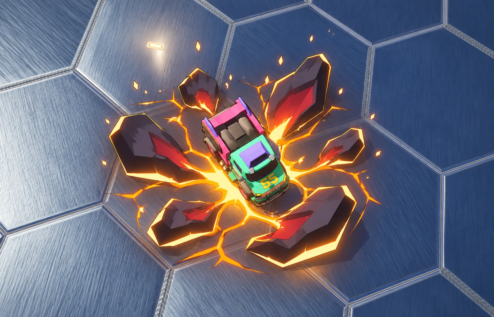
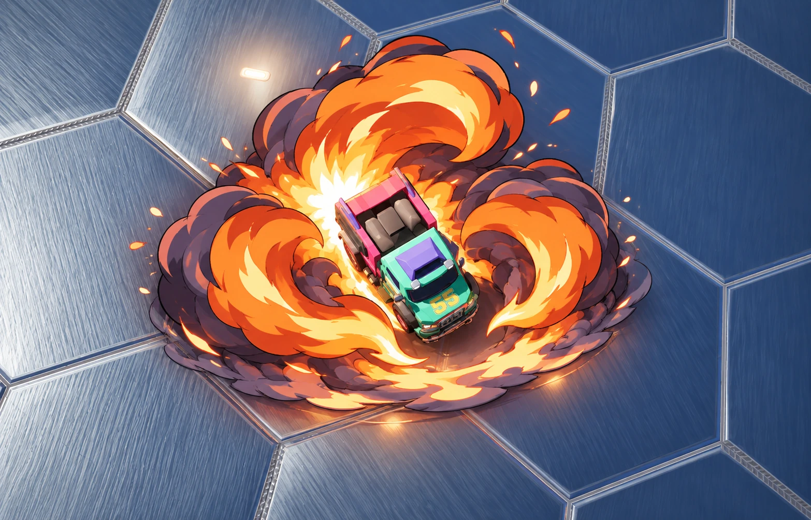
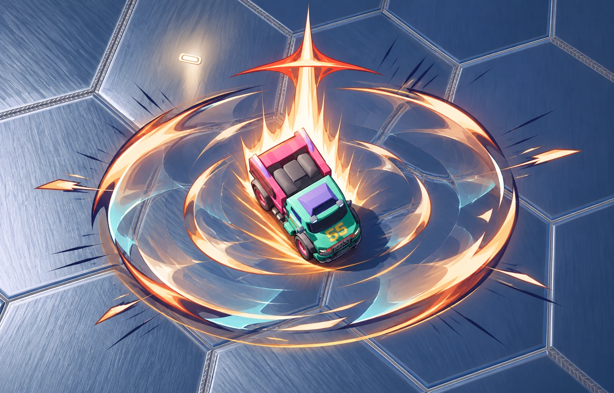

# 陨石球落地爆炸概念草图

三张草图用同一张 `MVPB_Match` 俯视实拍作参考。选定 B 的三股逆卷焰云作为主体，并取 C 最外侧的一道贴地音爆。A 的岩块与熔缝留作备选。

| A 熔岩裂冠 | B 逆卷焰云 | C 双环音爆 |
| --- | --- | --- |
|  |  |  |

## 首版焰云纹理

首版将橙色卷头、金色火舌和暗紫灰烟底画在透明纹理上，再贴到三片弯曲网格。11 月 23 日的正式版沿用 B 的三股构图，改用闭合烟团网格表现膨胀、遮挡和消散。[首版透明 PNG](../../../../../Tools/SpecialBall/Art/T_Meteor_ImpactBillow.png) · [新旧同机位实射](../MeteorBall_CloudExpansion.webp) · [正式球型调参](../../../Special_Ball_Base_CN.md#逆卷焰云与外围音爆)

<details><summary>展开这张纹理的 ImageGen 提示词</summary>

```text
Use the reference only for the existing B fire-cloud style. Create a production texture asset on a fully transparent RGBA background. Isolate and redraw ONE SINGLE asymmetric curling lobe of that orange meteor-impact cloud as a square hand-painted 2.5D game VFX sprite. Filling roughly 82% of the square with transparent padding on every edge. A tapered hot pale-yellow feeder/tongue at the LEFT edge (about x=12%, y=61%) rushes toward the RIGHT into a bulbous orange crashing breaker at x=69%, y=52%, which tips OVER and rolls BACK inward with one visible concave swirl. The big crest is the visual mass, not a long comet tail. Two or three broad round charcoal-plum side scallops tucked behind the orange crest, deep burnt red underside, 2–3 connected flat warm orange shapes, one cream-colored hand-painted flame-shaped stroke swept along the inner curve. Soft blocky cel shading, confident rounded ink contours, chunky exaggerated hand-drawn sports-game explosion. Shape has a convincing sense of volume when viewed at 65 degrees from above. Compose just the one lobe, not a flower or complete explosion. Sprite will be rotated into three separate lobes in a realtime overhead arena. Rich saturated fill. Clean coherent silhouette, a small opening at the center of the curl is good. No scene, no vehicle, no floor or shadows, no ring, no sparks outside the primary silhouette, no typography, no icon badge or framing, no white backdrop or checkerboard. Do not paint diffuse light halos outside the silhouette. Do not put a radial explosion centered behind it. The image is a straight-alpha standalone transparent game texture.
```

</details>

## 生成提示词

使用内置 ImageGen，以下为三张图各自的完整提示词。

### A

```text
Use case: stylized-concept. Make one polished full-colour game VFX keyframe sketch for art direction, landscape. Edit target: the provided overhead arena screenshot, locked camera, same blue brushed hexagonal steel tiles, same pink and mint toy sports truck angled to the lower right, same spot and scale. Remove the letterbox and the thin old telegraph, use its footprint as the measured maximum reach of the new effect; enough framing margin to see its full shape, preserve visible surroundings. Paint one joyous, exceptionally punchy, expensive-looking arcade meteor impact around and behind that truck, with a sport-comic three-value cel shader, softly bevelled shapes, dark coloured outlines, clean large graphic masses and cream-hot accents. Broad strokes readable at gameplay zoom, strong foreshortening and ground contact, show some identifiable cab. Ground stays intact after a transient effect. Make an authentic visual proposal suitable for real-time meshes/particles. One main hero frame. No UI, captions, letters, side panels, diagrams, watermark, lens dirt or whole-image grading. Direction A, MAGMA CROWN. Focus on a low, wide, sculpted crown erupting outwards. Five to seven uneven tilted chunks of black basalt with cherry-red inner faces, gold hot rims and cream-lit undersides around a hot central punch. A graphic network of TEMPORARY glowing amber fissures radiates low through the gaps, then stops just inside the perimeter, like a molten flower stamped onto steel. Leave negative spaces between the slabs and show steel between them. Clear chunky silhouette, flame only in the cracks, small ascending cinders, almost no smoke, no persistent pit. The compact impact feels like a massive stone just punched the floor.
```

### B

```text
Use case: stylized-concept. Make one polished full-colour game VFX keyframe sketch for art direction, landscape. Edit target: the provided overhead arena screenshot, locked camera, same blue brushed hexagonal steel tiles, same pink and mint toy sports truck angled to the lower right, same spot and scale. Remove the letterbox and the thin old telegraph, use its footprint as the measured maximum reach of the new effect; enough framing margin to see its full shape, preserve visible surroundings. Paint one joyous, exceptionally punchy, expensive-looking arcade meteor impact around and behind that truck, with a sport-comic three-value cel shader, softly bevelled shapes, dark coloured outlines, clean large graphic masses and cream-hot accents. Broad strokes readable at gameplay zoom, strong foreshortening and ground contact, show some identifiable cab. Ground stays intact after a transient effect. Make an authentic visual proposal suitable for real-time meshes/particles. One main hero frame. No UI, captions, letters, side panels, diagrams, watermark, lens dirt or whole-image grading. Direction B, ROLLING FIRE CLOUD. The shape to read first is a dimensional billowing fireball, curled into three broad, joined, asymmetrical comma-shaped lobes rolling back over themselves around a compact erupting white-gold core. Incandescent tangerine folds interlock with cool charcoal, violet-gray cartoon ash undersides, thin warm reflected rim on shadow, broken ink contours, a low spreading floor skirt. Show alternating overlaps and a clear mouth low in front exposing part of the truck. Bright flecks escaping between lobes. Plush rounded silhouettes and graphic soft-edged three-tone volume, dramatic vertical lift, no giant rock shards, no sci-fi halo, no tall column or nuclear mushroom.
```

### C

```text
Use case: stylized-concept. Make one polished full-colour game VFX keyframe sketch for art direction, landscape. Edit target: the provided overhead arena screenshot, locked camera, same blue brushed hexagonal steel tiles, same pink and mint toy sports truck angled to the lower right, same spot and scale. Remove the letterbox and the thin old telegraph, use its footprint as the measured maximum reach of the new effect; enough framing margin to see its full shape, preserve visible surroundings. Paint one joyous, exceptionally punchy, expensive-looking arcade meteor impact around and behind that truck, with a sport-comic three-value cel shader, softly bevelled shapes, dark coloured outlines, clean large graphic masses and cream-hot accents. Broad strokes readable at gameplay zoom, strong foreshortening and ground contact, show some identifiable cab. Ground stays intact after a transient effect. Make an authentic visual proposal suitable for real-time meshes/particles. One main hero frame. No UI, captions, letters, side panels, diagrams, watermark, lens dirt or whole-image grading. Direction C, PRESSURE SNAP. Sculpt the air and space itself, in luxurious broad graphic strokes. A compressed upright spear of cream-white heat capped by a narrow red-orange umbrella kink at the center; two broad, broken, layered, CONCENTRIC elliptical sheets of compressed glassy air cut outward at deck height, copper and ivory leading edge, a few cyan backlit undersides, dark stroke on the back arcs; all within the same marked perimeter and simultaneous event. Some radial ink speed dashes, a few flat fragments thrown out nearly horizontally; thin amber afterimage near the floor. Air lensing shown with displaced blue hex seams between the shells. Wide and fast, considerable negative space, strongest silhouette two luminous low pressure waves, no fireball and no crown of rocks.
```
