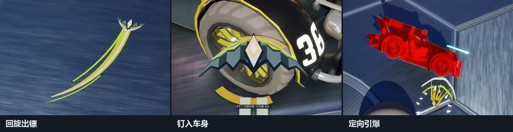

# Car12 震荡钉镖

Car12 的主技能有两次操作。第一次按键从车头掷出飞镖，第二次按键引爆已经钉在对手车身上的飞镖。可以等对手转向，让推力对准电墙或争夺中的球再引爆。

## 驾驶与战斗规则

- 满 100 点能量、车辆稳定着地且能施放技能时可以出镖。起手按左转向左回旋，中立或右转向右回旋。飞镖沿出手时的车头方向向前画宽弧，绕到原出手位置的侧后方。施放者可以继续变向驾驶。
- 首个有效车体接触挂镖，挂上时不扣血。飞镖可以命中去程或回程中的车辆，沿途穿过球、施放者和重叠触发区。实体墙截住飞镖，飞空或撞墙均结束本次投掷，能量照常恢复。
- 挂镖后可再次按同一个主技能键引爆。第二次按键不耗能。挂镖满 **5 秒**自动引爆。已腾空的施放者可以手动引爆，眩晕期间只能等待自动引爆或眩晕结束。淘汰、换车、离场和回合结束清除未结算的镖。
- 每名施放者同时拥有一枚飞镖。多人可以钉住同一个目标，每枚分别倒计时、结算一次。爆炸只作用于被钉住的目标。
- 普通命中结算 **10 点基础伤害、Medium 冲击、Long 水平推动**。攻击力与倍率在出镖时锁定，承伤倍率、伤害免疫、冲击抗性和脱球门槛在引爆时由现有 Combat Resolver 判定。练习房沿用房间的免扣血规则。

| 钉入的位置 | 引爆时的水平推力 |
|---|---|
| 前部 | 向车尾 |
| 后部 | 向车头 |
| 左侧 | 向车右侧 |
| 右侧 | 向车左侧 |

命中位置在目标车自身坐标中记录。车辆转过 90°，底盘箭头和引爆推力也随之转过 90°。箭头表示技能希望施加的水平方向，墙、车辆原速度和冲击免疫都可能改变实际位移。

## 第一版正式视觉

- **出手。** `SM_Car12_ResonanceBlade` 是独立的双翼镖模型。石墨色折面之间嵌黄绿翼纹，银白前缘和中央菱形镖芯在远镜头下勾出轮廓。镖身自旋时，两笔宽窄不同的弯弧沿刚经过的路径收尖。短尾长度可在技能 DA 调整。
- **钉入。** 镖尖插入目标车壳，双翼留在中镖侧，随车身移动和转向。接触瞬间有一圈断开的亮纹，随后镖芯和两侧的小弧按节拍亮起，最后 1.2 秒逐渐变快。常规可见的镖身和局部光纹对所有玩家可见。
- **施放者提示。** 锁定双音配合 0.35 秒的扫描线和收拢的翼标。深底编号牌使用目标的座位色，牌底五格随倒计时缩短，底盘空心箭头给出当前推力方向。出屏时淡线从本车轮廓外连向屏边翼标。目标被 Car08 烟幕遮蔽时，镖身、光纹、编号、方向和连线一并收起，施放者仍能看到「已挂镖」及当前引爆操作状态。
- **引爆。** 接触处先闪白，随后两道弧形波前和七道长短不同的裂光沿最终推力方向打开并消退。前端亮边给出推动方向，弧线之间的空隙让车身仍然可见。手动和到期引爆共用这一套表现。

图中三个局部来自 `MVPB_Match` 客户端的游戏画面，使用近景机位和裁切展示轮廓。引爆图中车身的红色来自已有的车辆受击反馈。

## 配置与试车

车辆入口是 `/Game/Data/MVP_B/DA_Vehicle_Car_12 → Abilities`。主技能引用原生 `HALBatarangAbility` 和 `/Game/Data/Abilities/DA_Ability_Car12_Batarang`。UE 读回 Car12 的攻击力为 25，动作倍率为 0.4，基础伤害为 10。车辆 DA 的 `Full Recharge Seconds` 为 20 秒。

| 技能 DA 参数 | 初版值或用途 |
|---|---|
| Flight → Forward Reach / Side Reach | 前伸 1050 cm、侧向约 480 cm，以出手点为原点 |
| Flight → Flight Seconds / Sweep Radius | 完整飞行 1.45 秒，接触半径 18 cm |
| Flight → Launch Offset | 相对物理车头的局部偏移，默认向前 12 cm、向上 3 cm |
| Combat → Fuse Seconds | 从钉住起计时，默认 5 秒 |
| Combat → Damage Multiplier / Impact Tier / Push Distance | 动作倍率与独立冲击配置 |
| Presentation → Wing Span / Pin Signal | 模型实际显示翼展默认 68 cm，可换锁定音 |
| Presentation → Art → Blade Mesh | 独立模型，鼻尖沿 +X、翼展沿 Y，运行时按实际模型宽度缩放 |
| Presentation → Art → Wake Seconds / Wake Material | 默认显示最近 0.14 秒的实走弧线，填 0 可收起尾迹 |
| Presentation → Art → Burst Reach / Resonance Material | 定向冲击波视觉前伸默认 240 cm，材质同时绘制中镖侧的节拍光纹 |

美术资产在 `/Game/Assets/FX/Batarang`。模型的材质实例 `MI_Car12_Blade`、飞行拖尾 `MI_Car12_Wake` 和接触／引爆 `MI_Car12_Resonance` 分别开放 `Ink` 与 `Livery` 供调整墨边和车款强调色。镖芯从施放者座位取色，目标编号牌从目标座位取色。美术源在 `Tools/Batarang/`，`CreateResonanceArt.py` 通过 UE Editor 生成模型、材质和实例，优先保留技能 DA 里已有的美术引用。

1. 打开 `/Game/Maps/SingleVehicleTest/SingleVehicleTest`，用 **Play Standalone** 单人进入。这张图的 `BP_VehicleTestGameMode` 车型名单已包含 Car12。
2. 在测试面板选 `BP_VehiclePawn_Car_12`，点击 **Apply selected vehicle**。在 **OPPONENT CAR** 选一辆车，点击 **Spawn / replace opponent**。对手默认出现在正前方 700 cm。稍微调整车身，让对手落在车头前方偏右的弧线上，松开转向并出镖。挂镖后观察中镖侧和箭头，短按同一键引爆。第二次可以等 5 秒，对比自动引爆。
3. 双人时，让目标挂镖后原地转向，再驶出画面、进入烟幕。施放者检查屏内箭头、屏外淡线和烟内保密提示。目标玩家应看到插在自己车上的实体镖，追踪 HUD 只出现在施放者屏幕上。在正式比赛中核对单次扣血和击退。

`hal.AbilityLog 1` 可在主机输出日志中查看 `Batarang release`、`Batarang pin`、`Batarang burst`。引爆日志记录实际扣血、有效冲击档和水平推力方向。

若团队习惯用 `Fred_TestScene`，这张图另有自己的名单。在 `BP_FredSkillTestGameMode → Class Defaults → Vehicle Test → Test Vehicle Classes` 点击 **+**，选择 `BP_VehiclePawn_Car_12`，编译并保存即可加入。

## 本轮视觉验证

- **构建与资产。** 2026-11-24 在 UE 5.8.2 通过 `BuildAndLaunch.cmd -NoLaunch -NoPopup` 构建 Win64 Development Editor。Editor 再次读回技能 DA 的独立镖身、尾迹和震荡波材质引用。三份材质在正式比赛图的 D3D12 客户端显示正常。配置读取与材质生成日志在 `Saved/Batarang/Art/AuthorRelease.log`。
- **常速比赛与烟幕。** 本机使用独立 Listen Server 和客户端，主机出站增加 60 ms 延迟。在 `MVPB_Match` 用测试 GameMode 让客户端钉住主机车，转向后等待 5 秒自动引爆。在 `MVPB_NetTest` 中，客户端目送目标出屏，进入 Car08 烟幕后手动引爆。覆盖了公开镖身、施放者私有翼标、烟内隐藏和最终推力方向。两个用例两端都通过，均只结算一次 10 点伤害。报告在 `Saved/Batarang/Art/Night/`、`Smoke/`，调整波纹后的最终夜场实拍回归在同目录的 `Photo/`。
- **玩法回归。** 项目默认启动配置下重新运行 `HAL.FutureCreation.` 共 285/285 通过，其中 283 项无警告，两项既有换车用例带预期警告。报告在 `Saved/Batarang/Art/Gameplay/index.json`。四台实机同时释放技能时的画面可读性留给团队试玩。

## 玩法接入时的验证 · 2026-11-24

- UE 5.8.2 的 Win64 Development Editor 通过 `BuildAndLaunch.cmd -NoLaunch -NoPopup` 增量构建。单独启动 Editor 再次加载正式资产，从磁盘读回攻击力 25、倍率 0.4、挂镖 5 秒、能量回满 20 秒，以及两张试车图的车型名单。
- 两项 Car12 专项自动化通过，覆盖左右镜像、四个钉入面、撞墙、穿过球与触发区、挂上时零伤害、手动和到期引爆、眩晕、多施放者与回合清理。按项目默认启动图运行 `HAL.FutureCreation.`，285/285 通过，其中两项既有换车用例带预期警告。另一次从引擎空图禁用资产注册缓存启动时，既有地面稳定性用例报告地面无物理体，使用项目默认入口的全量复测通过。报告在 `Saved/Batarang/GameplayFinal/index.json`。
- 本机独立 Listen Server 与客户端进程分别通过 `HAL.NetworkSmoke.Batarang.ClientPinsTurnsAndDetonates`。主机启用 60 ms 出站模拟延迟。客户端钉住主机车辆，主机转向约 90°，进入 Car08 烟幕后客户端再次按键。两端最终 HP 均从 100 降到 90，服务器只结算一次，推力和引爆前的箭头方向一致。两端报告在 `Saved/Batarang/NetworkFinal/`。
- 已检查客户端屏内挂镖、目标出屏、目标进烟三张 1280×720 实拍，分别保存在 `Saved/Screenshots/WindowsEditor/Car12_Pinned.png`、`Car12_Edge.png` 和 `Car12_Smoke.png`。四台真实电脑混战时提示是否足够醒目、锁定音在场地音效中的音量，待团队试玩。
