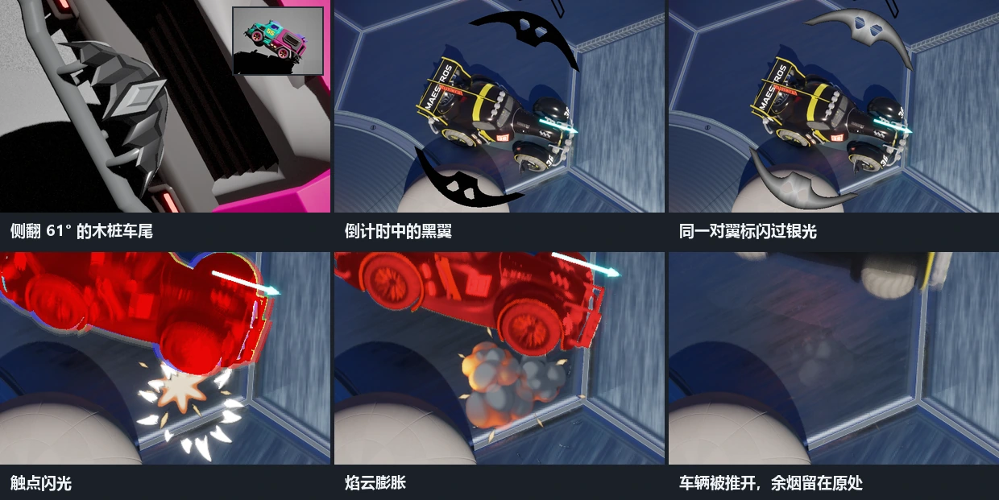

# Car12 震荡钉镖

Car12 的主技能有两次操作。第一次按键从车头掷出飞镖，第二次按键引爆已经钉在对手车身上的飞镖。可以等对手转向，让推力对准电墙或争夺中的球再引爆。

## 驾驶与战斗规则

- 满 100 点能量、车辆稳定着地且能施放技能时可以出镖。起手按左转向左回旋，中立或右转向右回旋。飞镖沿出手时的车头方向向前画宽弧，绕到原出手位置的侧后方。施放者可以继续变向驾驶。
- 首个有效车体接触挂镖，挂上时不扣血。飞镖可以命中去程或回程中的车辆，沿途穿过球、施放者和重叠触发区。实体墙截住飞镖，飞空或撞墙均结束本次投掷，能量照常恢复。
- 挂镖后可再次按同一个主技能键引爆。第二次按键不耗能。挂镖满 **5 秒**自动引爆。已腾空的施放者可以手动引爆，眩晕期间只能等待自动引爆或眩晕结束。淘汰、换车、离场和回合结束清除未结算的镖。
- 每名施放者同时拥有一枚飞镖。多人可以钉住同一个目标，每枚分别倒计时、结算一次。爆炸只作用于被钉住的目标。
- 普通命中结算 **10 点基础伤害、Medium 冲击、Long 水平推动**。攻击力与倍率在出镖时锁定，承伤倍率、伤害免疫、冲击抗性和脱球门槛在引爆时由现有 Combat Resolver 判定。练习房沿用房间的免扣血规则。

| 钉入的位置 | 引爆时的水平推力 |
|---|---|
| 前部 | 向车尾 |
| 后部 | 向车头 |
| 左侧 | 向车右侧 |
| 右侧 | 向车左侧 |

命中位置在目标车自身坐标中记录。车辆转过 90°，底盘箭头和引爆推力也随之转过 90°。箭头表示技能希望施加的水平方向，墙、车辆原速度和冲击免疫都可能改变实际位移。

## 黑钢飞镖与挂镖提示

- **出手与钉入。** 飞行和挂镖共用同一枚石墨黑钢镖，翼展 **108 cm**。命中后，系统从目标车型的可见轮廓找到受击侧，镖尖沿该处向内扎约 **28 cm**。两翼露在车壳外，随车身侧倾、翻滚。接触处的短环在 0.20 秒内收起。
- **B 的飞行尾迹。** 一笔宽黑墨痕贴着飞镖刚走过的弧线，在末端分出细尖，两笔间的留白透出地板。DA 的 `Wake Seconds` 控制显示多长一段已飞路径。
- **A 的车身蝠翼与击退箭头。** 两片镂空黑翼夹在目标车身两侧。翼内掠过银光、翼尖轻微舒展，起初每秒 0.85 下，最后 1.6 秒逐步加快到每秒 2.4 下。原先屏幕底部的文字和秒数已移除。黑色空心箭头显示此刻的水平推力方向。
- **C 的屏外点线。** 目标出屏时，黑色方点连到屏边，边缘翼标延续相同节拍。目标进入 Car08 烟幕时，实体镖和方位提示收起。施放者技能栏上方只保留一对原地闪动的小翼，仍可手动引爆。
- **小型爆炸。** 手动和到期引爆都从钉入处闪出暖白火芯和八枚短碎屑。三团有厚度的焰云错开膨胀，转为冷灰烟、上浮消散，全程约 0.45 秒。车辆被推开后，余烟留在起爆处。

车头自带的青色小箭头指向行驶朝向，车身外的黑色空心箭头指向引爆推力。[上一版的黑钢飞行尾迹和屏边点线实拍](Art/Car12/Car12_BlackInk.webp)

## 配置与试车

车辆入口是 `/Game/Data/MVP_B/DA_Vehicle_Car_12 → Abilities`。主技能引用原生 `HALBatarangAbility` 和 `/Game/Data/Abilities/DA_Ability_Car12_Batarang`。UE 读回 Car12 的攻击力为 25，动作倍率为 0.4，基础伤害为 10。车辆 DA 的 `Full Recharge Seconds` 为 20 秒。

| 技能 DA 参数 | 当前值或用途 |
|---|---|
| Flight → Forward Reach / Side Reach | 前伸 1050 cm、侧向约 480 cm，以出手点为原点 |
| Flight → Flight Seconds / Sweep Radius | 完整飞行 1.45 秒，接触半径 18 cm |
| Flight → Launch Offset | 相对物理车头的局部偏移，默认向前 12 cm、向上 3 cm |
| Combat → Fuse Seconds | 从钉住起计时，默认 5 秒 |
| Combat → Damage Multiplier / Impact Tier / Push Distance | 动作倍率与独立冲击配置 |
| Presentation → Wing Span / Pin Signal | 飞行与挂镖的完整显示翼展共用 **108 cm**，可调 15–150 cm。Pin Signal 指定锁定音 |
| Presentation → Art → Blade Mesh | 独立模型，鼻尖沿 +X、翼展沿 Y，运行时按实际模型宽度缩放 |
| Presentation → Art → Wake Seconds / Wake Material | 默认显示最近 **0.20 秒**的黑色尾迹，可调 0–0.35 秒，填 0 收起 |
| Presentation → Art → Pin Depth Percent | 镖尖扎入车壳的深度占翼展的比例。默认 26%，可调 0–45%。108 cm 翼展时，每加 1 个百分点多扎入约 1.08 cm |
| Presentation → UI → Fuse Pulse Rate / Final Fuse Pulse Rate / Fuse Warning Seconds | 初始 0.85 Hz，最后 1.6 秒提速到 2.4 Hz。三个参数共用同一倒计时相位 |
| Presentation → Art → Burst Reach / Resonance Material | 默认 145 cm，控制火光和碎屑展开的距离，以及焰云大小。爆炸伤害只结算给挂镖目标 |
| Presentation → Art → Burst Cloud Mesh / Burst Fire Tint / Burst Smoke Color | 三团焰云共用一份体积网格。两个颜色分别控制高温中心和冷却后的烟边 |
| Presentation → UI → Pin Widget Class | 留空使用原生 HUD。要换布局，可选以 `HALBatarangWidget` 为父类、已设置 Designer 根控件的 Widget Blueprint |

美术资产在 `/Game/Assets/FX/Batarang`。`MI_Car12_Blade` 的 `Ink` 控制大面颜色，基色约为 sRGB `#242425`。`BladeMetallic` 默认 0.90。抛光镖芯和暗色折面的粗糙度分别为 0.17 和 0.39。`MI_Car12_Wake` 绘制黑色尾迹，`MI_Car12_Resonance` 绘制短暂的触点、火芯和碎屑。焰云复用陨石效果已有的体积模型和材质，Car12 独立驱动大小、颜色与消散节奏。

自定义挂镖 UI 可从 `Get Pin View` 读取是否挂镖、能否手动引爆、剩余秒数、0–1 的 `Fuse Pulse`、可见车辆和推力方向。用 `Fuse Pulse` 驱动翼标明度即可与镖芯同步。烟幕中可见车辆为空、推力方向为零，脉冲可继续使用。

每个正式车型的车壳轮廓由 `Tools/Batarang/CreateResonanceArt.py` 在 Editor 里预采样。它从车模高度 42% 处提取 96 个方向的实际几何截面，保存进技能 DA 的 `Pin Profiles`。增加展示车型后重跑脚本即可补齐。修改已有车壳时，在命令行加 `-HALRefreshDartProfiles` 刷新截面。自定义车型还没有截面时按可见网格的椭圆轮廓估算。

1. 打开 `/Game/Maps/SingleVehicleTest/SingleVehicleTest`，用 **Play Standalone** 单人进入。这张图的 `BP_VehicleTestGameMode` 车型名单已包含 Car12。
2. 在测试面板选 `BP_VehiclePawn_Car_12`，点击 **Apply selected vehicle**。在 **OPPONENT CAR** 选一辆车，点击 **Spawn / replace opponent**。对手默认出现在正前方 700 cm。稍微调整车身，让对手落在车头前方偏右的弧线上，松开转向并出镖。挂镖后观察中镖侧和箭头，短按同一键引爆。第二次可以等 5 秒，对比自动引爆。
3. 双人时，让目标挂镖后转向，再驶出画面、进入烟幕。施放者依次检查车身两翼和空心箭头、屏边方点线、烟中的无方位翼标。目标玩家应看到插在自己车上的实体镖，追踪 HUD 只出现在施放者屏幕上。在正式比赛中核对单次扣血和击退。

`hal.AbilityLog 1` 可在主机输出日志中查看 `Batarang release`、`Batarang pin`、`Batarang burst`。引爆日志记录实际扣血、有效冲击档和水平推力方向。

若团队习惯用 `Fred_TestScene`，这张图另有自己的名单。在 `BP_FredSkillTestGameMode → Class Defaults → Vehicle Test → Test Vehicle Classes` 点击 **+**，选择 `BP_VehiclePawn_Car_12`，编译并保存即可加入。

## 车壳与小型爆炸验证 · 2026-11-24

- **构建。** Win64 Development Editor 通过 `BuildAndLaunch.cmd -NoLaunch -NoPopup`，最终日志在 `Saved/BuildTool/BuildAndLaunch_20261124_211803_438_faf7d7/`。为同步团队本机的独立游戏目标，另执行 `Build.bat HAL_Future_Creation Win64 Development -Project=D:\HAL_Future_Creation\HAL_Future_Creation.uproject -WaitMutex -NoHotReload -NoLiveCoding -Log=D:\HAL_Future_Creation\Saved\Batarang\PinBurst\GameVerified.log`，编译和链接均通过。
- **资产读回。** UE 5.8.3（CL 58210709）已保存正式技能 DA 和共鸣爆炸母材质。在另一个 Editor 进程逐一比对镖身、尾迹、触点／爆炸三份材质的着色器源码，并从 DA 读出 12 款车型各 96 个有效半径。翼展 108 cm、挂镖深度 26%、接触半径 18 cm，体积焰云模型已绑定。记录在 `Saved/Batarang/PinBurst/Author2.log`、`VerifyAssets.log`。
- **侧翻木桩。** 在正式 `BP_SkillTestDummy` 的车身侧倾 61° 时，从前、后、左、右分别检查。沿每个挂点的法线测得镖尖在车壳截面内 28.08 cm，镖尾在外 32.40 cm。随后将侧倾转至 −44°，同时改变俯仰和朝向，镖身仍跟随原挂点。D3D12 同机位在有镖和无镖两帧间测得 902 个明显变化的像素，另有正对镖翼的车尾特写核对实际遮挡。报告在 `Saved/Batarang/PinBurst/Photo3/`，原图在同级 `Tilted/`。[侧翻与实射画面](Art/Car12/Car12_PinBurst.webp)
- **独立主机与客户端。** 主机出站增加 60 ms 延迟，D3D12 客户端在 `MVPB_Match` 实射。挂镖时三团焰云已就绪并隐藏。目标转过 90° 后，击退箭头随车更新，尾段银光加速，5 秒到期自动引爆。实拍记录了触点火芯、膨胀焰云和留在原处的冷烟。在 `MVPB_NetTest` 中，目标驶出镜头再进入 Car08 烟幕，施放者仍可手动引爆，提示不泄露目标方位。两次均为挂镖时零伤害、引爆后 HP 从 100 到 90，主机和客户端各 1/1 通过。报告在 `Saved/Batarang/PinBurst/Night2/` 和 `Smoke2/`。
- **玩法回归。** Car12 三项专项均通过。全量 `HAL.FutureCreation.` 共 288 项，285 项无警告通过，2 项带既有换车警告通过，1 项失败。失败项 `SpecialBall.LifetimeContactsAndCover` 仍期望预警阶段的电球机关不触发接触，和上一轮结果一致。报告在 `Saved/Batarang/PinBurst/Gameplay2/`。本轮联机数据来自同机双进程，四人实机混战留给团队试玩。

## 黑钢版验证 · 2026-11-24

- UE 5.8.3（CL 58210709）的 Win64 Development Editor 通过 `BuildAndLaunch.cmd -NoLaunch -NoPopup` 构建。重新启动 Editor 从磁盘读回翼展 108 cm、尾迹 0.20 秒、命中半径 18 cm、金属度 0.90，核对了三份母材质的着色器源码和镖身材质输入。构建日志在 `Saved/BuildTool/BuildAndLaunch_20261124_195242_276_ec1ed7/`，资产读回见 `Saved/Batarang/BlackInk/Verify2.log`。
- 在主机出站增加 60 ms 延迟的独立主机和 D3D12 客户端上跑了两次实射。夜场到期引爆和烟幕中手动引爆均为主机、客户端各 1/1 通过。客户端核对飞行与挂镖用的是同一模型组件，三轴缩放一致。转向后的箭头对应服务器的最终推力。进烟后 HUD 只提供计时与操作状态。两次服务器均只结算一次 10 点伤害。两端报告见 `Saved/Batarang/BlackInk/Night2/` 和 `Smoke2/`。四台实机混战的可读性待团队试玩。
- 全量 `HAL.FutureCreation.` 共 287 项，286 项通过（含两项换车警告），Car12 两项专项均通过。余下的 `SpecialBall.LifetimeContactsAndCover` 在独立进程复测仍失败。断言期望特殊球穿过预警阶段的电球机关，工程当前将机关的 Begin 阶段视为接触有效。记录见 `Saved/Batarang/BlackInk/Gameplay/`、`SpecialBallRetry/`。

## 首版美术验证（改黑钢之前）

[第一版远投、侧面挂镖与定向引爆实拍](Art/Car12/Car12_Resonance.webp)

- **构建与资产。** 2026-11-24 在 UE 5.8.2 通过 `BuildAndLaunch.cmd -NoLaunch -NoPopup` 构建 Win64 Development Editor。Editor 再次读回技能 DA 的独立镖身、尾迹和震荡波材质引用。三份材质在正式比赛图的 D3D12 客户端显示正常。配置读取与材质生成日志在 `Saved/Batarang/Art/AuthorRelease.log`。
- **常速比赛与烟幕。** 本机使用独立 Listen Server 和客户端，主机出站增加 60 ms 延迟。在 `MVPB_Match` 用测试 GameMode 让客户端钉住主机车，转向后等待 5 秒自动引爆。在 `MVPB_NetTest` 中，客户端目送目标出屏，进入 Car08 烟幕后手动引爆。覆盖了公开镖身、施放者私有翼标、烟内隐藏和最终推力方向。两个用例两端都通过，均只结算一次 10 点伤害。报告在 `Saved/Batarang/Art/Night/`、`Smoke/`，调整波纹后的最终夜场实拍回归在同目录的 `Photo/`。
- **玩法回归。** 项目默认启动配置下重新运行 `HAL.FutureCreation.` 共 285/285 通过，其中 283 项无警告，两项既有换车用例带预期警告。报告在 `Saved/Batarang/Art/Gameplay/index.json`。四台实机同时释放技能时的画面可读性留给团队试玩。

## 玩法接入时的验证 · 2026-11-24

- UE 5.8.2 的 Win64 Development Editor 通过 `BuildAndLaunch.cmd -NoLaunch -NoPopup` 增量构建。单独启动 Editor 再次加载正式资产，从磁盘读回攻击力 25、倍率 0.4、挂镖 5 秒、能量回满 20 秒，以及两张试车图的车型名单。
- 两项 Car12 专项自动化通过，覆盖左右镜像、四个钉入面、撞墙、穿过球与触发区、挂上时零伤害、手动和到期引爆、眩晕、多施放者与回合清理。按项目默认启动图运行 `HAL.FutureCreation.`，285/285 通过，其中两项既有换车用例带预期警告。另一次从引擎空图禁用资产注册缓存启动时，既有地面稳定性用例报告地面无物理体，使用项目默认入口的全量复测通过。报告在 `Saved/Batarang/GameplayFinal/index.json`。
- 本机独立 Listen Server 与客户端进程分别通过 `HAL.NetworkSmoke.Batarang.ClientPinsTurnsAndDetonates`。主机启用 60 ms 出站模拟延迟。客户端钉住主机车辆，主机转向约 90°，进入 Car08 烟幕后客户端再次按键。两端最终 HP 均从 100 降到 90，服务器只结算一次，推力和引爆前的箭头方向一致。两端报告在 `Saved/Batarang/NetworkFinal/`。
- 已检查客户端屏内挂镖、目标出屏、目标进烟三张 1280×720 实拍，分别保存在 `Saved/Screenshots/WindowsEditor/Car12_Pinned.png`、`Car12_Edge.png` 和 `Car12_Smoke.png`。四台真实电脑混战时提示是否足够醒目、锁定音在场地音效中的音量，待团队试玩。
