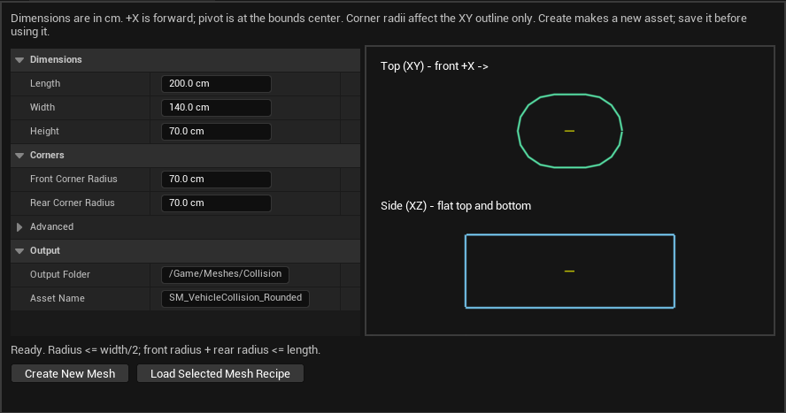

# 车辆碰撞代理生成工具：操作与交接（v0.1）

日期：2026-10-20。工具是项目原生 Editor 模块，入口 **Tools → HAL Tools → HAL Vehicle Collision Generator**（HAL Tools 是菜单分组标题，不一定是子菜单）。不需要新增插件或创建工具蓝图。

## 1. 用途与边界

输入长、宽、高、前后圆角，生成独立的 Static Mesh 代理和一个简单凸包。俯视前后圆润，侧视上下平整；沿用现有 `VehiclePhysicsBody` 单 Chaos 刚体、驾驶和网络物理。

生成工具不自动修改车辆 Blueprint、Vehicle Definition、表现 DA、地图、质量、驾驶参数或球控制点。资产生成后由团队检查、保存，再手工分配给车型。

每次创建新资产，重名自动追加编号；不提供覆盖现有资产按钮。修改旧形状时读取旧配方、创建新版本、对比后切换引用，可继续保留旧版用于回退。

## 2. 首次安装／换电脑

1. 同步 `.uproject`、`Source/HAL_Future_CreationEditor.Target.cs`、整个 `Source/HAL_Future_CreationEditor/` 及本说明。若使用双击编译工具，同时同步根目录 `Build_Editor.cmd` 与 `Tools/BuildEditor.ps1`。
2. 核对实际 UE 补丁版本，团队使用同一补丁。`.uproject` 的 `5.8` 不锁定 5.8.2／5.8.3。
3. 保存并关闭 Editor、游戏和 Live Coding，再双击 `Build_Editor.cmd`；成功后打开项目。工具新增了 Editor 模块和反射类型，首次接入应完整构建 Editor Target，不靠 Live Coding 加载。
4. 在 Unreal 顶部打开 **Tools**，找到 **HAL Tools** 分组中的 **HAL Vehicle Collision Generator**。它只在完整 Editor 中提供，不在游戏窗口或打包游戏中提供。
5. 找不到菜单时先检查本机是否成功构建了 `UnrealEditor-HAL_Future_CreationEditor.dll`，以及 `.uproject` 中是否包含该 Editor 模块；不需要重建玩家蓝图。

## 3. 参数含义

所有尺寸单位均为 **cm**，都是整体尺寸；例如 Length=400 表示总长4米，不是半长，也不是中间直线段长。

| 界面参数 | 用途／限制 |
|---|---|
| Length | 本地 X 方向总长，范围1～10000 cm；**+X为车头** |
| Width | 本地 Y 方向总宽，范围1～10000 cm |
| Height | 本地 Z 方向总厚度，范围1～10000 cm；顶、底各位于 `±Height/2` |
| Front Corner Radius | 车头 +X 端的两个水平圆角半径；范围0～Width/2 |
| Rear Corner Radius | 车尾 -X 端的两个水平圆角半径；范围0～Width/2 |
| Segments Per Corner（高级项） | 每个90°圆弧的分段数，范围1～8，默认4；增加后线框更圆，但凸包更复杂 |
| Output Folder | 输出虚拟目录，例如 `/Game/Meshes/Collision`，必须在 `/Game/` 下，不带末尾斜杠 |
| Asset Name | 输出资产名，例如 `SM_Collision_Car01_v1`；单个名称，不填路径／扩展名 |

圆角是水平面中的真实圆角，不是上下边缘倒角：

- 半径为0：该端保留方角。
- 半径小于车宽一半：端面中央仍有一段直边。
- 半径等于车宽一半：该端的两个圆角接成半圆。
- 前后半径可以不同，但 **Front Radius + Rear Radius ≤ Length**，防止两端圆角重叠。

工具不会静默缩小不合法半径。参数不合法时会显示原因，禁用生成按钮；例如减小 Width 后，也应相应减小两个半径。

资产 Pivot 固定为整体包围盒中心 `(0,0,0)`，尺寸直接烘焙入网格。工具默认200×140×70、前后70只是旧尺寸风格的起点，不是已经适配 Car_01 的测试结论。

## 4. 创建、检查和保存

1. 结束 PIE／Simulate，在 Tools 菜单打开生成器。
2. 展开尺寸和圆角参数，填写实测所需尺寸；提交参数后右侧预览更新俯视和侧视，车头 +X 在右侧，黄色短线表示原点。两张预览各自缩放以方便阅读，最终以数值和生成资产为准。
3. 填写输出目录、资产名。建议按底盘／车型和版本命名，例如 `SM_Collision_Car01_v1`。
4. 检查面板下方状态为 Ready，点击 **Create New Mesh**。
5. 工具自动定位新资产并打开 Static Mesh Editor。它此时仍是**未保存的新资产**，不会自动替换任何车辆。
6. 在 Static Mesh Editor 打开 **Show → Simple Collision**，检查绿色简单碰撞线框：上下平整、前后圆弧与预期一致，没有额外 Box、Sphere 或 Capsule。查看 Collision Complexity，应为 **Simple And Complex**。
7. 如需检查长宽高，核对包围盒／Approx Size；网格只有一个LOD和一个默认材质槽，无需制作材质或贴图。
8. **Ctrl+S 保存新网格**。保存资产后，生成参数一起写入该网格的包元数据。未保存就退出，会丢失资产和配方。

视口里看见代理本身是正常的；游戏中是否显示由车辆物理根的 Hidden In Game 配置决定，隐藏不会取消碰撞。

## 5. 手工接入当前车型

1. 确认实际玩家 `BP_RoundedVehiclePawn` 使用的 Vehicle Definition 引用，打开对应车辆 DA；当前团队玩家测试资产为 `DA_Vehicle_Player_TestBaseline_v1`，不因工具创建而自动换成新 DA。
2. 在 DA 的 **Physics** 分类中保持 **Collision Shape = Convex Mesh**。
3. 将 **Collision Mesh** 指向第4节已保存的新代理网格。
4. 核对 **Physics → Scale** 为 `(1,1,1)`。若旧资产已经用非1缩放，先记录该值并评估尺寸／子组件影响，再安排迁移；不要直接把旧根缩放与已经烘焙的尺寸叠乘。
5. 保留现有质量、阻尼、CCD、碰撞事件和碰撞通道等已调参数。Ready For Use 保持原迁移流程，工具不替你改动。
6. 核对骨骼表现 DA 的相对位置／缩放，让视觉车身与新代理对齐；骨骼模型仍为 No Collision、不模拟物理。不要给轮胎、尾翼和模型 Physics Asset 再启用独立车身碰撞。
7. 检查 **Ball Control Point**。加长车身后，原控制点可能落到车头内；让目标球中心位于车头外，预留球半径和合理间隙，并核对高度。不要盲目沿用旧的 `(170,0,20)`。
8. 保存修改的 DA。重新开始游戏时由现有 `ApplyDefinition` 应用新碰撞；在 Definition 模式下只改蓝图组件面板的 Static Mesh，运行时可能被 DA 覆盖。

改了根尺寸之后，还应核对出生高度、视觉轮胎与地面的关系、车头方向及接地调试。当前车辆由车身刚体支撑，车轮尚不是四个独立物理接地点；工具不同时引入悬挂。

## 6. 调整已有形状

1. 在 Content Browser 中**只选中一个**本工具生成并保存过的 Static Mesh。
2. 切回生成器，点击 **Load Selected Mesh Recipe**。
3. 面板恢复原尺寸、圆角、分段数和输出位置。它读取的是该资产的生成配方，不从后来手工编辑过的顶点反推参数。
4. 调整数值，再点击 **Create New Mesh**，保存新版本，检查后手工切换车辆 DA 的 Collision Mesh。

原资产、原配方和原引用保留。普通手工碰撞网格、缺失配方或未知配方版本会明确拒绝读取，并保留面板原参数。若手工修改了已生成网格，原配方不会随之自动更新；需要新的确定形状时应再次生成新版本。

## 7. 测试与 Git 交接

先在测试地图验证静止接地、前进／倒车／漂移、正撞／斜擦／侧撞／墙角和腾空落地，再检查控球／发射／脱球／冲击及主客互看。原参数不变也不保证手感不变：碰撞几何改变会影响接触法线、接触位置及惯性。先单独比较新旧代理，再决定是否调整物理参数。

生成并保存的 Static Mesh、团队修改的车辆／表现 DA，以及工具源码和文档需正常提交 Git。不要提交 Binaries、Intermediate、Saved 或缓存。生成参数随网格一起保存，不依赖这台电脑的会话状态。

## 8. 实现与验证入口

- `Source/HAL_Future_CreationEditor/` 是独立 Editor 模块；Runtime 模块和 Game Target 不依赖它。
- `HALVehicleCollisionGenerator.cpp` 负责参数校验、确定性圆角轮廓、封闭挤出网格、单凸包烹制、版本化文本元数据及唯一新资产创建。
- `SHALVehicleCollisionGenerator.cpp` 负责原生 Slate 面板、预览、读取配方及显式创建；没有工具蓝图或运行时 Tick。
- 正常保存的结果是标准 `UStaticMesh`＋`UBodySetup`，配方写在包元数据中，没有序列化 Editor 模块的自定义类引用。
- 自动化 `HAL.Editor.CollisionGenerator` 覆盖参数／几何、真实动态刚体、唯一新资产及 Saved 目录下的保存／重新加载；渲染面板探针为 `HAL.EditorUI.CollisionGenerator.Panel`，二者分别运行。

本轮编译、自动化、界面及资产保护的最终结果见[验证摘要](Vehicle_Collision_Generator_Verification_20261020.json)和[项目状态入口](../Project_Status_CN.md)；工具本身通过不等于新车型碰撞已完成真人双端验收，也不代表完整游戏已打包／Cook 验证。

本机使用UE5.8.2 CL56702186；最终真实渲染Editor中5/5工具测试通过，0测试错误／警告，截图已人工检查。初次链接错误与UI探针访问私有API已修正；初次保存探针改变包路径导致配方软路径不匹配，改为同路径真实重载后通过；首次界面绘制命中TArray禁止自引用追加的断言，改为复制首点再闭合预览轮廓，并在最终渲染进程复测全部5项。历史失败日志保留，不能以引擎退出码0替代报告结果。最终渲染启动日志仍有NVIDIA旧驱动TSR和r.MotionVectorSimulation线程标记提示，工具测试本身为0警告。
