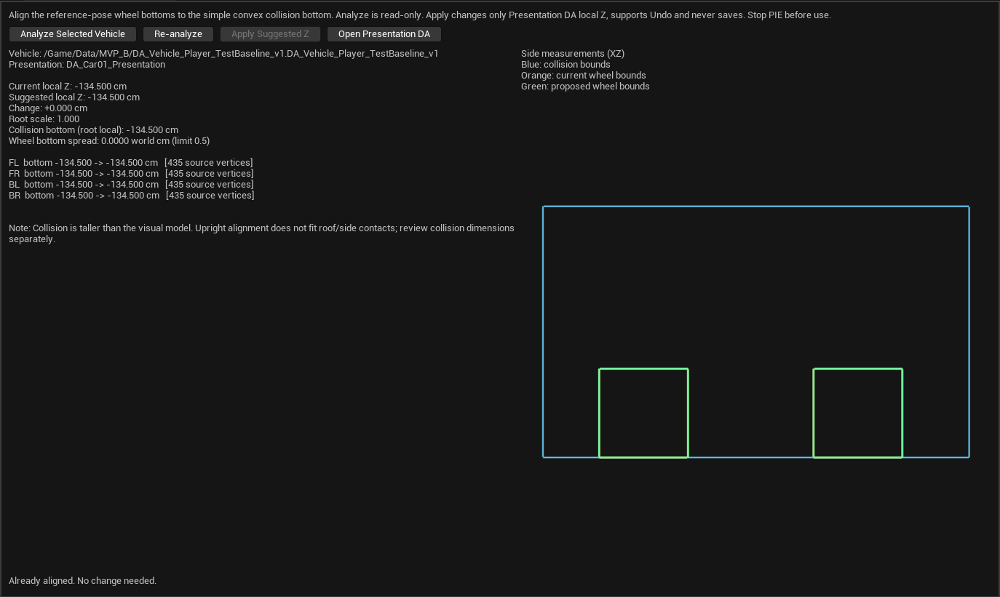

# 车辆外观自动高度校准工具：操作与交接（v0.1）

日期：2026-10-22（Asia/Tokyo）。施工基点`main/fc9f2b9`；保留团队已修改的`DA_Car01_Presentation`及此前接续文档。本工具是项目原生Editor功能，当前只处理正立参考姿态的静态轮底高度，不包含VP-3动态悬挂。

## 1. 入口与首次使用

1. 同步本轮Editor模块源码、Build.cs和说明；先保存工作，关闭Editor／游戏／Live Coding，再运行根目录`BuildAndLaunch.cmd`。没有新增插件或工具蓝图。
2. 编译成功后重新打开项目，在Content Browser选中**实际使用的Vehicle Definition**。当前玩家通常为`/Game/Data/MVP_B/DA_Vehicle_Player_TestBaseline_v1`。不要选模型、碰撞Mesh、表现DA或Pawn蓝图。
3. 打开顶部 **Tools → HAL Tools分组 → HAL Vehicle Visual Alignment**。HAL Tools是分组标题，不一定是子菜单。
4. 工具会尝试读取当前选择；选择尚未完成或已有面板时，点击 **Analyze Selected Vehicle**。此时只测量，不修改资产。
5. 如果Editor还在扫描资产，等待完成后再点 **Re-analyze**；工具需要检查是否有其他车型复用同一表现DA。

## 2. 阅读分析和二维预览

工具读取所选Definition的Collision Mesh、Physics.Scale以及Presentation引用，避免把蓝图旧组件默认值误当成运行配置。模型旋转和缩放会纳入计算。

| 输出 | 含义 |
|---|---|
| Current local Z | 表现DA当前Relative Transform的Z |
| Suggested local Z | 建议的绝对Z值，不是再减一次的偏移量 |
| Change | 需要改变多少Z；已经对齐时接近0 |
| Collision bottom | 真实简单凸包源顶点的最低Z，位于物理根局部坐标系 |
| FL／FR／BL／BR bottom | 四轮当前与建议轮底高度，以及参与测量的源顶点数 |
| Wheel bottom spread | 四轮底面高度差，已换算为世界cm；必须不超过0.5 cm |
| Shared DA user | 其他引用同一个Presentation DA的Vehicle Definition |

右侧是**XZ侧视测量示意**：蓝色为简单凸包外包围范围，橙色为当前轮组几何包围范围，绿色为建议位置。左右轮可能在侧视中重合；四轮分别的高度见左侧报告。它不是整车材质／动画渲染，也不代替最终游戏画面检查。

测量使用LOD0参考姿态中实际参与三角形的轮胎顶点，按配置的四个SpinBone及默认蒙皮权重识别，不用整车包围盒或配置的RadiusCm代替轮底。直接解出绝对目标Z，因此原来已经手调过也不会累计向下移动。

## 3. 应用、撤销和保存

1. 核对目标Vehicle、Presentation DA、四轮高度和预览。仅有尺寸提示时仍可应用；若显示Cannot apply，先按第4节处理。
2. 点击 **Apply Suggested Z**。只有表现DA的`Relative Transform.Location.Z`会改变；X／Y、旋转、缩放、轮半径、轴向和Chassis参数保留。
3. 应用后报告会刷新；已对齐时显示 **Already aligned**，按钮停用，不会再累积偏移。
4. 点击 **Open Presentation DA**，检查变更并按 **Ctrl+S** 保存。工具本身不会自动保存或提交Git。
5. 如需还原，使用Editor的 **Edit → Undo**；Redo也支持。撤销或手工改参数后点Re-analyze刷新报告。
6. 完整停止旧游戏并重新Play，在平地正立、静止落稳后检查四轮接地和车身高度，再做基本驾驶、持球／发射及双端观察。蓝图预览若仍显示旧位置，可重新打开该蓝图预览；无需改AnimGraph或添加Tick。

应用仅允许在非PIE／Simulate的Editor中执行，目标必须是项目`/Game`中的表现DA。每次应用前都会重新测量；若分析之后影响校准的变换、几何范围、目标引用或共享用户变化，会要求重新Analyze，而不会覆盖新修改。

**当前Car_01**：团队手动保存的Z=-134.5 cm与本工具实际测量的建议值一致；因此首次打开预期显示已对齐。这是正确结果，不需要故意改坏数值来启用按钮。新增车型配置后再按同一流程校准即可。

## 4. 共享DA与不支持的数据

同一个车型／碰撞配置可以由多辆Pawn复用已校准DA，不在每个实例BeginPlay或Tick重新校准。

- 多份Definition共用同一Presentation DA，且Collision Mesh和根Scale相同：列出共享用户，团队须勾选共同影响确认后才能应用。
- 共用Presentation DA但Collision Mesh／形状或根Scale不同：阻止写入。由团队在Content Browser复制表现DA，给需要独立基准的Definition重新引用并保存，再Analyze；工具不自动改引用或复制资产。
- 缺失LOD0可编辑源数据／源骨骼名／默认权重、缺失轮胎几何、四轮不共面或不符合现有Root→suspension→steer→spin链：报告原因，不猜测后写入。
- 首版测量要求轮胎顶点完整刚性绑定到各自配置的SpinBone。轮体混合蒙皮、跨轮权重或需靠子骨骼／Morph改变轮形的模型，不能直接保证自动校准，需要另行扩展识别规则。
- 模型与物理根仅支持正的均匀缩放；碰撞须为简单凸包集合、BodySetup.BuildScale3D=1。不支持Complex As Simple或混有Box／Sphere／Capsule的聚合体。凸包可有局部变换；每个顶点都转换后测量，不取可视Mesh包围盒冒充物理底面。

0.5 cm是当前工具的共面容差，不是悬挂行程或允许任意轮胎离地的玩法规则。旋转／模型几何造成前后明显高差时，一个整体Z无法同时解决所有轮子；应先修正参考姿态或配置。

## 5. 与物理、VP-2和VP-3的边界

校准不改变碰撞尺寸、质量、惯性、重心、接地探测、网络物理、GAS、球控制点或发射方向，不编辑Blueprint／AnimGraph。它只为静态模型提供可重复的高度基准。

如果凸包明显高于视觉模型，会显示尺寸提醒。正立轮底贴地不意味着侧翻、倒扣、车顶与墙面的外观也贴合；碰撞外形仍按实际碰碰车接触区单独评审并做物理回归。本工具不自动缩放碰撞体。

VP-2只给Chassis骨骼叠加驾驶倾斜，四轮链仍按参考基准；VP-3后续可以复用本工具校准后的参考几何，分轮输出动态伸缩。本轮没有实施VP-3／物理悬挂／自然落地辅助。

## 6. 实现与验证留档

- `HALVehicleAlignment.cpp`：纯几何测量、实际Definition分析、共享用户检查和显式事务应用。
- `SHALVehicleAlignment.cpp`：原生Slate报告、二维测量预览及分析／应用／打开DA操作。
- `HAL.Editor.VehicleAlignment`：源骨骼名映射、旋转／缩放、绝对解／重复计算、异常轮组、真实车型只读测量、Apply／Undo／Redo、过期预览和共享保护。
- `HAL.EditorUI.VehicleAlignment.Panel`：实际菜单／内容浏览器选择／面板截图。与原碰撞工具共同回归的筛选为`HAL.Editor`。

本轮实际结果及历史失败边界见[验证摘要](Vehicle_Visual_Alignment_Verification_20261022.json)；共享状态见[项目入口](../Project_Status_CN.md)。工具自动化通过不代表每一车型的全部姿态、动画、网络条件和真人手感已经验收。团队当前资产与既有未提交修改保持，不自动提交／Push。

本机UE5.8.2 CL56702186，Editor／Game Development均构建成功，最终真实渲染Editor中 **11/11工具测试通过，0测试警告／失败**：原碰撞工具6项、新校准工具4项数据／事务测试及1项实际面板测试。364份团队资产SHA256前后全部相同，包含用户本轮手调的表现DA；没有保存任何团队资产。

全11项通过后，只对ReferenceGeometry增加“模型轮底原点非零”和“凸包原点不在中心”的断言，确认会计算模型缩放后的真实轮底和真实凸包最低点，不写死Car_01的0／-134.5。本次测试改动重新构建Editor并单独复测该项1/1通过；生产／UI代码未变，不把它写成又一次全11项复测。

首次编译因项目Runtime头文件仍采用扁平目录而缺失include，已仅在Editor Build.cs增加私有包含路径与依赖，不移动Runtime文件。首轮自动化10/11：核心数据／事务通过，UI捕获因异步选择尚未完成而未显示车辆、窗口物理尺寸也未达断言；修正测试的选择等待及DPI窗口设置后，全11项重新通过，原断言保留。旧失败报告及截图保留在Saved，独立验证摘要记录边界，不用引擎退出码0冒充测试通过。

本轮没有重跑完整60项玩法回归、真人Apply／保存流程、游戏双端／扰动／四机，也未在UE5.8.3复测新工具；本步不改Runtime玩法，相关真人外观和新车型接入仍由团队按第3节验证。
