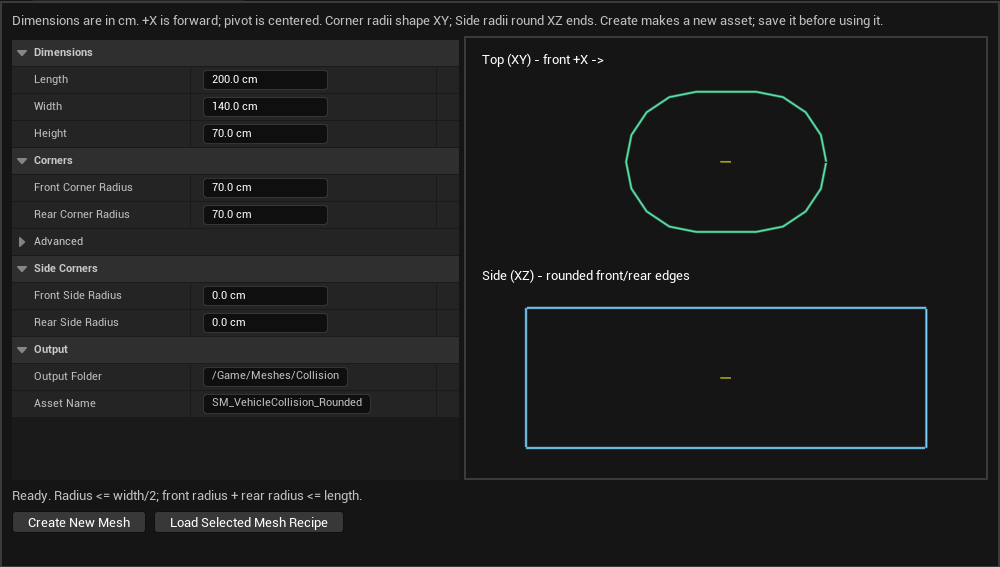

# 打包前车辆手感调整：重力、侧面圆角与墙体脱球

日期：2026-11-04。用户确认三项后授权施工，基点 `main/d85a24d4f93fa55033ff28c0508775e5ea66d89a`，UE5.8.3。

## 1. 车辆共享 Gravity Scale

入口：`Edit → Project Settings → Vehicle Stability → Shared Rules`，当前引用：

```text
/Game/Data/MVP_B/DA_Vehicle_Stability_Test_v1
```

打开这份 DA，在 **Gravity → Gravity Scale** 调整。默认 **1.0**，范围 **0.1～5.0**；建议第一次试 **1.5**，再按手感微调。团队保存资产并重新启动游戏世界后生效。

- 所有使用共用车辆规则的玩家车辆、其他车型和被动物理测试车共享倍率。
- 自由球及普通场景物体保留世界重力；持球仍受原物理约束牵引，重力变化后的带球手感需实测。
- 世界／关卡重力为基础。例如世界Z重力−980、倍率1.5，车辆有效Z重力为−1470cm/s²。
- 增加倍率会同时降低击飞最高高度和滞空时间，也会改变地面支撑力、落地冲量及斜坡手感。
- `Enable Gravity=false` 仍有效；不使用修改质量或线性阻尼代替重力。

实现使用 Chaos 原生 **Gravity Group 1**；Group 0 继续由世界和球使用。本项目保留Group 1给车辆，不应在其他对象上手动指定。求解器按原生路径积分重力，包含重模拟，不新增逐帧GA、GT力、额外Tick或Physics Action。

配置及有效世界重力加入既有每World不可变快照和复制签名。运行中修改源DA不改变当前World；两端配置不一致沿既有规则阻断车辆物理。此功能不支持比赛中动态更改世界重力；需要新世界重新初始化。

新旧冲击路径的翻滚速度均读取车辆有效重力，以`预计滞空时间≈2×目标向上速度/重力绝对值`估算角速度，并保留最大角速度上限。它是理想弹道估计，阻力、碰撞及角速度上限都会使实际翻转圈数不同；零重力或向上重力不作此估算。

## 2. 生成带侧面圆角的新碰撞体

打开 **Tools → HAL Tools → HAL Vehicle Collision Generator**。



| 参数 | 作用 |
|---|---|
| Length / Width / Height | 代理整体长宽高，单位cm，+X车头 |
| Front / Rear Corner Radius | 原有XY俯视圆角 |
| Front / Rear Side Radius | 新增XZ侧视前后端上、下边缘圆角 |
| Segments Per Corner | 两种圆角的多边形分段，建议先4，范围1～8 |

Side Radius默认0，完整保留旧挤出形状。范围0～Height/2，前后Side Radius之和不能超过Length。接近Height/2时，端部竖直平面高度缩小，降低车头／车尾着地后稳定竖立的机会。

建议先 **Load Selected Mesh Recipe** 读取旧代理，保持长宽，核对合理厚度，再将两端Side Radius试设为Height的0.4～0.5倍。此为团队初调建议，不是已经验收的固定参数。

调整后点击 **Create New Mesh**，保存新SM资产；打开新Static Mesh的简单碰撞显示核对形状，再按下节切换引用。侧视预览显示实际圆角；旧配方按Side Radius=0读入，新配方保留两项侧面半径。生成器继续创建独立的新Static Mesh、单个简单凸包，不覆盖旧资产，不修改任何Vehicle Definition或BP。侧面形状通过凸包构造，仍是有限平面近似，不能保证任何姿态下都不会竖立；手动自救保留。

## 3. 新碰撞体在哪里引用

实际物理碰撞体由 **Vehicle Definition** 引用，不在AnimBP或Presentation DA中。

1. 在Content Browser打开车辆BP，例如Car_01的 `BP_RoundedVehiclePawn`。
2. 选择 **Class Defaults → Vehicle → Configuration**，确认Configuration Source为`Definition`，查看当前 **Definition** 资产；使用旁边放大镜定位。
3. 打开该Definition，在 **Physics** 中设置：

   ```text
   Collision Shape = Convex Mesh
   Collision Mesh  = 新生成并保存的 SM_... 碰撞代理
   ```

4. 当前Car_01入口是 `/Game/Data/MVP_B/DA_Vehicle_Player_TestBaseline_v1`；Car_02入口是 `/Game/Data/MVP_B/DA_Vehicle_Car_02`。以BP当前实际引用为准，两款车需要分别核对。本轮只读确认两份Definition当前都指向`/Game/Meshes/Collision/SM_Car01_Collision`。生成新代理后分别切换需要调整的Definition，不覆盖原网格。
5. 保留 `Ready For Use` 和其他物理／驾驶配置，保存Definition。停止旧游戏，再启动新局检查。
6. 检查出生时不嵌地、物理根与可见模型对齐、车头方向、控球点、四轮视觉悬挂采样；厚度变化后按需调整相关偏移。

不要把代理填入 `Presentation → Skeletal Mesh`，也不需要为此修改模型Skeleton／Physics Asset／AnimBP。玩家车辆真正参与碰撞的是隐藏的 `VehiclePhysicsBody`，Definition会给它应用Collision Mesh。被动测试车仍使用Box路径，只有玩家凸包车型按上述方式切换。

## 4. 普通墙体独立脱球门槛

同一共享DA新增 **Wall Ball Drop**：

| 参数 | 默认／范围 | 含义 |
|---|---|---|
| Wall Drop Normal Delta Speed | 600cm/s；0～5000 | 普通墙体额外脱球门槛，测量法向冲量÷受撞车辆质量；不是车辆总速度 |
| Minimum Wall Slope Degrees | 60°；45～90° | 与世界上方向的坡度；用于区分墙面与普通地面／斜坡，顶面也不归为墙 |

设置更大阈值，普通撞墙更不容易通过受击路径掉球；0关闭这项额外限制，保留原有效档位门槛。无独立启用按钮。

普通墙体指非模拟、实际静止、WorldStatic、未挂HALImpactSource／车辆Receiver且不是球的来源。Mobility为Movable但实际静止的普通墙也可被识别。运动平台、模拟物体、车辆、球和特殊机关保留独立处理；普通地面／斜坡／天花板不使用这项墙门槛。

仍先检查冲击免疫／抗性、`Drop On Impact`及`Minimum Drop Tier`，再检查墙的额外门槛。新门槛仅决定是否释放持球，不缩放自然Chaos碰撞冲量，不改变冲击档位、规则追加速度、伤害或三档定义。球／弹簧拳等显式攻击不套用墙门槛。

如果墙Actor挂有`HALImpactSourceComponent`，它属于显式配置来源，按现有特殊来源处理；本步没有自动删除或覆盖该组件。

## 5. 区分撞击脱球与超距释放

主机控制台：

```text
hal.CombatLog 1
hal.BallControlLog 1
```

Combat日志增加 `WallDropSuppressed`、`WallDropThreshold`，结合`NaturalDV`、有效档位和来源分类检查。BallRelease日志记录`Reason`、当前控球点距离、最大允许距离和是否施加脱球冲量。

- `Reason=Impact`：通过冲击路径掉球。
- `Reason=DistanceExceeded`：球被墙挡住等情况导致球与控球点距离超限。
- Recovery／Stun／PhaseControlDisabled：对应已有独立释放规则。

测试结束设回0。墙门槛不关闭Max Controlled Distance保护，也不增加控球约束力；若墙边仍掉球，先查Reason再决定是否调整控球点、距离或跟随参数。

## 6. 验证与团队测试

代码、完整构建及程序验证完成，当前保存资产没有被修改。详见[本轮验证／保护清单](MVPB_Prepackage_Gameplay_Polish_Verification_20261104.json)。

| 验证 | 最终结果 |
|---|---|
| Editor／Game Win64 Development | 成功；最终增量24.78s／52.16s，保留既有引擎弃用警告 |
| 普通回归 | 132/132，0测试警告／失败，含真实Solver重力积分与独立墙门槛／抗性／原物理响应检查 |
| 碰撞生成器 | 5/5，0测试警告／失败，含对称／非对称／单侧圆角及1／4／8分段的凸性、闭合、无退化面、单凸包和旧配方 |
| 实际Slate面板／网格缩略图 | 2/2，0测试警告／失败；面板截图已查看，显示Side Radius=0的兼容默认值 |
| 1.5倍重力真实NetTest双端 | Host／Client各1/1，0测试警告／失败；客户端54次重模拟、配置签名一致；Host出站注入80ms，不等于实测RTT |
| 1.5倍重力真实房间／正式图两局 | Host／Client各1/1，0测试警告／失败；重新确认、新Epoch／身份／状态与最终回入口检查通过 |
| 资产保护 | 1183份Content保存资产SHA-256逐份相同；286份源码／配置／uproject留档，Config／uproject未改 |

网络测试用启动前选择的内存共享规则夹具（1.5倍、零回弹／Min材质），没有保存DA；房间两局组使用保存的Room／Match及车辆／PlayerState BP。132项包含纯规则与真实Solver，不把数学公式估算当作实际落地手感。新形状仅由程序几何／物理网格检查，团队正式代理尚未生成或切换。

首轮测试代码的API／头文件编译问题、重力探针缺少PreSimulate回调导致的断言，以及侧面凸包退化面两轮失败均保留。最终使用采样点去重、引擎凸包近共面简化与多边形面合并修复实际几何问题，原不退化／拓扑断言保持，未降低测试门槛。

团队在新世界中分别测试Gravity Scale=1／1.5、两种车型、带球／无球、不同冲击档、地面／斜坡／墙角／车头车尾着地、墙低于及高于脱球门槛、车辆对撞和球／机关攻击。检查Host与Client一致，重力变化后特别复查落地冲量和持球约束。

新代理由团队手工生成、保存、切换引用并验收；代理不能消除所有翻车后果。实际打包与四机验收仍在这些调整之后进行，GF-6及原F4／VP-4C／FX未执行项不据本轮提前标为通过。
