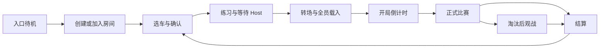

# Game Flow UI 定制开发交接说明 v1.0

日期：2026-11-06。依据当前 `main/328b78e` 的 C++ 接口，覆盖 GF-1～GF-7 及相机输入边界修复。面向制作 UMG／Widget Blueprint 的团队成员。

**交付目标：替换界面布局、素材、动画与显示文案，沿用现有创建房间、选车、开赛、观战和结算逻辑。** 本文没有创建或修改任何 Widget Blueprint、DA 或地图；下文 WBP 名称是建议名称，需要团队在 Editor 中创建并接线。

## 1. 先理解页面与代码的关系

玩家流程为：



练习／比赛中还可打开本地菜单；连接失败、主动离房或 Host 离开时回到入口。**本地菜单不暂停服务器比赛。**

目前只有 **三个顶层 Widget 配置槽**。选车、载入、比赛 HUD、观战与结算是 Room Widget 的不同显示状态，并不是各自独立的配置槽。可以将这些面板拆成子 Widget 交给不同成员制作，再由 Room Widget 组合。

GameInstance 在每台电脑上各有本地实例，由 C++ 为当前本地玩家管理界面。WBP 资产可共用，不需要每辆车复制一份，也不复制 Widget 到其他电脑。UI 只读 View、提交语义动作；服务器继续决定玩家名单、车型、比赛阶段与胜负。

## 2. 顶层 Widget 在哪里配置

打开 Content Browser 中现有资产：

`/Game/Blueprints/Network/BP_MVPB_NetworkGameInstance`

进入 **Class Defaults → Front End → Screens**：

| 配置项 | 必须继承的 C++ 父类 | 建议新建资产 | 使用范围 |
|---|---|---|---|
| **Entry Screen Class** | `HALArcadeEntryWidget` | `WBP_GF_Entry` | 待机、创建／加入、连接中及连接错误 |
| **Room Screen Class** | `HALPracticeRoomWidget` | `WBP_GF_Room` | 选车、练习 HUD、载入／倒计时、比赛 HUD、观战、结算与返房过渡 |
| **Pause Screen Class** | `HALPracticeRoomWidget` | `WBP_GF_Pause`，可选 | 已确认玩家在 Open／Playing 中打开本地菜单时的独立布局 |

Pause 可以继承自定义 Room WBP，也可以直接继承 `HALPracticeRoomWidget`，不强制两者互相继承。Pause 为空则继续用 Room；Room／Entry 为空则使用现有原生界面。

配置了有效 WBP 后，使用其 **Designer 整体布局**，不会再叠加原生选车布局。有效但 Designer 为空的 WBP 会显示空内容；它不会自动回退，务必先做好最小可用界面。

注意以下入口差别：

| 内容 | 配置位置／说明 |
|---|---|
| 当前项目使用哪个 GameInstance | Project Settings → Maps & Modes → Game Instance Class；现有工程配置为 `BP_MVPB_NetworkGameInstance` |
| 入口地图 | GI → Network Menu → Entry Map Path；现有流程使用 `/Game/Maps/MVPB_NetEntry` |
| Host 创建房间后进入哪里 | GI → Network Menu → Match Map Path；完整 GF 流程应进入 `/Game/Maps/MVPB_PracticeRoom`，不要因字段名 Match 就改成正式比赛图 |
| Host 开始后的正式比赛图 | 实际房间 GameMode 的 Room Config DA → Round Travel → Match Map；现有正式流程为 `MVPB_Match` |
| 品牌与原生主题 | GI → Front End → Front End Config，类型 `HALFrontEndConfig`，见第 7 节 |
| 人数、比赛时长与倒计时 | 实际 GameMode → Class Defaults → Room → Room Config，类型 `HALRoomConfig`；这些不是 UI 配置 |

以上地图字段只用于核对现有流程，UI 制作不要求改地图或房间规则。必要时从地图 **World Settings → GameMode Override** 打开实际使用的 GameMode，检查它引用的 Room Config。

旧的 `Menu Widget Class`、`Use Native Arcade Entry` 不再是新入口接线位置。`Match Lobby Widget Class` 与现有 `WBP_MVPB_NetMenu`／`WBP_MVPB_MatchLobby` 属于早期网络测试入口，不承担本交接中的新 Room View 接口。不要只把普通 UserWidget 或旧 NetMenu 填到上述三个槽里。

## 3. 每个界面的意义与显示依据

下表中的字段来自第 5 节的只读 View。`Phase` 是房间阶段，`LocalPhase` 是本人的选车／车辆准备阶段，二者不能混用。

| 界面 | 玩家在这里做什么 | 所属顶层 Widget／显示依据 | 主要内容与操作 |
|---|---|---|---|
| 街机待机页 | 看标题／宣传，开始操作 | Entry；`bAttract=true` | 开始按钮调用 `Open Connections` |
| 创建／加入页 | 创建 Listen 房间或输入 Host IPv4 | Entry；`bAttract=false` | 创建、地址输入、加入、返回；`Message` 显示错误原因 |
| 连接中／连接失败 | 等待结果、取消或重试 | Entry；`bConnecting` 与 `Message` | 连接中禁用重复请求，显示取消；失败后保留可重试入口，无独立 Error Screen 配置槽 |
| 房间与选车页 | 查看四席位、选择车型、确认进入练习 | Room；通常 `Phase=Open` 且 `LocalPhase=Selecting`；`PreparingAvatar` 显示车辆准备中 | 车型卡片、静态预览、确认、状态文字；按 `bCan…` 启用按钮 |
| 练习 HUD／等待 Host | 已确认者驾驶练习，等待开赛 | Room；`Phase=Open`、`LocalPhase=Ready`，驾驶时 `bMenuVisible=false` | 本人编号／颜色、房间人数、操作提示；练习不扣血；Host 在菜单中满足条件后开始 |
| 本地菜单 | 继续、练习时取消确认换车、Host 开始或离房 | Pause（已配置时）或 Room；`bMenuVisible=true` 且阶段允许 | 各按钮跟随能力字段；比赛继续计时，不做本地 Set Game Paused |
| 图内载入／等待玩家页 | 等所有参赛者完成实际载入 | Room；`Phase=Loading` | `LoadedPlayers / ExpectedPlayers`、`Status`；人数不是磁盘载入百分比 |
| 开局倒计时 | 同步准备开赛 | Room；`Phase=Countdown` | `CountdownRemaining`；UI 只显示，不自行宣布 Playing |
| 正式比赛 HUD | 查看剩余时间、存活状态和身份 | Room；`Phase=Playing`、非结算 | `MatchRemaining`、本人编号／颜色、`Match.Players` 的生命状态；本地菜单打开时仍可按设计保留部分 HUD |
| 淘汰提示／观战页 | 被淘汰后观看其他存活玩家 | Room；`bSpectating=true` | `SpectatedNumber`、上一辆／下一辆；**观战面板不能只放在 `bMenuVisible` 控制的面板下面** |
| 结算页 | 查看胜者、各玩家结果并等待统一返房 | Room；`bShowResults=true`／`Phase=Results` | `Match.Players`、`ResultSummary`、`ResultsRemaining`；Host 可在允许时提前返房，所有人可离房 |
| 返房／离场过渡 | 等待服务器返回准备房或入口 | Room 的 `Phase=Returning` 或 C++ 转场提示 | 收起旧阶段可操作按钮，显示状态；下一图由流程代码打开 |

**跨 World 的阻塞加载提示是例外：** 当前由 `HALNetworkPresentation.cpp` 生成原生 Slate 遮罩，不是 Room WBP，也没有 `Loading Screen Class`／`Results Screen Class`／`Spectator Screen Class`。Room WBP 可定制新 World 中的 Loading／Countdown 页面；不能靠普通 WBP 动画保证阻塞加载时持续播放。需要完整品牌化阻塞加载幕时，另交 C++ 任务扩展现有入口。

显示优先级建议：先处理房间不可用／元数据未就绪，再优先 Results、Loading／Countdown／Returning，其次 Open／Playing 中的真实菜单，最后驾驶／观战 HUD。结算开始时收起旧选车／观战操作。`bSpectating` 可能在 Results 仍为 true，应以 Results 面板为主要显示。

`Inactive`／`Unassigned` 用等待占位；兼容路径中的 `Locked` 可显示名单已锁定及 Status，不把 Locked 当作已经进入正式 Playing。

## 4. 在 Editor 中创建和接线

### 4.1 建立三个根界面

1. 从当前已编译的项目创建，例如 `/Game/UI/GameFlow/`。右键 **User Interface → Widget Blueprint**，在父类列表中选择第 2 节对应的 HAL 类；不要使用默认 `UserWidget` 作为顶层流程页面父类。
2. 在 **Class Settings → Parent Class** 再核对一次父类。需要脚本设置的文字、Image、Button、面板勾选 **Is Variable**。
3. 先做能操作的占位界面，再替换素材。Room 建议包含 `SelectionPanel`、`HUDPanel`、`LoadingPanel`、`SpectatorPanel`、`ResultsPanel`；可通过 WidgetSwitcher／Overlay 组合。
4. 入口添加 **Receive Entry View**，Room／Pause 添加 **Receive Room View**。可在 Overrides 或右键搜索对应 Event；Break 输入结构后调用自己的表现函数，例如 `RefreshVisuals(View)`。
5. Event Construct 可读取一次继承的 **Get Entry View／Get Room View** 初始化；之后由 Receive 事件更新。初期数据可能尚未复制到达，要显示等待占位。
6. 连接按钮 OnClicked 到第 6 节的继承函数。Button 的 Is Enabled 跟随 View 能力字段。切换可交互面板后调用 **Set Menu Focus Target**，指定当前页有效按钮。
7. Compile／Save 新 WBP。打开第 2 节的 GI，在三个 Screens 槽中指派 WBP，Compile／Save GI。先只配置 Entry，验证后配置 Room，最后按需增加 Pause。
8. 从 **MVPB_NetEntry** 新开会话验证。顶层页面由 C++ 创建、加入视口与销毁，团队不需要在 Level Blueprint 再 Create Widget／Add To Viewport。

WBP 的子面板／卡片可以继承普通 UserWidget，由父界面传显示数据、子控件通过本地事件通知父界面。比如车型卡片只回传 `VehicleId`，由 Room 根调用 `Select Vehicle By Id`。不用让每张卡片直接找 GameMode、创建车辆或请求网络旅行。

### 4.2 两段最小连接示例

入口加入按钮：

```text
JoinButton.OnClicked
  → AddressInput.GetText → ToString
  → 继承的 Join Room(HostIPv4)

Receive Entry View(View)
  → MessageText.SetText(View.Message)
  → Host／Join／地址输入：Enabled = !View.bConnecting
  → CancelButton：连接中显示
```

房间界面：

```text
Receive Room View(View)
  → 按 Phase／LocalPhase／bShowResults／bSpectating 更新面板
  → ConfirmButton.Enabled = View.bCanConfirm
  → StartButton.Enabled   = View.bCanStart
  → SelectedImage.SetBrushFromTexture(View.LoadedPreview)，为空时显示占位

ConfirmButton.OnClicked → Confirm Selection
StartButton.OnClicked   → Start Room Match
```

Receive 事件会在状态变化时重新推送；剩余时间变化也会触发更新。不要每次通知都重建卡片列表、重播进场动画或抢焦点。车型按 `VehicleId`、席位按 `Seat` 更新；动画按阶段／RoundId 的真正变化触发。蓝图不需要 Tick 查询所有玩家。

## 5. View 数据怎么用

蓝图显示名通常会将 `bCanStart` 显示为 `Can Start`；下面保留源码名方便核对。

### 5.1 Entry：FHALEntryView

| 字段 | 用途 |
|---|---|
| `bAttract` | 待机页／连接表单切换 |
| `bConnecting` | 请求进行中；禁用重复创建／加入，显示取消 |
| `Message` | 连接状态、非法地址、失败／断开原因 |
| `LastHostAddress` | 初始化地址输入框；不要每次 Receive 都覆盖玩家正在输入的文字 |

### 5.2 Room／Pause：FHALRoomView

| 字段组 | 用途 |
|---|---|
| `bRoomAvailable`、`bCatalogLoaded`、`Status` | 数据等待、占位与错误反馈 |
| `Phase`、`LocalPhase`、`bMenuVisible` | 页面状态与本地菜单显隐；不要根据 Physics Ready、眩晕或 HP 自建另一套输入切换 |
| `bHost`、`LocalNumber`、`LocalColor` | 本人身份与 Host 标识 |
| `bRequestPending` | 请求等待反馈；不能立即假设服务器已经接受操作 |
| `bCanSelect / bCanConfirm / bCanCancel / bCanStart` | 选车、确认、取消和Host开赛按钮的启用依据 |
| `bCanResume / bCanReturnToRoom / bCanLeave` | 继续、全员返房与本人离房按钮的启用依据 |
| `Vehicles` | 目录里的可用车型：VehicleId、DisplayName、Description、软引用 Icon／PreviewImage；不要按现有 BP 文件数量硬编码列表 |
| `SelectedVehicleId / SelectedVehicleName / Description / LoadedPreview` | 服务器认可的当前选车及异步加载的预览；LoadedPreview 为空时显示占位 |
| `Seats` | 固定四项，Seat 从 0 开始、Number 从 1 开始；含占用、本地／Host、玩家名、颜色、车型、阶段与已载入标记 |
| `MinimumPlayers` | 当前服务器配置给出的开局门槛；不在 UI 写死为四人 |
| `LoadedPlayers / ExpectedPlayers / CountdownRemaining / RoundId` | 正式开赛载入进度、共享倒计时、本局标识 |
| `MatchRemaining / ResultsRemaining` | 正式比赛及返房剩余秒数；由服务器截止时间派生，可 Ceil 后格式化显示 |
| `bSpectating / SpectatedNumber / bCanCycleSpectator` | 观战面板、当前目标与切换按钮；Number=0 表示场地兜底视角 |
| `bShowResults / ResultSummary / Match` | 结算页与完整比赛参与者数据 |

**菜单显隐只控制对应 MenuPanel，不要把整个根 WBP 隐藏。** Room 根还需要显示比赛 HUD／观战；自定义界面不会由 C++ 替你摆放这些内容。

### 5.3 Match.Players 与结算

每项为 `FHALRoundParticipant`：`PlayerKey`、`Number`、`PlayerName`、`Color`、`VehicleId`、`Life`、`HP`、`MaxHP`、`bWinner`。结果使用值快照，玩家离房后也能继续显示，不依赖旧 Pawn。

| 值 | 建议显示 |
|---|---|
| `Life=Alive` | 仍存活／完赛存活 |
| `Life=Eliminated` | 已淘汰 |
| `Life=Forfeited` | 已退出／弃权 |
| `bWinner=true` | 胜者；可能有多人，不能只取第一项 |
| `Match.Reason=LastSurvivor` | 最后存活获胜 |
| `TimeExpired` | 时间到，按剩余绝对 HP 判定，可能并列 |
| `NoSurvivors` | 无人生还／平局 |
| `Aborted` | 本局中止，不显示虚构冠军 |

Playing 中此列表由服务器更新；Results 后结果锁定。返准备房可能保留上一局结果数据，因此**不要仅看 Match 非空就再次显示结算**，应使用 `bShowResults`。返房后确认清除，重新选车确认后才能再开局。

## 6. 按钮绑定速查

以下都是继承函数，目标为当前根界面 Self；涉及房间／比赛规则的请求仍由服务器检查，焦点／观战切换等本地表现动作由本地代码处理。

| 界面／按钮 | 蓝图调用节点 | 数据／权限 |
|---|---|---|
| 入口开始 | `Open Connections` | 切到创建／加入表单 |
| 创建房间 | `Host Room` | 非 Connecting 时可点 |
| 加入房间 | `Join Room` | 传纯数字 IPv4 字符串；不附 `:7777`、地图或控制台命令 |
| 取消连接 | `Cancel Connection` | 连接进行中 |
| 车型上一项／下一项 | `Cycle Vehicle` | Direction = −1／1；`bCanSelect` |
| 指定车型卡片 | `Select Vehicle By Id` | 当前目录的 VehicleId；`bCanSelect` |
| 确认并练习 | `Confirm Selection` | `bCanConfirm` |
| 取消确认／重新选车 | `Cancel Selection` | `bCanCancel`；通常只在 Open，UI 不自行销毁旧车 |
| Host 开始比赛 | `Start Room Match` | `bCanStart`；其他玩家不显示为可操作 |
| 继续 | `Resume Driving` | `bCanResume`；观战时文案可写“继续观看”，不要假定一定有 Pawn |
| 离开房间 | `Leave Current Room` | `bCanLeave`；Client 比赛中退出为弃权，Host 离开则全员回入口 |
| 提前返准备房 | `Return To Room` | `bCanReturnToRoom`；结算时 Host 可提前返回，Playing 中开发中止也以能力字段为准 |
| 观战上一辆／下一辆 | `Cycle Spectator` | Direction = −1／1；`bCanCycleSpectator` |
| 通用返回键／返回按钮 | `Request Menu Back` | 使用现有返回语义；它不是直接离房或回入口 |
| 页面默认焦点 | `Set Menu Focus Target` | 传当前页面可见、启用且可聚焦的按钮／控件 |

`Host Room / Join Room` 返回 true 仅表示本地接受请求，**不代表已经成功进房**。等待 View／实际页面转换，不在 true 分支再自行打开地图或新建房间页。

`Return To Room` 与 `Leave Current Room` 意义不同：前者是 Host 请求全员返准备房，后者是本人离开／Host 结束房间。ResultsRemaining 到零时服务器会自动返房，WBP 不需要 Delay 后调用任何地图函数。

## 7. 文案、图片与规则分别在哪里改

| 内容 | 编辑位置 | 注意事项 |
|---|---|---|
| 自定义排版、字体、动画、按钮皮肤 | 新 WBP 的 Designer／表现图表 | 属于 UI 成员工作 |
| 原生回退的标题、副标题、Logo、Background、Accent | `HALFrontEndConfig` DA，引用到 GI 的 Front End Config | 可选创建，如 `DA_FrontEnd_Default`；自定义 WBP 不会自动套用这些素材 |
| 自定义 WBP 复用同一品牌 DA | 在 WBP 增加 `HALFrontEndConfig` 类型引用，指定同一资产，读其 BlueprintReadOnly 字段 | 当前 View 没有品牌字段，GI 的 GetFrontEndConfig 是 C++ 方法，不要求在蓝图寻找同名节点 |
| 车型名、介绍、Icon、PreviewImage | `/Game/Data/Gameflow/DA_VehicleCatalog_Default` → Vehicles；以实际 Room Config.Catalog 为准 | 选车卡片从 View.Vehicles 消费；可以多人同车型，不自行排他锁定 |
| 预览图 | 优先 PreviewImage，缺失时 Icon，均缺失用占位 | C++ 已异步提供当前选中车型的 LoadedPreview；卡片软引用如另行加载须处理迟到结果 |
| 展示四人／开发单人开赛 | 实际 Room Config → Rules → Profile：Exhibition／Development | UI 读取 MinimumPlayers；不是加一个“准备”按钮或改 PIE 人数解决 |
| 比赛时长、结果停留时间、开赛倒计时 | Room Config 的 Match Rules／Round Travel | 默认规则分别300秒／8秒／3秒，保存值可调整；UI 不决定截止时间 |

目前预览是静态图片，不自动生成 3D 展台车辆。`Vehicles` 也不提供完整技能／Buff 展示模型；若需动态 3D 预览、技能冷却列表或物品栏，应单独明确数据接口再扩展，不在 WBP 复制玩法规则。

配置自定义 Room 后，原生 `NativePaint` 不再绘制测试用车顶编号／血条。这不是资产丢失；需要正式血条时，由团队补对应表现。现有 Health 组件有只读 `Get Current HP / Get Max HP` 与 `On Health Changed`；绑定当前 Avatar 并在换车／销毁时解除。Match.Players 适合比赛名单／结果，不能不看阶段就当作练习车的实时健康来源。现有 Debug HUD 仍是独立调试界面，不等于生产比赛 HUD。

## 8. 焦点、输入和生命周期约定

- Button 保持 Is Focusable；使用 UMG 原生 Navigation 配置上下左右／Tab／手柄导航。自定义 Designer 中，C++ 不代替你生成完整焦点路径。
- IPv4 输入框的 On Text Committed 可在 Commit Method 为 On Enter 时调用 Join Room。加入按钮与文本 Enter 共用一个本地表现函数即可，避免重复请求。
- 切 WidgetSwitcher 页面后更新 Set Menu Focus Target。不要在每次倒计时通知中强行设置焦点，或持续将地址输入覆盖为 LastHostAddress。
- Esc／手柄B／Start 的返回语义由父类处理。自制二级面板可先在 On Preview Key Down 关闭自己并返回 Handled；未处理的键返回 Unhandled，继续父类逻辑。通用返回不等于退出整个房间。
- 练习／Playing 打开独立 Pause 时可能重建顶层实例；关闭后重新创建／切回 Room。选车结果、比赛状态不得只存在 WBP 内。观战时可能没有当前 Pawn，所有 Pawn／组件访问先判有效。
- 通过 Receive 事件驱动显示。UI 不调用 Set Input Mode、不清空 IMC、不根据 Movement Ready／Stun 切输入模式、不手动 ResetCamera。现有 C++ 已处理这条边界，重复实现会重新引入镜头缩近问题。
- 不自行移除顶层流程 Widget、调用 Open Level／ServerTravel、Spawn驾驶Pawn、写HP／Ready／Phase／胜者。可以创建／更新当前页面内部的纯表现子控件。
- 失焦／回焦、换车、跨图都会清理本地输入或替换绑定；不要保存旧 World 的 Pawn／Widget 引用到下一局。用 RoundId／阶段变化清理本局展示缓存。
- 以1280×720等设计尺寸做排版即可，使用锚点、DPI缩放与Safe Zone适配，Canvas不要求与所有玩家的实际分辨率逐像素一致。验收还需覆盖其他宽高比；不要为UI强行锁定团队游戏分辨率。

## 9. 建议分工与验收顺序

1. **入口负责人**：待机、创建／加入、连接中、取消和错误显示；先独立交付 WBP_GF_Entry。
2. **房间负责人**：Room 根／状态分发、车型卡片、四席位、练习 HUD；卡片／席位可拆给其他成员。
3. **比赛展示负责人**：Loading／Countdown、比赛 HUD、观战／淘汰提示、结果面板，作为 Room 子界面接入。
4. **菜单负责人（可合并）**：可选独立 Pause，处理继续、换车、Host 开始、返房／离房以及焦点。
5. 由一个整合者指派 GI 的三个 WBP 引用。WBP／DA／地图是二进制资产，避免多人同时改同一个根 WBP 或 GI；共享视觉部件优先各自独立资产后整合。

最低验收清单：

- [ ] 三槽全空仍可使用原生界面；逐个配置 Entry／Room／Pause 均能独立运行。
- [ ] 从 Entry 创建／加入；非法 IPv4、连接取消、失败后重试均显示原因，输入框和按钮焦点正常。
- [ ] 四席位、同车型、确认／取消确认、车型预览缺图／加载中，客户端显示跟随服务器最终结果。
- [ ] Development 一人可走完整流程，Exhibition 要求四人；未初始化／尚未确认者不会被UI提前当作就绪。
- [ ] 练习开关菜单、继续、Host 开始；Loading／Countdown 禁止绕过服务器屏障，正式Playing计时正确。
- [ ] 练习及Playing反复撞电墙、临时Recovery、失焦／回焦、鼠标／键盘／手柄切换，不自行切菜单或重置相机。
- [ ] 三人以上测试持续观战、目标退出／淘汰自动切换；两人淘汰一人可能直接结算，不误判观战失效。
- [ ] 结算含多胜者／平局／弃权；Client不能替Host提前返房；自动返房后重新确认再开局，旧结果不遮住选车页。
- [ ] Client在结算离房后可从同一进程重新加入Open房间；Host离开则其他人回入口并看到原因。
- [ ] 开始后加入被拒、房满被拒；超长名字、窄屏／窗口缩放、子面板返回、焦点与装饰层命中正常。
- [ ] 打包后新WBP、图片及软引用资源都可加载；独立进程／真实多机复验。

一机完整菜单验收要启动两个独立游戏进程，**两者都从Entry开始**：第一端点击创建，第二端输入127.0.0.1加入。多机改填Host的实际IPv4。PIE自动加入或直接打开旧NetTest可辅助局部测试，但不代替入口到结算的完整流程。新建WBP的手工接线与素材没有在本文编写时进行引擎实测。

## 10. 提交与后续查阅

UI 成员提交新 WBP／图片／字体及实际修改的 GI／品牌 DA／Catalog 等引用资产；不提交 Binaries、Intermediate、Saved 或引擎缓存。新增美术只应改显示元数据，不覆盖车型操控／物理调参。提交中说明本次覆盖的面板、按钮接口与实际测试阶段。

进一步细节：

- [原GF-5 Widget接口](GF5_Widget_Blueprint_Interfaces_CN_v0.1.md)：Designer替换、事件与焦点机制；其中GF-7之前“无结算”等历史范围不代表当前功能缺失。
- [GF-7实施与验收](GF7_Match_Loop_Implementation_CN_v0.1.md)：比赛、观战、结算和自动返房。
- [相机输入边界](../Presentation/MVPB_Camera_Input_Boundaries_CN_v0.1.md)：菜单／首次初始化与临时物理恢复的分工。
- 源码核对入口：`HALNetworkGameInstance.h/.cpp`（三个Screen槽／页面生命周期）、`HALFrontEndViewTypes.h`（View）、`HALArcadeEntryWidget.h`、`HALPracticeRoomWidget.h`（事件与动作）、`HALRoomWidgetInterface.cpp`（View组装）、`HALRoundMatchTypes.h`（结果快照）、`HALMenuWidgetBase.h/.cpp`（焦点／返回）。

本文件是基于当前源码的团队接线说明，不是新增UI功能的施工或验收记录。后续新增独立页面槽或View字段时应同步维护本文与项目状态入口。
