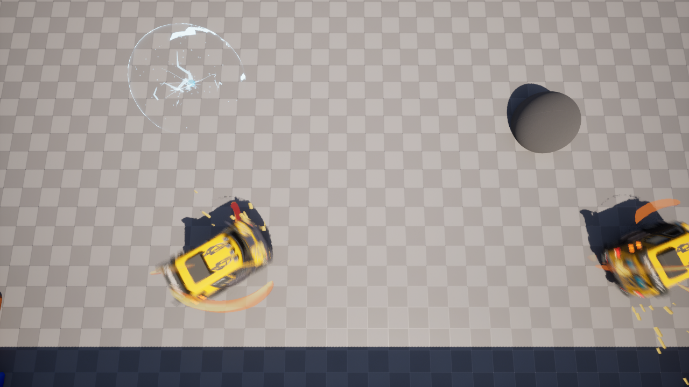
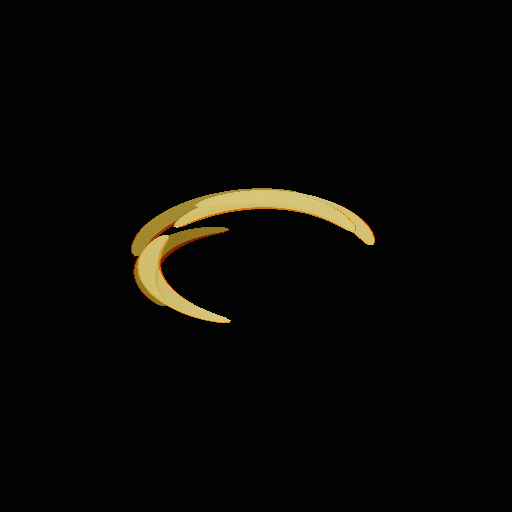
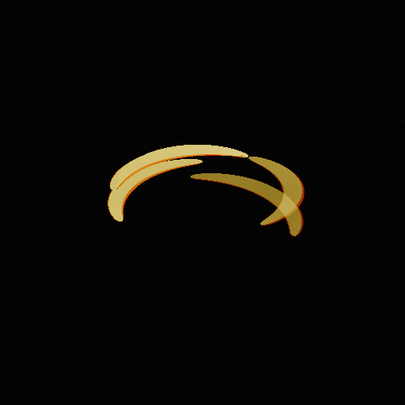
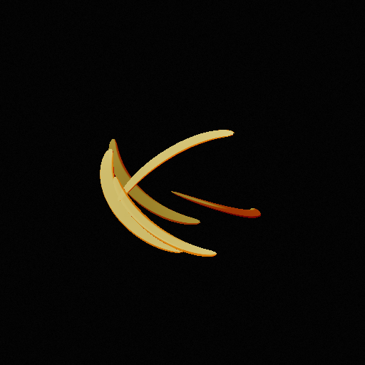

# Car03：柔和卡通火花与立体气流

**2026-11-14 最新：倾角改为实际角度，速度范围0～3600°/s、倾角范围0～80°；程序、保存资源、构建与专项完成，待团队目测。** 当前行为以[倾角真实值与调参范围](#倾角真实值与调参范围2026-11-14-修正)为准；早先“30°上限／仅保证不超上限”的描述是历史记录。

**2026-11-14 轴向修正：程序、气流资源、构建、16项专项及隔离双端专项完成，待团队实际画面验收。** 当前配置与制作约束以[气流方向与总倾角](#气流方向与总倾角2026-11-14-修正)为准；下方首版构建及验收记录保留原时点。

**状态：2026-11-14（日本时间）程序、保存资源、技能 DA 迁移与本机专项验证完成，待团队风格验收。** 从 `main/69a16d5` 接续，使用 UE5.8.3-58210709；本轮未提交／Push。

## 本轮范围

承接[上一轮接触飞溅与风格讨论](Car03_BattleTop_Polish_FX_CN_v0.1.md)，保持既定“夸张卡通、颜色与轮廓较柔和、圆润”的量产纲领。柔和卡通首版保留当时保存配方的 Contact Count=7、尺寸／寿命／速度／散射／视觉重力／阻力，只换造型和分色。后续团队将数量调至28；本次轴向修正继续保留团队保存值。Ground Sparks=None 也保留。

火花改为有弧度的圆头短笔触，少量圆点／小菱形作变化，使用概括的三档颜色和较低发光，去掉写实热白芯。气流使用 Niagara 曲面 Mesh 粒子：每条开放弧有真实横截面厚度、不同高度／倾角／起始朝向、独立寿命和上升运动，避免单个平面图案整体随车身自转。

这些是表现修改。技能许可、持续时间、碰撞分类、伤害、每目标 CD、推送、甩球、眩晕／自救及清理规则沿用原实现。车身 Spin Rate 与气流 Wind Flow Degrees Per Second 是两个独立参数。

## 资源与引用

五个新资源位于 `/Game/Assets/FX/BattleTop`：

| 资源 | 用途 |
|---|---|
| `NS_BattleTop_ToonWind` | 本地空间的持续气流 Mesh 粒子 |
| `SM_BattleTop_WindArc` | 110° 开放弧，平滑法线、有高度的椭圆横截面、无碰撞 |
| `M_BattleTop_ToonWind` | Unlit，按表面朝向切换暗／中／亮三档暖色，并控制粒子生灭 |
| `NS_BattleTop_ToonContact` | 复制原 ContactSpray 的运动配方，替换卡通材质 |
| `M_BattleTop_ToonContact` | 圆润笔触轮廓、概括分色与短暂出现／缩小 |

`DA_Ability_Car03_BattleTop → Presentation → FX` 使用：Wind=`NS_BattleTop_ToonWind`，Wind Material=`M_BattleTop_ToonWind`，Contact Sparks=`NS_BattleTop_ToonContact`。旧 `NS_BattleTop_Wind`、`M_BattleTop_Wind`、`NS_BattleTop_ContactSpray` 和旧火花均保留，可以手动切回。

代码通过现有表现组件创建独立 Niagara Component 和 MID，不需要增加 BP 图节点。车辆各自持有材质实例，技能 DA 仍是颜色和运行时参数的来源；直接修改母材质同名参数的默认值会被 DA 覆盖。

## 调参入口

重开 Editor 后，进入上述技能 DA，展开 **Presentation → FX**。不同 Editor 的嵌套分类可能平铺显示；可搜索字段英文名。

| 字段 | 新增默认值／保留值 | 调整效果 |
|---|---|---|
| Wind Flow Degrees Per Second | 默认240°/s，团队当前720°/s | 独立速度大小，0～3600；方向跟随技能主自转方向，历史负值按绝对值读取 |
| Wind Band Count | 默认5，团队当前6 | 稳态近似弧段数量，1～8；优先调少以保留车辆和球的可读性 |
| Wind Band Lifetime | 默认1.2 s，团队当前0.8 s | 每条弧的寿命；发射率自动按数量／寿命计算 |
| Wind Layer Height | 45 cm | 出生高度的错落范围；不是整体抬高 |
| Wind Tilt Degrees | 默认12°，团队当前30° | 弧带平面相对世界水平面的实际倾角，0～80°；随机起始方位不再削弱角度 |
| Wind Band Width Scale | 默认1，团队当前0.8 | 弧带径向厚度，0.35～2.5；不等于半径或整体尺寸 |
| Wind Rise Speed | 18 cm/s | 弧段生命周期中的局部向上运动 |
| Wind Glow Strength | 0.8 | 气流色彩亮度，0～3；建议先保持在 1 附近或以下 |
| Contact Glow Strength | 1 | 接触火花色彩亮度，0～3；无需靠高白光显示轮廓 |
| Main／Accent／Highlight Color | 保留团队暖色 | 主体中间色、暗部基色、亮部色；暗部会适度压暗 |
| Radius Scale | 保留 1.45 | 依据车辆真实外观 Bounds 调整气流覆盖范围 |
| Opacity | 保留 0.55 | 气流透明度，建议先试 0.55～0.8 |
| Contact Count | 团队当前28，本次不改 | 每次接触触发的粒子数量，与气流轴向无关 |
| Ground Sparks | 保留 None | 本轮没有重新开启底部火花 |

建议先调 Flow、Layer Height、Tilt、Width，最后调颜色和亮度。高度／倾角／数量／寿命属于新粒子出生配置；游戏运行时临时修改后，旧粒子需要过一轮寿命才全部更新，重新释放技能可获得一致对照。

## 制作约束

气流材质仍为 Unlit，但方向分色使用网格法线，能表达真实曲面朝向。它不依赖场景灯光，也不是贴图里的固定明暗渐变。弧带中心留空，出生／结束淡出，不使用完整封闭实心圆盘覆盖车辆。

气流使用外表面单面渲染，避免透明弧带的内外表面叠显产生条纹；接触 Sprite 仍为双面。制作新 Mesh 时要核对表面绕序、法线与第 0 个 Mesh 槽，不能在 Niagara 自动创建的空槽后再追加实际网格。

Niagara User 参数由 C++ 表现组件提供。继续制作资源时保留 `User.WindMaterial`、`User.SpawnRate`、`User.Lifetime`、`User.YawRate`、`User.ScaleMin/Max`、`User.PositionMin/Max`、`User.RotationMin/Max`、`User.Velocity`。接触系统保留原 BurstCount／VelocityMin/Max／SizeMin/Max／LifetimeMin/Max／Gravity／Drag／SparkColor，并使用新增 `User.StyleParameters.x` 传入 Contact Glow Strength。

材质的 `Envelope` 由原技能过渡控制，必须保留；`BandWidthScale` 的 WPO 依赖弧网格 VertexColor RG 编码，换网格时不能随意删除顶点色。方向分色遵循曲面法线，不需要真实阴影或光照。旧 `SpinAngle` 接口仍供旧风环使用，新气流不读取它。

可追踪配方为 Editor 模块 `HALBuildBattleTopCartoonFXCommandlet`。新资源创建入口使用 `-run=HAL_Future_CreationEditor.HALBuildBattleTopCartoonFX`，需要 `-AllowCommandletRendering`。同名资源已存在时拒绝覆盖，**正常使用无需重新运行**。显式 `-Apply -SkillAsset=...` 仅迁移三项资源引用，并逐字段确认其他保存配置一致；不编辑 Blueprint。维护用 `-RefreshCompiledData` 仅完整刷新两份新 Niagara 的编译数据，不重建造型或改变 DA。

复制 Niagara 后新增脚本参数／模块时，生成器调用 PostEditChange、强制完整编译并等待完成再保存。仅在 Editor 渲染测试中临时编译成功，不能证明独立 Game 加载的保存副本已就绪；本轮额外使用全新双进程验证了这一点。

## 验证与团队验收

本机 UE **5.8.3-58210709**：最终 **Editor R13／Game R4** 编译链接成功。最终统一专项 **Final_R3：16/16**，0 测试警告／失败／未运行／进行中，包含 BattleTop、技能授予、战斗结果和三项 D3D12 渲染。新资源检查了默认 Mesh 槽、真实横截面、持续粒子、宽度、层高、独立流速、忽略车身 SpinAngle、退出隐藏和七粒子自然消失；实际输出气流 10928 个暖色像素、接触笔触 1681 个，已查看图片。

最终 **Network_R6**：当前 NetTest 地图的 D3D12 双进程，Host 出站额外 80 ms；Host／Client 各 **1/1**，报告无测试警告／失败。使用客户端实际技能请求、拥有者／观察者参数复制、原 ObserveContact 入口的合成权威接触、真实 cosmetic multicast、数量7、技能到期归位／粒子清理与冷却。本轮没有通过改变物理碰撞／伤害资格使测试通过。合成接触不代替真人撞墙、持续擦碰及四人比赛验收。

早期 Render_R1～R3 发现空默认 Mesh 槽；单面绘制后修正绕序以匹配外表面法线。Network_R1～R4 发现复制的 Contact 系统在独立 Game 未就绪，完整编译刷新后修复；Network_R5 用临时隔离 RPC 诊断通过，最终 Network_R6 已移除该临时入口并恢复原 ObserveContact。失败记录保留在 Saved，不冒充通过。

保存资产／Config／uproject 共 **1277** 份开工基线，只有授权的技能 DA 改变，其余 **1276** 份逐份哈希一致。DA 在保存前经过全部反射字段比较，保存后重新加载数值核对：只改 Wind、Wind Material、Contact Sparks，Contact Count=7、Ground=None 和原尺寸／寿命／速度等保留。原有 368 份源码只有两份表现源码和三份相关测试发生改变；车辆移动、BattleTop 玩法组件、GA、碰撞规则、BP 和地图未被代理修改。

日志、原始报告、备份及基线位于 `Saved/BattleTop/Cartoon_20261113`（不入 Git）。便于跨设备核对的摘要见[本轮验证记录](Car03_BattleTop_Cartoon_Verification_20261113.json)。历史首版 UE5.8.2 的 16/16 不作为本轮证据。没有执行四机／发布包测试或全量历史套件。

下图是本轮实际地图、实际车辆的 D3D12 截图；是测试夹具的瞬间画面，最终配色／密度／遮挡仍由团队验收。

团队重点看：静止／驾驶中气流是否都有前后高低层次；不同方向撞墙时笔触是否清晰；自救／眩晕／到期／淘汰后是否按既定规则暂停或清理；低透明度和高透明度下是否遮住球／车辆中心。程序像素检查不替代最终风格与手感验收。

## 气流方向与总倾角（2026-11-14 修正）

本节为前一轮轴向约束时点的记录；其中旋转向量、0～30°及“总倾角上限”的算法已由后文独立实际倾角替代。

团队指出部分弧带似乎反向、甚至接近竖直。保存资源核对确认 Initial Mesh Orientation 使用的是默认 **Random**，在小幅 Rotation Vector 之外又叠加任意三维基准；原 Mesh Rotation Rate 还会绕这个倾斜基准的局部轴推进。真实粒子读回在旧资源中观察到最大150.695°倾角、单步最小-3.477°，不符合技能的竖直自转表现。

现在 Initial Mesh Orientation 明确设为 **None**，保留 Use Rotation Vector，Rotation Coordinate Space 设为 **Simulation**。只保留随机起始方位和受限小倾角；XY旋转向量各分配 `TiltLimit / sqrt(2)` 的范围，使合成总倾角也受同一个 DA 上限约束。默认上限12°，需要更平缓时可先试6～8°，0°会全部水平。高度错层仍由 Wind Layer Height 独立控制。

旋转改为 `绕Z轴旋转(粒子年龄 × 速度) × 出生姿态`，使用引擎原生四元数／乘法动态输入；旧 Mesh Rotation Rate 节点禁用。该组合严格绕统一竖直轴推进，不能交换四元数顺序。风组件跟随车辆中心，旋转使用绝对世界坐标，底盘转向／翻滚／自救不会额外把弧带转竖或改变其旋转方向。

Wind Flow Degrees Per Second 继续只调气流速度，方向取技能主 Spin Rate 的符号；当前技能为顺时针。旧负速度值兼容读取为大小，不能再单独配置反向。技能结束的归位角修正也不会短暂反转气流。这不修改车身自转数值、玩法碰撞、伤害或技能时序。

仅通过 Editor 原生 API 修改保存的 `NS_BattleTop_ToonWind`；不重新生成材质、Mesh 或其他 Niagara，不保存技能 DA／BP／地图。已有生成配方也采用同样约束，维护入口 `-ConstrainWindAxes` 可重复执行而不重复追加更新模块，正常使用无需运行。

本轮最终 Editor R7／Game R4 构建成功；`Final_R2` 的16项原生＋D3D12专项全部通过，0测试警告／失败。实际粒子验证覆盖1200次姿态、1179次连续推进：最大倾角9.078°，在12°上限内，最小顺时针步进4.000°，步进绕Z轴且不叠加俯仰／侧滚。下面是实际独立渲染结果，不是概念图。

`Network_R5` 的 Host／Client 各1/1、0测试警告／失败，验证旧负速度-315正确转为同向315、两端组件使用绝对世界旋转、拥有者／观察者气流、原 ObserveContact→multicast 的接触粒子、归位／到期清理及冷却。使用当前 NetTest 地图和Car03资产、显式原生 Match GameMode、640×360及进程级低渲染设置，Host额外80ms出站延迟。**这不替代团队当前房间 BP 的完整流程验收。** 早期R1/R2有启动帧率等待，R3/R4未完成视觉阶段而超时，均保留失败记录；在独立进程重载、再次完整编译保存气流后，R5使用相同原生测试入口通过。没有把超时记录计作通过，也未为测试修改房间／玩法规则。

开工1282份资产／Config／uproject只有 `NS_BattleTop_ToonWind` 改变，其余1281份逐份哈希一致，包括团队未提交的监听GameMode BP、技能DA和Contact Count=28。当前DA的气流速度720、倾角12、弧段数量4均原样保留。371份原有源码中仅两份表现源码、四份相关测试和Editor配方改变；没有修改GA、移动／伤害／碰撞代码，没有新增复制字段或Tick。

原始报告、修复前／中间失败对照和备份位于 `Saved/BattleTop/WindAxis_20261114`；跨设备摘要见[本轮验证记录](Car03_BattleTop_Wind_Axes_Verification_20261114.json)。首版的16/16与原房间BP双端记录保留各自时点，不代替此次复验。未做四机、发布包或真人手感／风格验收，未提交／Push。

## 倾角真实值与调参范围（2026-11-14 修正）

团队反馈720°/s及30°上限不够，且设30°仍接近平面。旧方案虽然保证不超角度上限，却把随机起始方位和小倾角编码进同一轴角旋转向量，随机的Z分量会改变旋转轴和总旋转量，造成倾角抵消。旧资源在请求30°时，真实粒子仅约0.555～24.282°，因此不能把“上限检查通过”当成“配置30°就达到了30°”。

现在出生姿态为 `绕Z随机起始方位 × 绕X配置倾角`，两个四元数独立计算；每条弧的倾斜方向随起始方位变化，倾角大小与DA值一致。持续阶段继续使用 `绕世界Z旋转(age × 同向速度) × 出生姿态`，保持既定旋转方向。旧 Initial Mesh Orientation 模块禁用，新增出生模块带有 `HAL BattleTop Independent Tilt v2` 标记；重复执行维护工具不会重复追加。`User.TiltDegrees` 是当前直接输入，旧 RotationMin/Max 仅保留兼容，不能再拿它们驱动当前ToonWind的姿态。

DA的UI范围与C++校验同步放宽为速度0～3600°/s、实际倾角0～80°，默认240°/s及12°不变。上限低于90°以保留不倒扣的弧带平面。技能自转速度、碰撞、伤害及其他玩法规则不变。当前保存DA的速度720、倾角30、弧段6、寿命0.8、宽度0.8、火花28全部保留，没有为展示效果代改数值。

重开Editor后停止Play，在原技能DA的 **Presentation → FX → Cartoon Wind** 调整并保存，再进入游戏释放技能。30°现在对应实际约30°；需要更夸张可先试45°与1200～1800°/s。Tilt控制倾斜，Layer Height仍独立控制出生高度错层。活跃技能持有本次发动的表现快照，修改DA后应重新发动／重新进游戏对照。

以下两张是同一测试场景中0°与30°的真实D3D12输出：

| 0°水平 | 30°倾斜 |
|---|---|
|  |  |

本轮 **Editor R2／Game R1** 完整构建成功；最终统一规则＋D3D12专项 **16/16**，0测试警告／失败。五档0／12／30／60／80°均实际达到配置值（测试容差0.1°），每档600次姿态、587次连续推进，共3000次姿态／2935次推进；1440及3600°/s分别对应每60Hz帧约24°、60°同向推进，未额外俯仰／侧滚。水平／30°实际轮廓差异也已验证并查看图片。修复前的失败对照保留，不计为通过。

高参数双端专项Host／Client各1/1、0测试警告／失败：验证旧负速度-1440转同向1440、45°参数在两端直接进入Niagara、世界旋转、接触粒子和到期清理。使用原生Match GameMode、当前NetTest地图及Car03资产、进程级低渲染设置和Host出站80ms；不代表房间BP完整流程、四机或发布包验收。

1282份开工资产／Config／uproject仅ToonWind改变，其余1281份逐份哈希一致；包括未提交BP及DA的全部团队调参。没有编辑BP／地图／技能DA，只有表现源码、相关测试、Editor生成／维护配方和当前气流资源更新。两次独立维护进程验证新增模块、重新加载和编译保存；完整家族资源生成入口没有重新执行。日志／备份位于 `Saved/BattleTop/WindTilt_20261114`，跨设备摘要见[本轮验证记录](Car03_BattleTop_Wind_Tuning_Verification_20261114.json)。未提交／Push，最终画面仍待团队验收。
