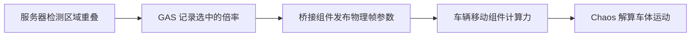
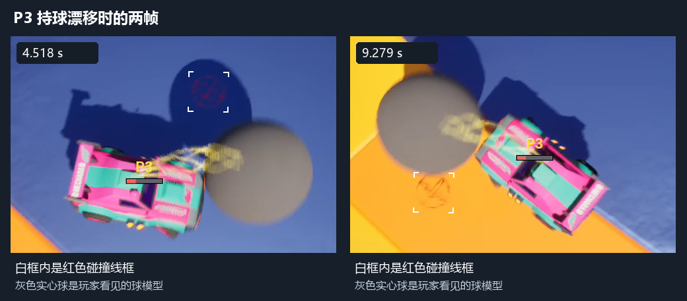
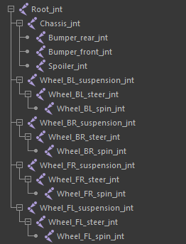
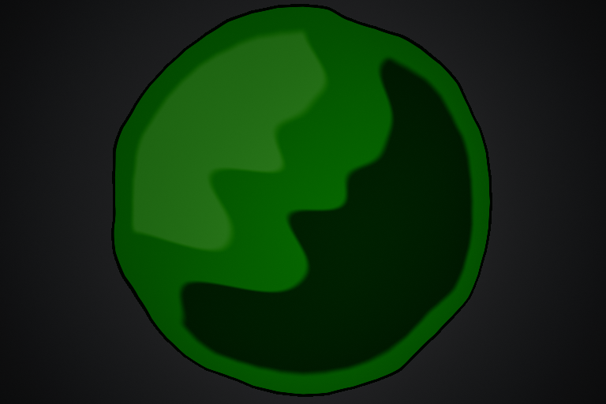
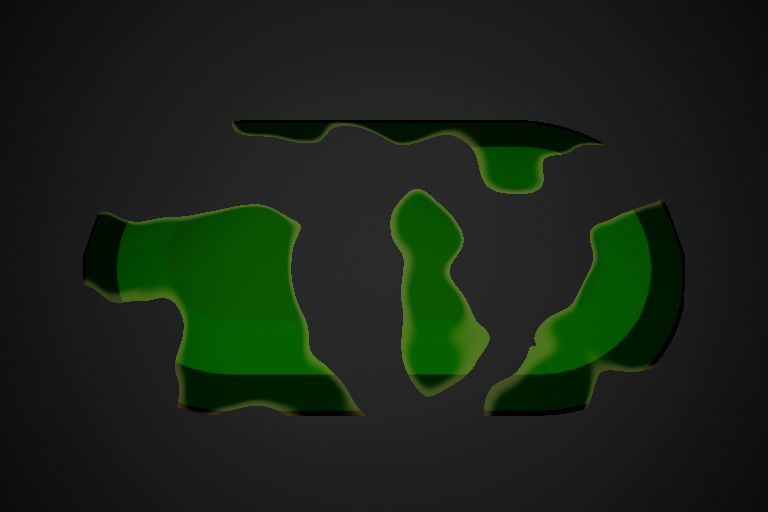

# 一辆车、一颗球、四个视角

**HAL Future Creation 项目技术演示 · 约 8 分钟**

## 开场 · 漂移中的车能往哪里发球？

先看拿球的车。入弯时，轮胎痕迹向侧面延伸，车头已经瞄向对手。玩家此时按下发射，球沿车头方向飞出，车辆受到反作用力。这就是我们把碰碰车和躲避球放在一起的原因。玩家可以用一次漂移同时完成走位和瞄准，对手也可以观察车头，预判这颗球会往哪里飞。

这是一场四人混战。争球、撞车和场地机关都可能改变下一次出手的机会。对开发团队来说，同一次发射要经得起四个视角的检验。拿球的人要能瞄准，对手要看得懂来球，四台机器最终还要对命中和胜负达成一致。

## 1. GAS 怎样让一辆车减速，但仍能从零起步

团队测试减速区时，想要的手感很具体。车开进去要慢下来，主动停住以后，踩油门还得能走。我们把**速度上限倍率设为 0.3，加速度倍率保留 1.0**，这两种行为就可以同时成立。要是同一块地面还覆盖了打滑区，侧向抓地力会独立下降，玩家低速转弯时仍可能向外滑。 [区域配置与实车初测](../Combat/MVPB_Movement_Areas_Implementation_CN_v0.1.md)

虚幻引擎的 Gameplay Ability System（GAS）在这里承担规则层的工作。玩家状态（`PlayerState`）持有能力系统，当前驾驶的车执行动作。服务器按来源登记车体进入的区域，对加速度、限速和抓地力分别选择限制最强的值，并用 Gameplay Effect 记录结果。桥接组件把倍率和恢复时间写入物理帧数据。移动组件据此计算车辆受力，交给引擎的刚体物理系统 Chaos 解算。如果车先驶出打滑区、仍在减速区，抓地力会逐步恢复，限速仍为 30%。客户端需要重算过去的运动时，也能取回当时的倍率。 [规则到物理的数据流](../../Source/HAL_Future_Creation/HALMovementEffectBridge.cpp)

主动技能也能用这套分工。Car07 的换线每成功发动一次消耗 25 点能量，满槽为 100 点。技能层检查能量、左右输入和车辆状态，移动组件执行横移与强化漂移的弧线。于是同一次换线既有明确的使用成本，也会受到场地墙体的实际阻挡。 [技能能量规则](../Combat/Vehicle_Ultimate_Energy_CN.md) · [Car07 弧线与墙面验证](../Combat/Car07_Extreme_LaneChange_CN_v0.1.md)

*演示时让车在减速区内主动停稳，再从零起步。这个动作比单看速度表更容易讲清「加速度」和「速度上限」的区别。*

## 2. Listen Server 怎样让四个人认同同一次命中

四人比赛中，一位玩家的机器同时运行自己的游戏和权威服务器，这就是 Listen Server。同学在局域网内开房，其余三人加入，向主机提交驾驶输入和技能请求。以一颗球为例，服务器记录它当前可被争夺（`Free`）、由哪辆车持有（`Controlled`），或已经由谁发射（`Launched`）。球命中时，服务器根据发射者记录确定攻击归属，结算伤害并同步 HP。最后一辆车存活，或时间耗尽需要比较剩余 HP 时，主机生成同一份结果发给所有玩家。房主被淘汰后可以继续观战和主持比赛，房主关闭游戏则结束这场联机。 [比赛与结算流程](../Networking/GF7_Match_Loop_Implementation_CN_v0.1.md)

**四人测试暴露了一个仅凭主机画面很难发现的问题。** 客户端持球连续漂移时，球有时会在车头抖一下。录像里能看到灰色球模型与红色碰撞线框分开。本机复现时，日志给出了原因。持球位置的网络更新被推迟，客户端把暂时缺少样本当成应该切回球的物理位置。下一个样本到达，它又开始随车显示。急转弯放大了这两处位置在屏幕上的距离。

*修复前的客户端录像。白框标出红色碰撞线框，灰色实心球是玩家看到的模型。*

修复分在两端做。主机提高持有球的发送优先级。客户端则保留**同一辆车、同一次持球**最后可信的相对位置。遇到短时断样，车继续转，球也跟着当前画面里的车转。新样本到达后，在车身坐标内平滑接回。一旦收到发射、脱球或换持有者，旧跟随立即结束，服务器仍按球的真实状态判定命中。 [持球显示实现与验证](../Networking/MVPB_ControlledBall_RelativePresentation_CN_v0.1.md#held-ball-drift-fix)

| 2026 年 11 月 18 日本机专项 | 球仍被持有时，客户端误切显示位置的次数 |
|---|---|
| 修复前 · 一主一客，重复三轮 | 各轮为 3、2、3 次 |
| 修复后 · 一主一客，重复三轮 | 各轮均为 0 次 |
| 修复后 · 一主三客，两人驾驶、两人观察 | 三个客户端各为 0 次，发射后两球均切回独立物理显示 |

三组都使用独立的无画面游戏进程，并给**主机出站**流量注入 80 ms 延迟。表中衡量的是持球期间显示模式是否误切。校园四台实机上的视觉流畅度仍需用同场录像验收。 [复现条件与逐轮记录](../Networking/MVPB_ControlledBall_RelativePresentation_CN_v0.1.md#held-ball-drift-fix)

## 3. 动画蓝图怎样把车的重量做出来

把一脚急刹慢放。车辆还有向前的速度，车头已经开始下压，车轮仍在滚。随后打方向，前轮先转向，车身随横向加速度侧倾。这些随驾驶动作产生的反馈就是车辆的**二级动画**。同一个刹车动作，从高速和低速进入时，会因为实际运动不同而有不同的幅度。

C++ 表现组件读取车体的线速度、角速度和转向输入，计算出一帧车身与四个车轮的姿态。例如每个轮子都用自己所在位置沿滚动方向的速度和轮径计算转角，弯道内外轮便可以转得不一样。动画蓝图（ABP）读取这一帧，用 `Transform (Modify) Bone` 把俯仰和侧倾叠到 `Chassis_jnt`，把转向和滚动分别交给轮骨。车辆的碰撞体和击球方向继续由物理车体决定，美术可以单独调大点头或回弹的幅度。 [姿态计算](../../Source/HAL_Future_Creation/HALVehiclePresentationComponent.cpp) · [骨骼接线与车型配置](MVPB_Vehicle_Model_Import_And_AnimBP_Setup_CN_v0.1.md)

*同一根骨下，车身和四个车轮分支并列。车身可以向前点头，车轮仍能沿各自的轴转动。*

这套骨架也承接路面和撞击。启用视觉悬挂的车型会从四个轮位分别探测地面，把结果转成轮骨的压缩或伸长。车辆受到有效冲击时，表现组件又能按冲击方向给车身叠一次短促回弹。用急刹接侧撞的片段，观众能分辨哪一下来自驾驶、哪一下来自对手。 [四轮视觉悬挂](MVPB_Vehicle_Presentation_VP3_Implementation_CN_v0.1.md) · [受击回弹](MVPB_Vehicle_Presentation_VP4B_Implementation_CN_v0.1.md)

## 4. 动态相机怎样兼顾自己的车和前方的球

持球者绕到对手侧面准备出手时，需要同时看见自己的朝向和下一段球路。每位玩家的本地相机都以自己的车为基准，计算唯一标记的主球和其他车辆各有多重要。目标越远，权重逐渐降低。相机用这些权重调整焦点和拍摄距离，所以附近的争球可以拉动构图，场地另一端的一辆车只会产生有限影响。FOV 和基础距离可在共用的相机数据资产中调节。 [动态取景与参数](MVPB_Dynamic_Camera_Implementation_CN_v0.1.md)

玩家也可以推右摇杆或移动鼠标向前看。本地相机先把这次手动偏移叠在自动构图上，再检查本车中心是否仍处于画面的安全框内。达到边界后继续往外推，镜头会停住。松开后，偏移经过短暂延时逐渐回中。**用两位玩家的画面并排演示**，让其中一人拖动视角，另一人继续开车，就能直观看到同一场比赛里两个镜头各自作决定。 [相机求解与双端验证](MVPB_Dynamic_Camera_Implementation_CN_v0.1.md)

## 5. 一条油膜怎样同时成为赛道机关和卡通特效

释放打滑带后，先让施放车开一个 S 弯。服务器沿车尾实际经过的地面记录一串采样点、落点时刻和地面法线。每段落地后留在原处，越早铺下的部分向两边扩得越宽，因此直行会留下近似梯形的油膜，转弯则会保留玩家刚刚走出的弧线。另一辆车高速横穿时，服务器会检查它在前后两次采样之间扫过的路径。命中区域后抓地力下降，车身开始左右打滑，玩家仍可给油、刹车和修正方向。 [打滑带的铺设与判定](../Combat/Vehicle_Slippery_Trail_Ability_CN_v0.1.md)

各端用同一条轨迹和服务器时间生成地面网格。材质把中央顶点抬高，让边缘贴地，再按隆起表面朝向虚拟光源的角度分出暗、中、亮三档。中间色包住高光，暗绿色沿边缘收住轮廓，俯视时也能看出哪里鼓了起来。技能到期时，服务器撤掉该区域的摆动，抓地力按配置恢复。表现端接着让油膜内部出现缺口，缺口扩大、相连，地板逐块露出来。美术可以调整这段消散的时长，玩法截止时间由技能单独控制。 [表面三档着色](Slippery_Trail_Three_Tone_CN_v0.1.md) · [分块消散](Slippery_Trail_Dissolve_CN_v0.1.md)

| 暗、中、亮三档与边缘过渡 | 消散进度 50% 时的缺口 |
|---|---|
|  |  |

*两张图分别取自着色和消散的独立材质测试。演示技能覆盖范围时，用 S 弯实机画面最直观。*

## 收尾 · 用一次带球出手串起整场演示

最后把主机和客户端的画面并排。左边的玩家拿球，漂移绕到对手侧面。出手前暂停，请观众替右边的防守者选一条躲避路线。轮胎痕迹告诉他车从哪里来，车头告诉他球会往哪里去。

继续播放到命中。左边的车向后回弹，球离开车头。右边的车受到冲击，血条随服务器结算下降。把画面停在这里，观众就能回看自己刚才选的方向，判断那次提前变线能否躲过这颗球。
