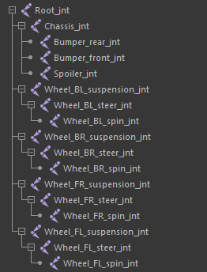
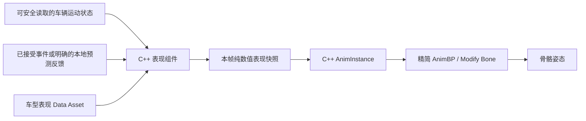

# MVP-B 车辆模型与基础 Rig 表现方案（v0.1）

日期：2026-10-19（Asia/Tokyo）。核对基点：`main / ca90ffb9b85c1fef20bdde81fa562ace8882b170`，工作区起始干净；本机引擎为 `UE 5.8.3-58210709+++UE5+Release-5.8`。

**2026-10-23最新：团队确认VP-3配置完成、暂未发现表现问题，基础接线与画面初测通过。** 当前`main/093e758`已提交Car_01的ABP／表现DA，详见[反馈与资产记录](MVPB_Vehicle_Presentation_VP3_Implementation_CN_v0.1.md#7-团队接线与画面初测反馈2026-10-23)。下一入口为VP-4方案确认，建议分三小步，见11.2节；本次仅文档，无新源码／资产修改或编译／测试。完整画面组合／扰动／四机不由此次一般反馈推定通过。

**2026-10-22 VP-3代码及原生验证完成**：从干净`main/faf5d06`接续，在既有表现链路增加四轮参考探测、世界cm行程／平滑和自动Bone Space平移，默认关闭，不改物理规则或保存资产。UE5.8.2 Editor／Game成功、普通67/67、实际双端各1/1，667资产全同。团队接线／正常地图画面仍待验收，详见[VP-3实现、参数与手工节点步骤](MVPB_Vehicle_Presentation_VP3_Implementation_CN_v0.1.md)。以下旧“VP-3未施工”保留原时点；当前以本段和项目状态为准。VP-4、物理悬挂／自然落地辅助与F4保持后续范围。

**2026-10-22接续：用户确认VP-2俯仰真人初测成功、参数以后调整。** 当前各通道配置上限30°，代码／构建／原生验证及初测记录见[VP-2文档第7～8节](MVPB_Vehicle_Presentation_VP2_Implementation_CN_v0.1.md)。下一开发入口可进入VP-3视觉悬挂方案／准备，尚未施工；其他画面／双端细项继续跟踪，不把俯仰初测扩写为全部验收。以下保留原方案和历史过程。

**2026-10-21最新：自救真人基本功能验收已由用户确认，表现以后优化；VP-2代码／构建／原生验证完成，待团队DA／AnimBP接线及画面。** 本轮Editor／Game、普通60/60、最终实际双端各1/1通过，364资产未改；具体参数、节点与证据见[VP-2实施／配置](MVPB_Vehicle_Presentation_VP2_Implementation_CN_v0.1.md)。以下总体方案及过程记录保留历史，VP-3／4与自然物理辅助仍未施工。

**原始方案状态：总体技术方向已获用户认可，本文件用于方案留档、团队分工和后续实施讨论。** 随后用户已授权代码侧准备与接口施工，实际实现与验证见[实施记录](MVPB_Vehicle_Presentation_VP1_Implementation_CN_v0.1.md)，团队导入接线见[操作流程](MVPB_Vehicle_Model_Import_And_AnimBP_Setup_CN_v0.1.md)。**2026-10-21用户确认VP-1结束，素材及ABP／DA／玩家引用已提交，下一入口VP-2具体方案／施工准备。** 以下正文保留完整设计范围与历史待核对表，部分结构／数值为建议，不能据此认为VP-2～4已实现；证据边界及旧回退测试待适配见实施记录第8节。

同日流程调整：用户新增倒扣驾驶与持续弹跳反馈，选择低速、持续侧翻后长按自救；现于VP-2之前插入[车辆物理修正与自救计划](../Movement/MVPB_Vehicle_Stability_And_SelfRighting_Plan_CN_v0.1.md)。VP-1保持结束，先诊断／修正接触反弹，再完成姿态操控限制与自救，随后继续VP-2。自然落地辅助、紧急自救和骨骼表现分开；本次只有计划，无新实现。

同日后续诊断已完成，见[物理基线与Solver对照](../Movement/MVPB_Vehicle_Stability_Diagnostic_CN_v0.1.md)；旧无Rig夹具已修复、普通50/50通过。此为诊断时点记录：随后支撑分类已修正并获“弹动有效减少”反馈，姿态门控／自救和Local Config输入链路已完成、纳入`eae910e`，实际真人自救验收仍待反馈，详见[实现记录](../Movement/MVPB_Vehicle_Pose_And_SelfRighting_CN_v0.1.md)。下一开发回到VP-2；下方旧计划中的物理待办不能替代最新项目状态。

先读根目录 [AGENTS.md](../../AGENTS.md) 和 [项目状态](../Project_Status_CN.md)。本方案承接 [MVP-A→MVP-B 交接第 5.4／6 节](../MVP_A_to_MVP_B_Handoff_CN_v1.0.md)中的模型、基础 Rig 与后续物理辅助路线，不新增“阶段 11 已启动”等进度结论。

## 1. 团队同步摘要

采用以下组合：

> **C++ 表现计算 + 精简 AnimBP + Transform (Modify) Bone。**

| 项目 | 结论与边界 |
|---|---|
| 核心方法 | C++ 计算转向、轮转、悬挂偏移、车身倾斜和回弹；AnimGraph 只输出骨骼姿态 |
| 骨骼结构 | 当前截图层级适合该方案；尚未核验实际导入资产的局部轴、轴心、蒙皮与参考姿态 |
| 首轮目标 | 模型接入、前轮转向、四轮滚动、车身俯仰／侧倾 |
| 后续表现 | 在基础链路稳定后接视觉悬挂、受击／发射回弹 |
| 物理边界 | 当前 Chaos 刚体继续负责碰撞与运动；动画骨骼不承担权威移动、命中或控球 |
| 参数配置 | 表现 Data Asset 管参数与骨骼映射校验；普通 Modify Bone 节点仍在 AnimBP 中选择目标骨骼 |
| 蓝图编辑 | 团队在 Unreal Editor 手动创建、配置和验证资产；代码代理提供 C++ 支持与操作说明 |
| 并行工作 | 弹簧拳战斗／联机由另一成员负责，接口对接见 [机关交接](../Combat/MVPB_SpringPunch_Combat_Handoff_CN_v0.1.md) |
| 验收排期 | 每小步保留相关编译／自动化／基本双端检查；10-F-4 完整集成／扰动／四机仍在 MVP-B 收尾统一执行 |

以下章节中的类名、字段名、分步编号和调参起点均为实施建议。除明确标注“已有”的内容外，不应据此认为工程已存在对应接口或团队已确认全部数值。

## 2. 目标、范围与后续关系

### 2.1 本模块要达到的效果

1. 玩家能从轮转、转向和车身姿态读懂车辆的实际运动。
2. 加速、刹车、转弯、漂移、受击和发射有适量表现，仍能看清车头方向、球轨迹与物理姿态。
3. 同一套 C++ 表现逻辑服务本地车辆与远端车辆；不同车型通过资产配置调节。
4. 保留现有驾驶、球、伤害、冲击、GAS 和网络物理规则，表现开关不改变权威结果。
5. 未来四点物理悬挂可输出轮点状态，替换前期视觉探测的数据来源，继续复用骨骼输出。

### 2.2 当前范围

- 一套已提供层级的四轮车辆骨骼模型。
- 一个轻量原生表现组件和一个原生 AnimInstance 基类，职责分别见第 5 节。
- 一个精简 AnimBP、一个车型表现配置，以及必要的 Skeletal Mesh 接入。
- 四轮分开的轴向、滚动符号、半径与悬挂行程配置。
- 有界、可关闭的倾斜、回弹及开发诊断。
- 针对当前 Listen Server 架构的连续表现取数与离散事件去重。

### 2.3 不在本方案中一并施工的内容

- 四点物理悬挂、空中 PD／落地辅助及紧急翻身的具体力学实现；它们另行设计和验证。
- 动态摄像机距离策略、正式 HUD、最终美术与完整视听包装。
- 完整轮胎抓地／打滑模拟、Ackermann 转向、独立驱动轮动力学和轮胎碰撞刚体。
- 任意骨骼重映射的通用动画框架、自定义多骨骼动画节点、Control Rig 或 Chaos Vehicles 迁移。
- 弹簧拳机关自身的命中、伤害、冲击、动作时序与复制。
- 新技能槽、伤害公式变更、完整比赛淘汰／观战／结算。

四点悬挂和落地辅助仍属于已有 MVP-B 后续路线，本文只约定表现接口；不因出现悬挂骨骼就将物理功能标记为实现。基础表现之后，再推进物理辅助、动态摄像机和最终统一验收。

## 3. 当前工程事实与需要补充的内容

本节描述`ca90ffb`施工前基点。随后VP-1新增的实际接口／字段与验证以[实施记录](MVPB_Vehicle_Presentation_VP1_Implementation_CN_v0.1.md)为准，不把本节旧的“需要补充”读成当前仍无实现。

| 当前代码／配置 | 已有事实 | 本方案需要补充 |
|---|---|---|
| [TestVehiclePawn](../../Source/HAL_Future_Creation/TestVehiclePawn.cpp) | `VehiclePhysicsBody` 为 Chaos 物理根；`VisualMesh` 为无碰撞、不模拟物理的 Static Mesh；球控制点和摄像机有独立组件 | 增加可选 Skeletal Mesh 表现路径及原生表现组件，保留现有组件与旧配置兼容 |
| [VehicleDefinition](../../Source/HAL_Future_Creation/VehicleDefinition.h) | `FVehicleVisualConfig` 当前引用 `UStaticMesh`；车辆、被动车和球使用现有视觉配置 | 为驾驶车辆增加可选骨骼表现配置引用，不将球和被动车强制迁移成骨骼模型 |
| [配置应用](../../Source/HAL_Future_Creation/VehicleConfigurationApplication.cpp) | `ApplyVisual` 面向 `UStaticMeshComponent` | 增加车辆所需的窄接入入口，不破坏原有 ApplyVisual 的调用和行为 |
| [ArcadeVehicleMovementComponent](../../Source/HAL_Future_Creation/ArcadeVehicleMovementComponent.h) | 基础驾驶／漂移、接地探测、回滚物理等已有；悬挂和落地辅助尚未实现 | 如需新的跨线程运动读数，提供安全快照；不让表现组件直接读取物理线程可变成员 |
| [VehicleNetPhysicsData](../../Source/HAL_Future_Creation/VehicleNetPhysicsData.h) | 输入／回滚状态和动作支持已有 | 先核对哪些数据各网络角色实际可用；不为视觉轮转默认扩展物理历史协议 |
| [ImpactReceiver](../../Source/HAL_Future_Creation/HALImpactReceiverComponent.h) | 有复制的 `LastImpact` 摘要，但并非完整、逐次保证送达的表现事件队列 | 受击回弹需要独立核定通知入口、事件身份与远端送达策略 |
| [TestVehiclePawn 发射流程](../../Source/HAL_Future_Creation/TestVehiclePawn.cpp) | 有发射序号、服务器接受结果和拥有者预测后坐 | 将表现回弹接到合适的接受／预测反馈点；现有拥有者结果 RPC 不等于全部观察者都收到演出事件 |
| [HealthComponent](../../Source/HAL_Future_Creation/VehicleHealthComponent.cpp) | HP 通知是数值更新通知，可能发生同值通知 | 不能用通知次数推导受击次数或启动多次回弹 |

基点代码没有本方案所述的 Skeletal Mesh／AnimInstance／车轮骨骼表现链路。既有 45 项自动化和加速双端日志属于历史底座证据，不能作为本模块已通过的证据。

## 4. 骨骼与素材规范

### 4.1 已提供的层级

以下为用户提供截图的原样归档。它证明已讨论的骨骼名称与父子关系，不证明导入朝向、骨骼局部轴、权重、网格尺寸或运行表现。



```text
Root_jnt
├─ Chassis_jnt
│  ├─ Bumper_rear_jnt
│  ├─ Bumper_front_jnt
│  └─ Spoiler_jnt
├─ Wheel_BL_suspension_jnt
│  └─ Wheel_BL_steer_jnt
│     └─ Wheel_BL_spin_jnt
├─ Wheel_BR_suspension_jnt
│  └─ Wheel_BR_steer_jnt
│     └─ Wheel_BR_spin_jnt
├─ Wheel_FR_suspension_jnt
│  └─ Wheel_FR_steer_jnt
│     └─ Wheel_FR_spin_jnt
└─ Wheel_FL_suspension_jnt
   └─ Wheel_FL_steer_jnt
      └─ Wheel_FL_spin_jnt
```

业务轮位统一为 `FL / FR / BL / BR`。截图树的遍历顺序为 `BL / BR / FR / FL`，不能据此直接填写运行时数组索引；配置必须显式指定轮位。

### 4.2 骨骼分工

| 骨骼 | 驱动内容 | 首轮建议 |
|---|---|---|
| `Root_jnt` | 模型参考基准 | 不添加驾驶动画偏移，不用 Root Motion 驱动物理车 |
| `Chassis_jnt` | 局部 Pitch／Roll；后续轻微升沉与回弹 | 驾驶俯仰／侧倾先启用，幅度受限 |
| 四个 `suspension_jnt` | 沿各轮悬挂轴的平移 | 基础轮转阶段保持中立，VP-3 再接视觉探测 |
| `FL/FR_steer_jnt` | 前轮转向 | 左右同目标角起步，符号由实际骨骼决定 |
| `BL/BR_steer_jnt` | 后轮转向扩展点 | 建议为 0，不因有骨骼就加入四轮转向玩法 |
| 四个 `spin_jnt` | 沿轮轴的滚动角 | 分轮半径、轴向和符号，支持前进／倒车 |
| 保险杠／尾翼 | 跟随车身 | 暂无独立变形或摆动算法 |

车轮与 Chassis 并列，意味着额外车身倾斜不会自动传递给车轮；整个模型仍随物理根的位置和姿态运动。悬挂骨骼是轮位链的父级，可自然带动转向与滚动子级。

### 4.3 素材接入核对单

- 统一在 UE 车辆坐标中理解 `+X 前、+Y 右、+Z 上`；导入变换须记录，骨骼局部轴允许不同。
- 记录 Skeletal Mesh、Skeleton 的项目资产路径、参考姿态、导入单位／缩放和相对物理根的偏移。
- 四轮分别确认半径（cm）、轴心、滚动轴、转向轴、悬挂轴与正负方向；不凭镜像外观假定左右轮符号相同。
- 在预览中对单个 steer／spin 骨骼施加小角度或 90° 旋转，确认轮子围绕正确轴心运动。
- 移动单个 suspension 骨骼，确认整条轮位链随动；修改 Chassis 时，确认轮子不随额外车身倾斜。
- 核对刚性部件蒙皮，避免车轮权重泄漏到车身、保险杠或其他车轮。
- 根和所有必要控制骨骼在运行 LOD 中应保留；检查包围盒能覆盖最大轮行程和车身倾斜，防止裁剪。
- 首轮尽量采用已烘焙的统一模型缩放，避免非均匀缩放使轮胎半径和探测距离解释不一致。
- Physics Asset 不作为当前车辆权威碰撞来源；Skeletal Mesh 的碰撞和物理模拟均关闭。

素材负责人交付实际资产后，补充一张“轮位—骨骼—轴向—符号—半径”实测表。截图中尚无这些数据，当前不得填成已核验。

## 5. C++、AnimBP 与配置职责

### 5.1 数据流



该数据流没有从骨骼姿态返回物理、控球或伤害系统的箭头。开发用每帧表现更新有明确用途：持续轮转和阻尼姿态需要随渲染更新；不因此新增逐帧 GA 或 Blueprint Tick 规则。

### 5.2 建议的窄接口

以下名称为建议，施工前沿用工程最终命名规范：

| 建议类型 | 职责 | 不承担 |
|---|---|---|
| `UHALVehiclePresentationComponent` | 游戏线程采样、速度／加速度处理、轮转积分、倾斜与回弹状态、探测、事件去重和快照输出 | GAS 结算、车辆施力、物理回滚执行 |
| `UHALVehicleAnimInstance` | 动画初始化与重新绑定，拉取／复制表现快照，向 AnimGraph 暴露只读姿态数据 | 第二套倾斜算法、直接查询世界或修改 Actor |
| `UHALVehiclePresentationConfig` | 车型 Mesh／AnimClass、骨骼映射、各轮几何和表现参数、编辑器校验 | 运行时角度／弹簧状态、权威 HP／Buff |
| `FHALVehiclePresentationFrame` | 一次采样完成的四轮变换、Chassis 变换、有效性和采样身份 | UObject 生命周期所有权、可回滚权威状态 |

四轮数量固定，可使用固定轮位字段或有校验的四项配置；当前不建设任意轴数／轮数系统。Data Asset 只存默认值，运行状态保存在组件实例中，不修改共享资产。

### 5.3 组件接入与兼容

建议保留现有 `VehiclePhysicsBody`、`VisualMesh` 等默认子对象名称和物理参数，增加一个独立 Skeletal Mesh 表现组件。结构示意：

```text
VehiclePhysicsBody                  ← 现有 Chaos 权威根
├─ VisualMesh                       ← 现有 Static Mesh 回退路径
├─ SkeletalVisual                   ← 新增，可选；NoCollision / 不模拟物理
│  └─ AnimInstance → 骨骼姿态
├─ BallControlPoint / BallConstraint ← 继续以物理基准工作
├─ CameraBoom / Camera              ← 继续使用现有本地摄像机规则
└─ PresentationComponent            ← C++ 表现计算，不改变上述权威组件
```

- 车辆 Definition 增加可选表现配置引用即可；旧资产未填写时继续显示原 Static Mesh。
- 新配置有效并启用后，只显示选中的一条视觉路径，避免双层车身；编辑器验证与运行回退要有清晰日志。
- 配置缺失、骨骼不全或 Skeleton／AnimClass 不匹配时，禁用对应表现或回退旧视觉，不阻止车辆基本玩法初始化。
- 不把新骨骼配置塞进所有球／被动车共享的必填视觉字段，不改写已保存的物理配置来适配外观。
- 发射方向、控球约束和权威命中继续使用现有物理基准；视觉发射 Socket 如后续添加，只连接特效。
- 普通 AnimInstance 与 Skeletal Mesh 使用引擎现有运行时能力；当前方案无需启用 Control Rig 或车辆插件。只有实际 C++ 引用了动画节点类型时，才按编译需要补模块依赖。

## 6. 表现数据与计算规则

### 6.1 输入与输出约定

| 数据 | 来源／单位 | 用途与约束 |
|---|---|---|
| 车体位置／旋转 | 与该网络角色画面运动一致的采样基准 | 统一采样时点，不混合不同帧的物理与显示变换 |
| 线速度 | 安全读取的 cm/s | 地面轮转、速度相关表现；不能直接用油门代替实际运动 |
| 角速度 | rad/s；使用前核对接口单位 | 需要时计算各轮位置的切向速度 |
| 转向值 | 当前角色可用的输入或同步后的表现状态，范围 -1～1 | 本地立即响应，远端来源见第 9 节 |
| 接地／轮点状态 | 安全快照或视觉探测结果 | 区分有效接地与无命中，不直接读异步线程可变标记 |
| 发射／冲击事件 | 已接受结果和唯一事件身份 | 只驱动离散回弹；不从速度突变凭空制造命中事件 |
| 输出姿态 | 四轮 Translation／Rotation、Chassis Translation／Rotation | 统一为约定空间内的偏移，默认 Scale 保持原样 |

当前网络物理与远端 PI 的具体导出接口需在 VP-0／VP-1 核对。不能假设本地 `CurrentInputCommand` 在所有观察者处都有有效值，也不能直接把异步 `bGrounded` 的读取视为线程安全。

### 6.2 车轮滚动

以实际行进速度估算装饰性轮转，而非建立轮胎物理模拟。可使用轮心点速度在该轮滚动方向上的投影：

```text
轮心点速度 = 车体线速度 + 角速度 ×（轮心世界位置 - 质心世界位置）
滚动角增量（rad）= Dot(轮心点速度, 该轮滚动方向) / 有效轮半径 × DeltaTime
骨骼滚动增量（deg）= RadiansToDegrees(滚动角增量) × 该轮符号
```

- 轮径和距离统一为 cm，角速度统一为 rad/s，传给骨骼的角度统一为 deg。
- 转向后的滚动方向应随该轮 steer 改变；最小实现可先用有符号前向速度，但需记录转弯／漂移时的近似限制。
- 前进／倒车由实际有符号速度决定；碰墙持续踩油门不应出现全速空转，除非以后明确增加打滑表现。
- 滚动角每帧按增量积分并环绕归一，避免长局角度持续增大；跨 360° 不按普通浮点值做错误回插。
- 半径必须大于安全下限；非法值不参与除法，并输出可定位的配置错误。
- 低速可设死区抑制轮子抖动；阈值与实际采样精度匹配，不能掩盖车辆真实缓慢移动。
- 腾空时继续按车体速度滚动或保持前一轮速并衰减均为视觉选择；建议后者，最终策略需在 VP-2 前记录。

### 6.3 转向

- 首轮建议前轮左右同目标角，后轮为 0，不额外改变实际车辆转向力矩。
- `目标角 = Clamp(转向值, -1, 1) × 最大视觉转角`，按时间常数平滑；骨骼轴和正负方向逐轮配置。
- 转向归零、反向输入和低帧率恢复不得越过限幅或长时间残留。
- 视觉转角与驾驶转向响应应协调，但它不是物理轮角；首轮无需计算 Ackermann 几何。
- 高速收小轮角等额外曲线以后按需要添加，当前不默认增加大批调参。

### 6.4 车身俯仰与侧倾

- 由世界线速度差计算加速度，再投影到车辆当前前向／右向；避免仅对不断旋转的局部速度分量求差造成伪加速度。
- 使用滤波后的纵向／侧向加速度计算目标 Pitch／Roll，并施加限幅与阻尼。
- 加速适量后仰、刹车适量前倾、转弯适量向外侧倾，最终符号以模型预览为准。
- 在 `Chassis_jnt` 上叠加相对参考姿态的局部偏移；不抵消物理车已发生的 Pitch／Roll，不形成自动扶正。
- 漂移仍以实际运动变化为主要依据；不把手刹按钮直接等同为固定侧倾角。
- 腾空／倒扣时衰减依赖地面驾驶的附加倾斜，保留物理姿态；落地回弹通过独立事件或探测边沿处理。
- 对网络位置校正、瞬移和重新绑定设置重置／钳制规则，不将校正速度尖峰放大成车身猛甩。

### 6.5 回弹与振动

- 驾驶倾斜、发射回弹、冲击回弹分通道计算，最终合成后统一限幅；不能各通道都占满最大角度。
- 回弹采用稳定的阻尼响应；大 DeltaTime 需钳制／有限子步或使用稳定解析形式，检查 30／60／120 FPS。
- 发射回弹是车身视觉偏移，不再次给物理根后坐力。
- 冲击响应依有效结果和方向驱动；降档／免疫后的表现强度应对应实际有效冲击，而非只看原始提议档位。
- 持续微振动为后续可选项，初始建议关闭；频率／振幅不应掩盖车头方向或变成无原因持续抖动。

## 7. 视觉悬挂与未来物理悬挂

### 7.1 视觉探测阶段

视觉探测只提供骨骼平移，不调用 AddForce／AddImpulse。每轮缓存参考轮心和探测基准，不能每帧从已经偏移的悬挂骨骼重新出发，否则可能形成反馈漂移。

简化关系可定义为：

```text
视觉压缩偏移 = Clamp(参考命中距离 - 当前命中距离, -最大伸长, 最大压缩)
```

“参考命中距离”需包含探测起点偏移、轮半径和参考姿态约定；不能忽略轮径就把地面高度直接写成骨骼位移。平坦基准地面应输出接近零的额外偏移。

- 四轮分别探测，记录命中有效性、偏移和必要法线。
- 忽略自身组件及自身受控球；对象通道、是否允许其他车辆作为支撑面，应与后续物理规则对齐并留档。
- 无命中时平滑到允许的伸长位置；墙面、倒扣或不合法法线不能被当作正常悬挂支撑。
- 探测方向、骨骼平移轴和重力方向分别定义并转换；不能假设所有姿态都能直接使用一个世界 Z 值。
- 原有整体接地 Trace 不能替代四轮探测，也不能因为视觉探测命中就修改驾驶接地结果。
- 记录探测次数与 CPU 开销；不以“只有四辆车”为由跳过测量，也不提前引入大型调度系统。

### 7.2 后续物理悬挂接入

物理悬挂另行规定轮点、弹簧、阻尼、支撑力与回滚状态；它必须符合网络物理的权威／预测／重模拟边界。表现组件后续读取其安全输出：每轮有效接地、压缩／伸长、必要的接触法线与采样时间。

同一模式下只选一套悬挂状态来源。物理悬挂可用后，关闭替代性的视觉测量或明确其仅补插值用途，避免两个系统分别探地造成车身与轮子不一致。物理参数属于物理配置，视觉幅度／平滑属于表现配置，不复制成两套互相竞争的弹簧刚度。

自然落地辅助仍主要修 Pitch／Roll、尽量保留 Yaw，不能通过骨骼把翻车“看成已经扶正”；倒扣紧急翻身继续作为独立功能，不默认追加。

## 8. AnimBP 与变换空间

### 8.1 图结构

```text
Reference Pose
  → Local To Component
  → Chassis：局部平移／旋转偏移
  → FL：suspension → steer → spin
  → FR：suspension → steer → spin
  → BL：suspension → steer → spin
  → BR：suspension → steer → spin
  → Component To Local
  → Output Pose
```

完整四轮分层加 Chassis 约 13 个 Modify Bone 节点；未启用的通道保持中立，后轮 steer 可省略或输入零。按每条链父级到子级排列，便于审核。

普通 Skeletal Control 使用组件空间姿态接口，同时各变换输入可选不同参考空间。需要一次局部→组件转换，集中应用骨骼控制，再转换回局部；避免每个骨骼前后重复转换。[Epic：Skeletal Controls](https://dev.epicgames.com/documentation/en-us/unreal-engine/animation-blueprint-skeletal-controls-in-unreal-engine)

### 8.2 节点设置约定

| 通道 | 建议模式 | 空间核对 |
|---|---|---|
| 悬挂平移 | `Add to Existing`，仅 Translation | 使用已标定悬挂方向所在的 Bone／Parent Bone 空间，必要时先在 C++ 转换 |
| 转向旋转 | `Add to Existing`，仅 Rotation | 使用已标定转向局部轴，核对左右符号 |
| 滚动旋转 | `Add to Existing`，仅 Rotation | 使用 spin 骨骼轮轴，继承 steer 后的父级姿态 |
| Chassis 偏移 | `Add to Existing`，启用所需通道 | 对参考姿态的局部偏移，核对 Pitch／Roll 的实际方向 |
| 缩放 | `Ignore` | 初期不缩放骨骼 |

上述是从参考姿态叠加偏移的建议。`Replace Existing` 会替换选定空间的变换，不能把零平移／零旋转误当作“保留原始骨骼偏移”。具体模式和空间须通过单通道测试后写入配置记录。[Epic：Transform Bone](https://dev.epicgames.com/documentation/en-us/unreal-engine/animation-blueprint-transform-bone-in-unreal-engine)

### 8.3 骨骼映射的实际限制

普通 Modify Bone 的 `Bone to Modify` 是节点配置；不能仅在 Data Asset 改 FName 就让已连接的整套 AnimGraph 自动换目标。本机 UE 5.8.3 的 `AnimNode_ModifyBone.h` 将骨骼引用列为节点编辑属性，Translation／Rotation 列为 BlueprintReadWrite 输入；编辑器节点还会编译校验目标骨骼。

因此首轮采用“固定命名约定 + 薄 AnimBP + C++ 配置校验”。Data Asset 的骨骼字段用于查询参考几何、校验和记录；团队仍须在节点中选择同名骨骼。不同 Skeleton 是否可复用 AnimBP 要单独验证，不承诺改一个资产引用即可通用。确有多种不兼容骨架时，先使用薄的专用 AnimBP，不预建万能重映射系统。

## 9. 线程、更新顺序与联网表现

### 9.1 一帧数据的生命周期

1. 在游戏线程从合法接口获取当前角色所需运动状态；世界 Trace 也在安全的游戏线程阶段执行。
2. 表现组件计算一次，形成完整快照；明确采样时间与身份，避免四轮读到不同更新批次。
3. 原生 AnimInstance 在安全的动画取数阶段拉取／复制该快照，例如 `NativeUpdateAnimation`；若后续需要 Proxy 或线程安全纯计算，再按实际数据访问实现。
4. AnimGraph／工作线程只消费该次快照，不跨线程追踪 Pawn、ASC、UWorld 或异步物理内部状态。
5. 帧间积分与回弹状态只推进一次；不在 AnimGraph Evaluate 中累积时间，不在物理重模拟回调中执行表现逻辑。

需要核定表现组件与 Mesh 动画更新的先后关系。不能简单将组件移到 PostPhysics 就认为同帧数据已自动传入先前开始的动画任务；选择明确的 Tick 前置依赖／更新阶段，或记录为受控的一帧快照延迟。首轮以数据一致和线程安全为先，再测量是否需要进一步并行优化。

AnimBP Event Graph 尽量为空，节点直接读取原生变量；避免为每个节点重复 Cast／GetOwner／计算。可用编译器 Fast Path 提示检查变量读取，但不能只凭“代码在 C++”就声称线程安全或零开销。[Epic：Animation Optimization](https://dev.epicgames.com/documentation/en-us/unreal-engine/animation-optimization-in-unreal-engine)

### 9.2 不同网络角色的数据来源

| 对象／状态 | 建议来源 | 必须核对 |
|---|---|---|
| 本地拥有车辆 | 现有本地输入和本地可见运动状态 | 立即转向反馈不等待服务器往返；仍不改变驾驶规则 |
| Listen Server 上的远端玩家车 | 服务器实际接受的输入／状态 | 不读取主机本人的本地输入来驱动其他车 |
| 客户端上的其他玩家车 | 远端可见运动和服务器认可的必要表现状态 | 远端 `CurrentInputCommand` 可能无值，需查现有历史／输入导出是否适用 |
| 晚加入／重新相关 | 当前连续状态快照 | 轮角允许本地重建，不回放久远受击／发射 |
| 换 Pawn／Avatar／Mesh | 重新绑定并重置本地表现状态 | 旧角度、事件去重集合和回弹不能串到新车 |

连续轮转和倾斜在各显示端计算，不逐骨骼高频复制。远端轮子转向若无法从已有安全数据得到，补一个窄的服务器认可表现转向状态，带初始值和有界更新；频率、量化和变化阈值在实现时测定，不每帧可靠 RPC，也不为表现复制整套输入或修改物理历史协议。

速度差分与位置采样应使用一致的显示／模拟基准，避免把 PI 校正当作额外真实加速度；具体接入点要在 VP-1 通过不同网络角色实测决定。各端装饰性轮角不必逐帧完全相同，方向、转向意图和状态变化应一致。

### 9.3 离散事件与去重

- 发射以现有 LaunchSequence 为关联依据，结合 Pawn／Avatar 身份。若使用本地预测回弹，服务器接受不能再播一次；拒绝要平滑撤销或归中。
- 冲击以已有 AttackId／Pulse／目标身份关联，使用有效档位和方向。服务器普通路径和拥有者确认应走同一表现消费入口。
- 伤害与冲击保持独立：冲击免疫可仍扣血，0 伤害可仍发生冲击；不能用一个“受伤程度”同时覆盖两个通道。
- 不按原始碰撞回调数、HP 属性通知数或物理重放次数触发演出。普通接地／擦碰不应不断注入受击弹簧。
- `LastImpact` 普通属性复制可能合并短时间内的更新；不能把轮询该摘要当成逐次事件可靠交付。已有发射结果 RPC 主要面向拥有者，也不自动覆盖远端观察者。
- VP-4 需选定最小通知传输：尽量复用已有事件；缺口采用必要的轻量表现通知。记录是否允许高频装饰事件合并／丢失，不承诺逐次视觉送达，不引入通用事件总线。
- 迟到事件按年龄过滤或衰减；关联不匹配、已消费、旧 Pawn 或过期事件不得重启回弹。物理重模拟不产生新的演出身份。

弹簧拳成员负责提供合法战斗结果与身份；车辆表现统一消费，机关不直接写车身骨骼。若现有公共接口不足，先对接窄的通知缺口，不创建机关专用车身动画路径。

### 9.4 重置与可见性

瞬移、重生／换 Pawn、失去所有者、切换配置／Mesh、长时间未更新后恢复可见，应清理差分采样和弹簧速度；必要时保留无害的轮角，但不补算整段停更时长。

选择可见性动画 Tick／LOD 策略时，确保首次显示姿态有效且无大步跳变；无渲染环境可关闭表现计算，不能因此停止权威驾驶、球、GAS 或机关规则。

## 10. Data Asset 配置清单

### 10.1 应包含的配置组

| 配置组 | 最小字段 | 校验／单位 |
|---|---|---|
| 资产与状态 | Skeletal Mesh、AnimClass、启用／准备状态、相对变换 | Skeleton 兼容；未准备好时可回退 |
| 骨骼映射 | Root、Chassis、FL／FR／BL／BR 的 suspension／steer／spin | 必要骨骼存在、轮位不重复；与 AnimBP 手工选择一致 |
| 每轮几何 | 半径、参考轮心、必要探测起点 | cm；半径为正，明确参考姿态／坐标空间 |
| 每轮轴向 | 悬挂／转向／滚动轴及符号 | 用枚举或受校验单位向量，禁止零轴与不明空间 |
| 转向 | 启用轮位、最大角度、平滑时间 | deg／s；角度有上限，时间非负 |
| 轮转 | 低速死区、空中保持／衰减策略 | cm/s／s；不保存运行累计角 |
| Chassis | 纵向／侧向增益、Pitch／Roll 上限、滤波／阻尼 | cm/s²→deg；参数单位与含义明确 |
| 视觉悬挂 | 数据来源、最大压缩／伸长、探测长度／通道、平滑 | cm／s；与未来物理参数分组 |
| 回弹 | 分通道幅度、方向映射、频率／阻尼、最终总限幅 | deg／cm／Hz 或有明确定义的参数，不混用 |
| 开发诊断 | 日志／探测线／轴向显示开关 | 默认关闭、按实例定位，无逐帧刷屏 |

### 10.2 调参起点与确认边界

当前没有经过该模型实测的最终值。下列只用于实施时的保守预览起点，**不作为用户已定案的手感，也不直接写入现有资产**：

| 参数 | 建议预览起点 | 使用前处理 |
|---|---|---|
| 前轮最大视觉转角 | 25° | 对照车体实际转向与轮拱，检查是否穿模 |
| 后轮转角 | 0° | 后轮转向功能留待明确需要时讨论 |
| Chassis Pitch／Roll 上限 | 各 4° | 检查物理翻滚时没有被动画抵消，检查遮挡与穿模 |
| 转向／驾驶倾斜平滑时间 | 约 0.10～0.20 s 的观察范围 | 最终选定具体时间常数，并检验不同帧率 |
| 持续微振动 | 关闭 | 需要可读性价值后再加，不默认堆振动参数 |
| 轮半径／悬挂行程／探测距离 | 不提供虚构尺寸 | 从实际模型和物理根对齐结果测量 |
| 发射／冲击回弹强度 | 尚未定值 | 按有效事件和模型比例预览，合成后总限幅 |

初始化时校验必填资产、骨骼、半径、轴向、有限数值、重复轮位与行程。当前不建立运行时热编辑／配置网络同步系统；若以后允许运行中换车，再另行定义生命周期。

## 11. 分步实施与完成门槛

`VP-0～VP-4` 仅为本文的车辆表现局部分步，方便分工和记录；不替代原阶段编号，也不表示用户已授权立即施工全部步骤。

| 小步 | 工作内容 | 交付与完成门槛 |
|---|---|---|
| VP-0 素材与接口核对 | 导入实际模型，填写轮位／局部轴／半径表；核对远端转向和安全运动取数；确定最小配置结构 | 素材路径、截图、轴向实验和接口结论留档；没有模型数据时可继续读代码，但不猜尺寸完成验收 |
| VP-1 骨骼接入与轮转 | C++ 可选 Skeletal Mesh 路径、配置校验、快照和 AnimInstance；团队手建 AnimBP；前轮转向／四轮滚动 | 旧 Static Mesh 路径仍可用；前进／倒车／转向正确；主机和客户端互看轮子有效；相关构建和检查通过 |
| 插入车辆物理修正 | 反弹诊断／支撑修正、姿态门控、长按自救已完成；用户已确认自救真人功能可用，表现以后优化 | 构建／原生验证与团队基本反馈已记录；完整网络／攻击组合仍留MVP-B收尾，不视为全部最终验收 |
| VP-2 车身驾驶表现 | 加减速俯仰、转弯侧倾、滤波／限幅、非驾驶衰减和重置已实现；各通道可配上限30° | 代码／构建／原生验证完成，用户确认俯仰真人初测成功，参数后调；其他画面／双端细项仍待具体反馈 |
| VP-3 视觉悬挂 | 分轮参考几何／WorldStatic简单Trace、压缩／伸长／平滑、法线／侧翻／自救过滤和自动骨骼空间换算已实现 | 原UE5.8.2两Target／67项普通／双端各1项保持；2026-10-23团队确认配置完成、画面初测无问题。完整细项／扰动另验，后续物理轮点替换探测来源 |
| VP-4 回弹与联机闭环 | 发射／冲击通知、预测确认／拒绝、去重／时效、销毁与换 Pawn 清理 | 一次事件不重复回弹；远端能看到约定效果；免疫／0 伤害组合符合独立通道；记录传输限制和基本双端结果 |

首轮原建议为VP-0～VP-2；现VP-1已结束，先完成插入的车辆物理修正再推进VP-2，随后按VP-3、VP-4扩展。每步修改仍按AGENTS做完整受影响Target构建与相关验证。不是所有小步都新增测试框架，只为数学、配置、状态生命周期和网络行为补必要验证。

物理悬挂／落地辅助需另建具体方案并重新保存物理基线；不能当成 VP-3 的附带实现。动态摄像机也保留独立设计入口。

### 11.1 VP-2接续范围（2026-10-21）

原接续核对基点`main/eae910e`，起始工作区干净，UE5.8.3。当时`FHALVehiclePresentationFrame`只有四轮转向／滚动及驾驶速度，`ChassisBone`虽已校验但没有车身姿态输出。随后用户授权施工，以下范围已完成C++实现与原生验证，新增输出为`Presentation.ChassisRotation`；最终设置与手工节点见[实施记录](MVPB_Vehicle_Presentation_VP2_Implementation_CN_v0.1.md)。沿用现有表现组件／AnimInstance／车型DA，未改Unreal资产。

| 内容 | VP-2实施范围 |
|---|---|
| 加速／刹车 | 世界速度差求加速度，投影当前车辆前向，生成有界车身俯仰；以实际运动为依据 |
| 转弯／漂移 | 侧向加速度生成外侧倾斜，手刹不直接触发固定角度 |
| 数值与轴向 | 在车型表现DA增加俯仰／侧倾轴、符号、幅度和响应参数；建议起点各4°、响应时间常数0.15秒，最终符号由Chassis局部轴预览确认 |
| 非地面驾驶 | 腾空、侧翻／倒扣及自救执行时衰减附加驾驶倾斜；保留物理车真实姿态 |
| 异常采样／生命周期 | 首帧、长帧、瞬移、网络校正和重新绑定重置／抑制速度差尖峰，避免错误猛甩 |
| 输出和手工接线 | C++输出只读车身旋转，团队在原AnimBP给Chassis增加Modify Bone，沿用原车型DA与玩家Definition引用 |
| 验证 | 数学／配置／生命周期回归、Editor／Game构建、30／60／120时间步稳定性及必要基本双端检查；骨骼轴与实际画面由团队验收 |

俯仰／侧倾只改变模型骨骼，不改变碰撞根、控球点、发射方向、驾驶许可或自救扭矩。视觉悬挂留VP-3，发射／冲击／落地回弹与振动留VP-4。现有VP-1空中轮转先保持按实际运动计算；“保持先前轮速并衰减”仅为第6.2节旧建议，不混入本步车身功能。自救真人功能现已由用户明确确认完成；VP-2仍需独立的模型接线／画面验收。

### 11.2 VP-4建议施工顺序（2026-10-23）

本节为讨论用开发计划，尚未开始VP-4代码施工，也未冻结演出幅度／时长。继续采用现有表现组件、车型DA、快照和AnimInstance，不建立新的战斗、物理或通用事件框架。

| 顺序 | 建议实现 | 单步检查重点 |
|---|---|---|
| VP-4A 发射回弹 | 车身短促后仰／回弹；拥有者按已满足本地发射条件即时预播，服务器确认后不再重播、拒绝则平滑撤销；主机及其他观察者按服务器接受结果播放 | 本车／远端都能看到，一次发射只演一次；无球／拒绝／重复请求不会留下回弹，不追加第二次物理后坐力 |
| VP-4B 有效冲击回弹 | 从统一CombatResolver／ImpactReceiver的已结算结果消费事件，按实际有效档位和方向产生短促车身偏移；球、车、墙、炸弹及机关复用同一路径 | 降档减弱、冲击免疫／None不播放规则冲击回弹；0伤害强冲击仍可回弹。普通支撑追加被抑制时不得仅因保留档位播放，持续接触不按回调频率重复注入 |
| VP-4C 联机与生命周期收尾 | A／B各自先完成必要去重与双端验证，随后集中复核预测确认／拒绝、重复／迟到事件、短时间多次事件、换Pawn／配置、退出与恢复可见 | 事件身份、年龄、有限缓存与清理有明确规则，物理重模拟不再触发表现；记录装饰通知是否允许丢失／合并，补主机／拥有者／旁观者基本检查 |

A／B不能先做重复播放的临时路径，再把去重全部留给C；C是组合收尾。发射可沿用`LaunchSequence`，当前`ClientLaunchResult`只通知拥有者并记日志，仍须补齐观察者的表现入口。冲击现有`LastImpact`只是可合并的复制摘要，不是可靠逐次事件队列；具体采用何种轻量通知、方向和事件年龄字段在施工规格中定稿。

各回弹通道独立计算，最终与VP-2驾驶倾斜合成并统一限幅，避免两个通道叠加超出车型可读范围。幅度／方向、持续或阻尼、总限幅及开关放在当前车型表现DA，旧资产默认不启用新通道；C++负责计算，AnimBP只读取最终姿态。不能从HP通知或未经处理的速度尖峰生成冲击事件，不改变伤害、脱球或权威击飞。

首轮建议只包括发射与规则冲击回弹；落地回弹、持续微振动及摄像机震动后续按需要独立确认。四点物理悬挂、自然落地辅助、动态摄像机与F4完整扰动／四机仍是后续独立事项，不算VP-4附带交付。

## 12. 团队 Editor 操作路线

以下是后续施工配套的操作路线，不代表这些资产已创建。代码类型与字段完成后，再提供与最终实现一致的逐项接线文档。

1. **素材成员**导入 Skeletal Mesh 和 Skeleton，记录资产路径与导入设置；在 Skeleton 预览中完成第 4.3 节检查，不修改现有权威碰撞根来迁就外观。
2. **代码成员**实现原生配置、表现组件、AnimInstance 和可选接入；提供可用属性说明、默认值与回退逻辑。
3. **配置成员**以原生 AnimInstance 为父类创建对应 Skeleton 的 AnimBP，选择 Reference Pose 和空间转换节点。
4. 先只接一个前轮 steer 和 spin，验证轴向、旋转方向及参考姿态，再扩展到四轮；最后添加 Chassis。
5. 每个 Modify Bone 手工选择正确骨骼，只启用所需通道，检查 Add／Ignore 和空间；输入直接使用 C++ 输出变量。
6. 创建车型表现 Data Asset，填写 Mesh／AnimClass／轮位／轴向／半径和数值；核对配置校验，再引用到对应车辆 Definition。
7. 在测试地图先验证静止、前进、倒车、左右转向与漂移，确认只显示一套车身；对照物理根和车头方向调相对变换。
8. 分别以主机／客户端驾驶，互看轮转、转向和车身表现；若只有本地车生效，先核对远端取数，不用客户端额外施力掩盖问题。
9. 后续 VP-3／VP-4 逐通道启用，避免一次打开所有回弹／振动后无法定位。
10. 保存并正常提交新模型、Skeleton、AnimBP、配置、相关 Blueprint／地图及文档；不提交 Binaries／Intermediate／Saved 等生成目录。

代码代理不直接编辑 `.uasset`／`.umap` 或 Blueprint Event Graph；以上资产工作由团队在 Editor 完成。源 DCC 文件由团队指定位置保存，记录来源与版本，避免只交截图而没有可接续素材。

## 13. 验证矩阵与证据

### 13.1 每小步的基本检查

| 检查组 | 场景 | 通过依据 |
|---|---|---|
| 配置与回退 | 无新配置、缺骨骼、无效半径／轴、Skeleton 不匹配、重复轮位 | 有明确诊断；不崩溃／NaN；旧视觉与基本玩法可继续工作 |
| 单轴／层级 | 每轮独立转向／滚动／升降，Chassis 独立倾斜 | 轴心／方向正确，无错误父子联动和蒙皮拉扯 |
| 基础驾驶 | 静止、前进、倒车、转向归零、加减速、漂移、墙角受阻 | 表现与实际运动对应，静止无持续漂移，轮角无明显归一跳变 |
| 帧率／异常时间 | 30／60／120 FPS、短卡顿、暂停／恢复 | 阻尼与积分稳定，无大幅发散或补算停更时间 |
| 腾空／碰撞 | 侧撞、翻滚、倒扣、落地、连续接触 | 保留真实物理姿态，不通过骨骼自动扶正，受击通道有界 |
| 悬挂 | 平地、单轮高差、坡面、无地面、倒扣／墙面 | 参考偏移正确、轮间独立、合法过滤、无反向驱动物理 |
| 玩法回归 | 持球、发射／后坐、受撞脱球、加速／到期、冲击免疫 | 权威车头／球控制点／伤害与物理结果不受视觉偏移影响 |
| 双端角色 | 主机驾驶、客户端驾驶、互看对方、重新相关 | 连续表现均有效，不只本地有效；不存在额外施力或骨骼高频可靠 RPC |
| 离散事件 | 发射接受／拒绝、预测后确认、重复／迟到冲击、短时间多次事件 | 按约定去重与时效处理；记录事件合并限制，不把 HP 通知当事件 |
| 生命周期 | Pawn 销毁、玩家退出／重进、换 Mesh／配置、不可见后恢复 | 无旧引用、旧回弹、旧去重身份残留；恢复后姿态有效 |

### 13.2 自动化与性能

- C++ 变更后编译 Editor／Game Development，记录实际 UE 补丁、提交与结果。
- 运行受影响的既有回归；新增测试集中覆盖轴向映射／有符号轮转、角度环绕、阻尼有界、非法配置回退、事件幂等与生命周期。
- 骨骼蒙皮、节点空间和肉眼可读性由 Editor 预览及双端人工测试确认，不能用纯数学测试代替。
- 四车时记录表现组件／AnimBP／Trace 的开销、网络新增状态开销和可见性策略；当前不预写未经测量的性能通过值。
- 需要时提供受控轴向／探测线／快照日志。诊断标识区分网络角色、Pawn／PlayerId、轮位和事件身份，默认关闭。

### 13.3 与收尾统一验收的关系

完整网络扰动、长时稳定性、四台真实有线 PC，以及与弹簧拳／加速／免疫的完整物理组合，合并到 [10-F-4 收尾方案](../Combat/MVPB_Phase10F4_Integration_Plan_CN_v0.1.md)。沿用届时冻结的同一代码／资产／构建和既定网络门槛；本方案不降低它们，也不提前标记通过。

每次交付应分别填写“方案／代码／编译／自动化／团队实测／最终集成”的状态，注明未执行项。至少记录提交号、UE 补丁、相关资产路径和版本、主客角色、地图、帧率／网络条件、操作、预期／实测、日志或截图位置。

## 14. 分工、待核对项与下一入口

### 14.1 分工建议

| 角色 | 交付 |
|---|---|
| 素材负责人 | 实际模型／Skeleton、参考姿态、轮位轴向与半径表、蒙皮修正及源文件版本 |
| 车辆 C++ 负责人 | 可选表现接入、配置校验、快照、算法、线程／生命周期、必要联网适配和测试 |
| Editor 接线负责人 | AnimBP、Data Asset、车辆引用、逐轴预览、保存资产与手工验证 |
| 弹簧拳负责人 | 机关标准战斗结果、状态复制和模块最小验证；与车辆方对接必要的表现事件身份 |
| 联调／验收负责人 | 主客互换、帧率／异常时间／退出检查、证据留档，最终合并 MVP-B 收尾矩阵 |

同一成员可以兼任多个角色；本表不代表已向任何成员发出任务或锁定人员。

### 14.2 原始方案时的待核对与待定细节

下表保留方案起草时点；VP-0／VP-1的素材、接口及接线已在后续完成，最新进度按实施记录第8节与项目状态读取，不因旧表重复创建资产或重开方法选型。VP-2～4的具体规则和数值仍在对应小步核对。

| 项目 | 当前状态 | 处理时点 |
|---|---|---|
| 总体技术方向 | 用户认可 C++ + 精简 AnimBP + Modify Bone | 不重开方法选型 |
| 实际 Mesh／Skeleton 路径、参考姿态与单位 | 未提供可检查的项目资产，当前只有截图 | VP-0 素材交付后核对 |
| 四轮局部轴／符号、半径与轮心 | 未核验 | VP-0 单轴实验，写入实测表 |
| 后轮转向 | 建议关闭 | 首轮配置时明确记录；不自动追加四轮转向 |
| 视觉数值与空中轮转策略 | 只有第 10.2 节建议起点 | VP-1／VP-2 实机预览后定值 |
| 远端转向与运动快照接口 | 原工程有网络物理，表现安全导出未核定 | VP-0／VP-1 按实际网络角色查证 |
| 动画更新阶段与延迟 | 尚无本模块实测 | VP-1 确定先后关系并测量 |
| 悬挂探测参考／支撑面规则 | 本文定义边界，具体数据未定 | VP-3 前记录，与后续物理规则对齐 |
| 发射预测反馈／远端冲击通知 | 现有序号／摘要可参考，但不能假设接口完整 | VP-4 明确传输、去重和时效策略 |
| 四点物理悬挂／落地辅助 | 后续独立功能，未在本文完成力学规格 | 基础表现稳定后另行设计 |

素材数据核对与常规实现选择不等于需要重复询问用户已确认的方向。遇到会改变驾驶、命中、控球或比赛规则的选择，先说明影响，再按用户授权范围处理。

**当前接续（2026-10-22）：VP-1结束，车轮正常，自救真人功能已获确认。VP-2代码／原生验证完成，俯仰真人初测成功、参数以后调整，其他人工细项继续跟踪。下一开发可进入VP-3视觉悬挂方案／接口准备，当前未施工；VP-4、四点物理悬挂与自然落地辅助未施工，完整网络扰动／四机仍在MVP-B收尾。**

## 15. 参考依据与本次留档检查

- [项目 AGENTS](../../AGENTS.md)：C++／蓝图、物理、GAS、联机、资产编辑与验证边界。
- [项目状态](../Project_Status_CN.md)：10-F-4 后置、弹簧拳成员分工及当前证据。
- [MVP-A→MVP-B 交接](../MVP_A_to_MVP_B_Handoff_CN_v1.0.md)：模型→基础 Rig→悬挂／落地辅助→动态摄像机的路线来源；旧参数不得覆盖当前资产。
- [Epic Transform Bone](https://dev.epicgames.com/documentation/en-us/unreal-engine/animation-blueprint-transform-bone-in-unreal-engine)：指定骨骼的变换模式／空间。
- [Epic Skeletal Controls](https://dev.epicgames.com/documentation/en-us/unreal-engine/animation-blueprint-skeletal-controls-in-unreal-engine)：组件空间姿态接口与集中空间转换。
- [Epic Animation Optimization](https://dev.epicgames.com/documentation/en-us/unreal-engine/animation-optimization-in-unreal-engine)：线程安全取数与 AnimGraph 变量读取。
- 本机 UE 5.8.3 引擎相对路径：`Engine/Source/Runtime/AnimGraphRuntime/Public/BoneControllers/AnimNode_ModifyBone.h`、`Engine/Source/Editor/AnimGraph/Private/AnimGraphNode_ModifyBone.cpp`、`Engine/Source/Runtime/Engine/Classes/Animation/AnimInstance.h`，用于核对节点属性与原生动画更新接口。

原始方案留档时只核对Git／引擎版本、组件／配置／事件入口、骨骼截图和官方资料，截图为用户附件原样复制；当时没有源码／Unreal资产修改、构建或运行。后续用户已授权VP-1源码施工，其实际构建与原生测试见上方实施记录／验证摘要，不以本段历史状态替代最新进度。
