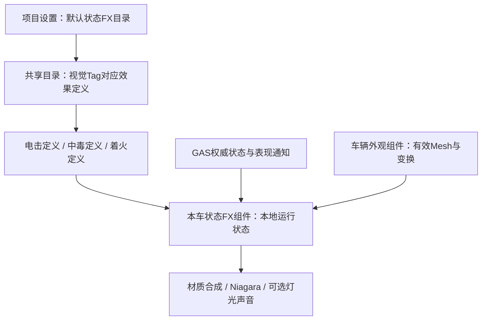

# 车辆通用状态特效：共用配置与 Mesh 适配方案 v0.1

日期：2026-11-06；检查基点 `main/7c7ede7`，本机 UE5.8.2-56702186。

**状态：用户已确认总体架构及六环节顺序；2026-11-06 FX-1／FX-2及FX-3A／B完成各自C++与程序验证，下一FX-3C。** FX-1提供统一外观目标，见[FX-1留档](MVPB_Vehicle_Status_FX1_Implementation_CN_v0.1.md)；FX-2提供只读定义、精确Tag目录、默认／局部覆盖、异步缓存和Cook收集，见[FX-2留档](MVPB_Vehicle_Status_FX2_Implementation_CN_v0.1.md)。[A模型](MVPB_Vehicle_Status_FX3A_Implementation_CN_v0.1.md)已由[B本车组件](MVPB_Vehicle_Status_FX3B_Implementation_CN_v0.1.md)持有，B仅准备资源／渲染请求并管理生命周期，不写Overlay、不激活粒子；当前电击仍使用下述旧播放路径。C观察／诊断及FX-4～6仍后续，画面与团队验收按环节分别记录。

## 1. 当前电击表现是什么

`UHALShockedPresentationComponent` 已包含两种不同的车身表现：

| 层 | 当前做法 | 已有复用能力／限制 |
|---|---|---|
| 车表电流／闪白／焦痕 | 扫描本车可见且非HiddenInGame的 StaticMesh／SkeletalMesh 组件，排除物理根；每个目标创建独立 MID，调用 SetOverlayMaterial | 同一 Overlay 材质可以用于多车型，无需给每辆车复制材质；筛选依赖可见组件枚举，未明确外观角色 |
| 车外主电弧 | 从首个已选 Overlay Mesh 获取 LocalBounds.BoxExtent，程序生成椭球周围的折线点，Niagara读取数组画 Ribbon；挂到Owner物理根 | 不是沿真实Mesh表面采样；没有完整处理Bounds中心、Mesh相对物理根的变换、不同缩放、多部件及骨骼变形 |
| 扩散／消退 | WipeRadiusCm等参数在组件默认值，扩散原点转换到每个Mesh局部空间 | 固定半径不会保证不同体型都覆盖合适；参数及资源尚未集中为共用状态FX配置 |
| 触发与网络表现 | 权威 State.Visual.Shocked 标签，加本地／观察者电墙回弹标记；保持一次表现直到权威状态接续或超时释放 | 共用方案应复用这条及时反馈与去重逻辑，不能直接改成只等远端标签，也不能让预测表现决定眩晕 |

当前 OverlayMaterial、RibbonSystem、ArcSystem及其外观参数位于组件的 EditDefaultsOnly 属性，C++没有为所有车型自动配置同一资源库。旧电墙留档曾有Car_02未填资源的情况；本轮没有重新导出所有保存BP，不据旧记录断言当前车型仍缺引用。

需要注意的现存边界：

- Overlay目标首次收集后被缓存，不能依赖组件遍历顺序确定主车体；动态增加／更换外观应明确重绑。
- 主电弧尺寸目前依赖Overlay收集结果，若Overlay未配置，可能沿用默认尺寸，而不是自动改用实际车体。
- ClearTimeline直接将目标Overlay设为nullptr，没有恢复原Overlay，也没有考虑另一状态仍在使用相同入口。
- 当前主体外观已有标准入口：VehiclePresentation.Configure持有SkeletalVisual及静态Fallback，GetPresentationMesh可取得骨骼表现Mesh。通用效果应复用这份车型信息。

源码定位：HALShockedPresentationComponent.cpp的IsOverlayTarget／EnsureOverlay／EnsureRibbon／ClearTimeline；HALShockArcGeometry.cpp的Build；HALVehiclePresentationComponent.h/.cpp的GetPresentationMesh／Configure。

## 2. 推荐结构

采用 **项目默认的状态FX目录 + 每种效果的共享定义 + 每辆车的运行时表现组件 + 统一外观Mesh入口**。

以上结构已获用户认可，FX-1／FX-2的已实现入口及配置名称以各自实现文档为准，其余仍为后续设计。实现保持窄范围，不建设跨所有Actor的万能特效框架。

| 层 | 配什么／做什么 | 谁维护 |
|---|---|---|
| 项目默认目录引用 | 在项目设置配置一次共用DA，所有标准车辆默认使用；避免C++硬编码资产路径 | 程序接线，团队手动指定资产 |
| 状态FX目录DA | 视觉GameplayTag → 对应效果定义；检查重复Tag、缺引用 | 共用配置维护者 |
| 每种效果定义DA | 材质／Niagara资源、参数、颜色、强度曲线、视觉淡出、绑定策略及合成优先级 | 特效／美术；每种效果做一次 |
| 本车状态FX组件 | 观察状态、绑定目标、创建本车MID／Niagara实例、刷新／淡出／清理与去重 | C++共用逻辑 |
| 车型外观信息 | 已有Mesh、Rig及RelativeTransform；多部件外观统一注册为可受状态影响的目标 | 现有车型接入流程，不逐效果再配置 |

DA仅保存共享定义，不能保存“这辆车目前着火几秒”等运行状态；不得运行时改共享材质、Niagara模板或DA参数影响其他车辆。每辆车使用自己的实例与计时。

**正常新车型连同一个状态FX DA引用也不必重复填。** 从项目默认目录继承即可；特殊车型确实需要不同表现时，才提供可选的车型覆盖。不要为每辆车复制一整套目录。

## 3. 如何让同一效果适配不同Mesh

### 3.1 目标与坐标统一

优先从现有VehiclePresentation取得有效SkeletalVisual／静态Fallback。多部件车辆由同一外观入口提供目标列表；排除碰撞代理、调试Mesh、UI及隐藏预览，不能把Owner上任意可见Mesh都当成主车体。

效果读取实际Mesh的Bounds中心、尺寸和组件变换，按目标空间转换点位，正确处理相对物理根的平移、旋转与缩放。覆盖半径／粒子密度由规范化比例与限幅计算，不再给所有车套固定400cm半径或默认100cm外壳。

换车／换Mesh／重新初始化外观时重新绑定；Pawn退场时释放本车实例并解除旧ASC监听。外观适配不能修改物理碰撞、质量、重心或移动参数。

### 3.2 分清“包围”和“贴表面”

- 电晕、烟雾环等允许近似包围的效果，可以使用经过变换的包围体，成本较低。
- 需要从真实车表长出的火焰／烟雾／附着粒子，应绑定实际StaticMesh／SkeletalMesh的表面采样。可各有一套通用静态／骨骼适配，由代码自动选择，而非每辆车制作一个系统。
- 对真实骨骼姿态贴合的要求高于读一次包围盒，需在所选Niagara采样路径下核对LOD、采样数据和性能，不能承诺任意模型无条件可用。
- 表面材质优先使用对象／统一局部空间的程序化图案，减少对车型专用UV布局的依赖；公用材质仍需满足Static／Skeletal使用条件。

目标是**符合车型接入规范的新车无需额外状态FX配置**。模型本身仍要按既有流程接入Mesh／Rig／变换；特殊透明表面、极端形变、多部件等应有导入校验与明确例外。仅增加一个DA不等于解决几何适配。

## 4. 多状态共存必须一起设计

现有电击设置／清空的是组件级Overlay入口。即使引擎支持材质槽级Overlay，也不能让多个效果各自改写同一表面的同一入口，否则“中毒覆盖电击”“电击结束清掉着火”仍会发生。

建议：

1. 粒子层允许共存，例如车表电流与周围火焰同时存在；刷新持续状态复用原实例，不按Tag重复通知一遍遍生成。
2. 同一Mesh的表面材质由一个协调者拥有。可用共用状态Overlay材质承载有限的融合通道，或为不兼容的样式设明确优先级；首版不承诺任意数量独立材质层无限叠加。
3. 每种状态只交出自己的强度／参数请求，不直接SetOverlayMaterial。状态结束时重算剩余效果；全部结束后恢复原有Overlay，兼容原外观配置。
4. 状态来源按Tag计数／效果身份聚合，一个来源到期不能错误关闭仍被其他来源维持的表现。GAS叠层数量与视觉粒子份数分开定义。

具体融合视觉仍需美术确认。建议默认粒子共存、表面有限混合，并为不兼容样式设置优先级；效果排序不能影响伤害／眩晕等规则结果。

## 5. GAS与联机边界

GAS／GE继续决定中毒伤害、眩晕、持续时间、叠层、免疫与清除。状态FX只负责视觉，效果定义DA中的淡出／焦痕残留是表现尾迹，不是延长实际Debuff。

现有电击先保留ASC视觉Tag监听和回弹提前表现，通过统一组件聚合成同一表现实例。未来如用GameplayCue通知进入／更新／退出，也应进入同一协调者，避免Tag、Cue与本地预测各播放一份。中毒／着火的视觉Tag与新Cue接线均属后续实现，不是当前已具备功能。

各客户端根据可复制状态和本地显示Mesh创建材质／粒子，不逐帧复制粒子或MID。保留电击已有预测确认／否决清理边界，不把电击的特殊提前逻辑套到所有Debuff。常用资源在准备阶段预加载／预热，尽量避免首次中招同步加载造成顿挫；软引用也须进入打包资源检查。

## 6. 建议施工顺序与验收

这是一次中等规模的表现层重构，分六个可单独交付／验证的环节。下表相对工作量用于排序与分工，不是未经验证的工期承诺。

| 环节 | 开发内容 | 交付／验收 | 相对工作量 |
|---|---|---|---|
| FX-1：统一外观目标 | 复用VehiclePresentation，提供有效骨骼／静态／多部件Mesh、中心／尺寸和坐标变换；明确重新绑定与无效目标处理 | 能检查程序选中了哪些外观；不同体型／偏移／旋转／缩放得到正确绑定，不再靠枚举首项 | 中 |
| FX-2：共用配置 | 效果定义DA、Tag目录DA、项目默认引用及校验；安排公共资源预加载与Cook引用；预留少量车型例外 | 团队只在项目设置一次默认目录；常规车辆自动继承；重复Tag／缺资源有可追踪反馈 | 中 |
| FX-3：通用运行组件 | 每车独立MID／Niagara实例与时间状态；接收进入／更新／退出，聚合多来源，处理换车／销毁／跨图清理 | 两车互不污染共享配置，重复通知不重复生成，退出清理无残留 | 较大 |
| FX-4：材质共存与粒子适配 | 统一Overlay所有权、有限融合／优先级及原Overlay恢复；支持规范化包围体和通用Static／Skeletal表面采样绑定 | 两状态共存且任意结束顺序均正确；粒子跟随实际Mesh／变换；共用材质及Niagara模板由团队在Editor接线 | 较大 |
| FX-5：迁移现有电击 | 先保存实际BP资源／参数／曲线，再迁入共享定义；旧电击驱动接入共用表现，保留本地回弹起点、观测者、权威接续、去重与焦痕 | 新旧外观基线对照；多车型使用同一配置，Host／Client不重复播放，不退回等待权威才显示 | 较大 |
| FX-6：组合验收与交接 | 用第二种占位视觉状态验证共存／刷新／多来源；补自动化、双端、四车同时效果与首次播放性能检查；整理新增效果／车型操作文档 | 在共用目录新增已支持样式即可复用；团队真人外观确认，已调资产和原玩法保留 | 中 |

先完成FX-1，再依次推进。FX-4如需细分，可将材质合成与粒子表面适配分别交付；每个环节维护状态记录和实际验证证据，不把全部完成前的中间结果标为全系统可用。FX-5进入迁移前必须读取保存资产实际值，不用C++原生默认值覆盖。

程序主要承担查询／数据结构／生命周期／合成协调／网络表现接续与自动化。团队在Editor创建或调整共用DA、材质、Niagara模板，指派一次项目默认引用，完成视觉确认；代理提供具体操作步骤，不直接改资产。普通车型只沿用已有Mesh／Rig接入，特殊资产例外按需处理。

本轮建设范围为共用能力、现有电击迁移及第二种占位视觉状态的共存验证。中毒扣血／着火伤害／完整GA或GE、两种正式效果美术，以及更复杂的全新渲染方式，作为后续独立内容制作；占位视觉验证不代表这些玩法已实现。框架支持的样式可主要配置DA，新的渲染机制仍可能需要材质／Niagara或小规模C++扩展。

验收至少包含：三种不同体型、非零Mesh偏移／旋转／缩放、多材质／多部件、骨骼动画／车身回弹、缺资源降级、双状态先后退出、原Overlay恢复、两车互不影响、同状态刷新／多来源、换车／跨图清理、Host／Client与观测者一致性、四车同时触发的性能与首次播放。

最初咨询只做设计分析、总体方案确认与工作量拆分；FX-1的验证见[对应留档](MVPB_Vehicle_Status_FX1_Implementation_CN_v0.1.md#4-本次验证与限制)，FX-2见[构建／153项原生及双端流程验证](MVPB_Vehicle_Status_FX2_Implementation_CN_v0.1.md#5-验证记录)。共用目录类已实现，但保存DA仍需团队创建／指定；**真实表面采样绑定、多状态协调器与电击迁移尚未施工**，不将配置和加载Ready写成已经具备完整通用FX播放能力。

参考：

- [Epic：UMeshComponent Overlay接口](https://dev.epicgames.com/documentation/unreal-engine/API/Runtime/Engine/UMeshComponent)：组件级及材质槽级Overlay设置。
- [Epic：Niagara Particle Update中的Mesh采样](https://dev.epicgames.com/documentation/en-us/unreal-engine/particle-update-group-reference-for-niagara-effects-in-unreal-engine)：骨骼／静态Mesh采样模块。
- [现有电墙与车身电流留档](../Combat/MVPB_Electric_Wall_CN_v0.1.md)：网络起点、接续与去重的历史规则与证据。
