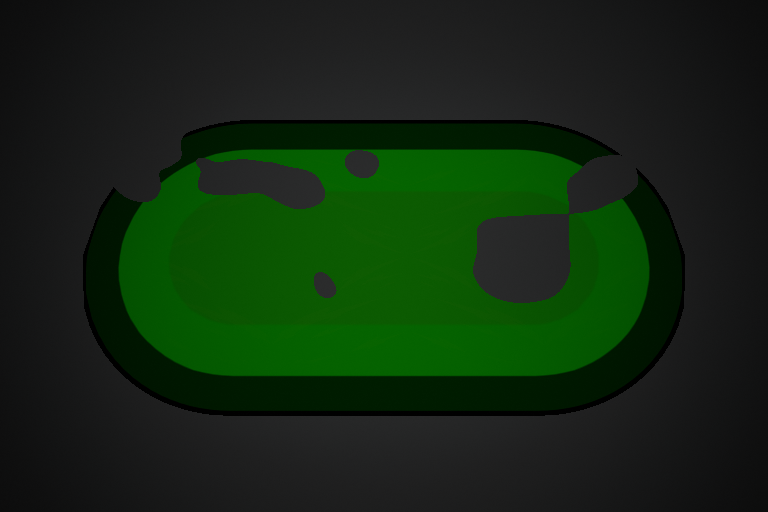
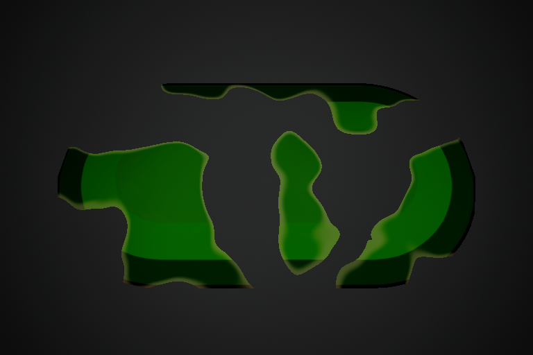
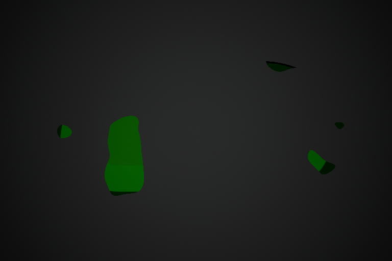

# SlipperyTrail 分块蒸发消散

## 行为与时间

技能到期时，区域内部出现圆润、不规则的缺口。缺口随时间扩大、连接，露出地面，最后整片消失；保留现有卡通配色、隆起与体积明暗。消散边缘可混入独立的浅色，首版不包含向上飘的蒸汽粒子。

玩法时间与表现时间独立：

- `Shape → Lifetime Seconds` 到达时，服务器停止铺设／区域判定，移除该区域来源并结束 GAS 技能。摆动停止，抓地沿原 `Handling → Recovery Seconds` 恢复，其他区域来源继续按原叠加规则结算。
- 随后的 `Presentation → Dissolve Seconds` 只保留视觉。默认 **1 s**，允许 **0～5 s**；0 表示立即消失。消散中的区域没有碰撞、查询或新的打滑影响，也不额外占用技能活跃状态。
- 比如 Lifetime=7 s、Dissolve=1 s：第 7 秒玩法结束，第 7～8 秒消散，第 8 秒清理 Actor。原冷却规则保持。
- 到期后冻结平面范围，仍可继续原有隆起波动；断开的各段使用同一消散进度。淘汰、换车、离场、失去当前控制权或比赛结束仍清理所属 Actor，换图由 EndPlay 清理。

## 配置与调试

母材质 `/Game/Assets/FX/Materials/M_SlipperyTrail_Graffiti` 已接入，原 `MI_SlipperyTrail_Graffiti` 自动继承新能力。没有覆盖 MI 配色、纹理、技能 DA、车型授权或 BP，无需新建技能或重接 Event Graph。

1. 使用本次完整 Editor 构建重新打开工程。
2. 打开 `DA_Ability_SlipperyTrail`，展开 **Slippery Trail → Presentation**，找到 **Dissolve Seconds**（Dissolve 分组），先用 1 s。原 `Ground Material` 继续引用现有涂鸦 MI。
3. 打开 `MI_SlipperyTrail_Graffiti`，展开 **05 Dissolve**，勾选要覆盖的参数再调节。
4. 保存并重新释放技能。通过普通 GA／主技能按键测试，已有区域使用发动时的时间配置快照。

本轮已只读加载当前保存的 `DA_Ability_SlipperyTrail`，确认新字段默认读取 **1 s**，Ground Material 仍为原涂鸦 MI，母材质仍 Unlit／Masked；因此当前配方重开 Editor 后可直接施放查看，再按下表调试。该检查没有保存资产。

| 位置／参数 | 首版默认 | 调试含义 |
| --- | --- | --- |
| DA / Dissolve Seconds | 1 s | 玩法结束后的视觉消散时长，0 为立即消失 |
| MI / DissolveCellSize | 160 cm | 图块尺度；增大形成更大、更少的图块，减小形成更多小块，可先试 100～240 cm |
| MI / DissolveSoftness | 0.04 | 噪声阈值过渡宽度，无量纲；建议 0.002～0.25，材质保持 Masked 裁切 |
| MI / DissolveEdgeWidth | 0.06 | 剩余油膜上的边缘色带宽度，无量纲；建议 0.002～0.25 |
| MI / DissolveEdgeStrength | 0.35 | 边缘颜色混合强度，0 关闭边缘色，建议 0～1 |
| MI / DissolveEdgeColor | 初始取当前 AccentColor | 之后独立调节消散边缘颜色，不改原主体配色 |

`HAL_GroundDissolveProgress` 是程序写入的 0～1 进度，不作为日常配方填写。形变关闭时也支持消散，程序会单独建立本区域 MID。继续使用没有消费该参数的旧材质时，尾效期间会保持原画面，最后清理；可将 Dissolve Seconds 设为 0 使用原立即移除行为。

## 程序与材质边界

`AHALSlipperyTrail` 使用独立到期定时器停止玩法、移除接收者来源，并通过原生 `OnGameplayEnded` 通知 GA。GA 解除自身对 Actor 的销毁绑定并结束；Actor 留到视觉截止时刻，保留现有定时器对拥有者／比赛权限的清理检查。提前取消仍走原立即销毁路径。没有新增 GA Tick、每块缺口 Actor、每帧进度复制或 Gameplay Effect 来控制视觉。

两端根据复制的 StartTime、Lifetime 与 DissolveSeconds 及服务器时间计算进度。晚观察时直接计算当前进度，网格按玩法截止时刻的宽度构建；到视觉截止立即隐藏，服务器销毁包迟到也不会延长显示。调试轮廓在玩法截止时停止。

公共 `UHALGroundSurfaceComponent::SetDissolveProgress` 为每区域设置独立 MID 参数，兼容形变开／关。材质使用固定地面 UV0 和 `HAL_GroundInvTileSize` 将块尺度换算为厘米，双层平滑噪声生成缺口，乘入原 Opacity Mask；边缘色混入原最终颜色。噪声不跟随滚动纹理、波动相位移动。材质继续 Unlit／Masked，可选真实投影也会随裁切变化。

材质更新脚本为 `Tools/SlipperyTrailGraffiti/UpdateDissolveMaterial.py`，内嵌代码源为同目录 `DissolveMask.hlsl`。通过 Unreal Editor API 更新母材质，运行时不依赖外部脚本／HLSL 文件。原 Volume 更新脚本已兼容外层消散颜色节点。脚本不保存 Blueprint、MI、DA 或地图。

其他地面效果可复用公共进度参数与材质分支，但需各自明确玩法截止、视觉保留和强制清理时机；本轮没有改变其他区域 Actor 的生命周期。

## 团队验收

1. 原地、直线、弯道和断段：观察先出现内部缺口，缺口扩大、连接，最终全部露出地面。
2. 另一辆车停在区域内：到期摆动来源移除、抓地开始按原曲线恢复，尾效期间新进入不会重新注册该来源。重叠区域仍按原规则生效。
3. 分别用 Dissolve Seconds=0／1／2，对照玩法时长保持、消散时长改变；原技能冷却保持。
4. 形变开／关、描边与体积明暗、可选投影分别检查，确认原颜色与隆起保持。
5. Host／Client 看同一区域共同消散；在铺设中／尾效中淘汰、换车、返房和退出，检查没有残留网格、区域来源或活跃 GAS。

## 验证记录

基点 `main/d08eae9`，UE 5.8.3-58210709。最终 Editor／Game R2 构建通过；原生专项 **12/12**，带实际涂鸦材质的 D3D12 Listen Server／Client 各 **1/1**，均 0 测试警告／失败／未运行／进行中。联机夹具使用非默认 1.2 s 尾效和 Host 出站 80 ms 注入，验证时长复制、时钟进度、尾效可见时来源已移除且 GAS 已结束、抓地恢复和最终清理；不等同校园多机、实测 RTT 或发布包验收。

母材质保存并重新加载，84 节点，VS175／PS296 指令、1 个采样器，为本设置统计。实际材质 D3D12 R4 八帧检查通过且原生进程退出 0：0／25／50／75／100% 进度下剩余覆盖分别为 **158450／140268／78294／12417／0** 像素。每阶段新增回长像素均为 **0**，恢复至 0 进度时遮罩差异 **0**，25% 时检测到 **3 个内部缺口**，后续连接至外边缘。图片尺寸 768×512，固定色 Unlit 背景、关闭后期量化噪声，读回 FColor 原值并使用 6/255 通道差异阈值。另有组合体积明暗与边缘色的中间帧，已查看实际导出图片。

R1／R2 读回把 8 位通道按浮点阈值比较，混入地面明暗和量化差；修正后 R3 严格像素检查通过，但旧进程包装器没有确认干净退出，因此 R4 用直接原生命令再次确认退出 0。原始失败、脚本和图片保留在 `Saved/SlipperyTrail/Dissolve_20261111`。1246 份原有保存资产／Config／uproject 中，只有授权母材质变化，其余 **1245** 份逐份一致，包含原 MI、技能 DA、地图、纹理及用户开工前的 Definition DA 修改。没有代改 BP，没有新增真人／校园多机／发布包或大量区域性能结论，未提交／Push。详见[可同步验证摘要](Slippery_Trail_Dissolve_Verification_20261111.json)。

以下是独立测试场景的实际渲染，按 25%、50%、75% 排列；中图额外开启体积明暗与消散边缘色。背景和曝光用于检查，亮度不代表正式地图。

