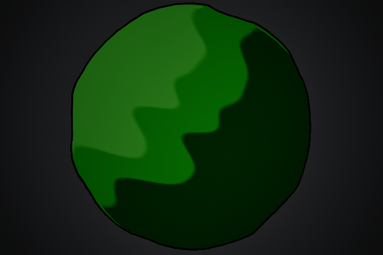
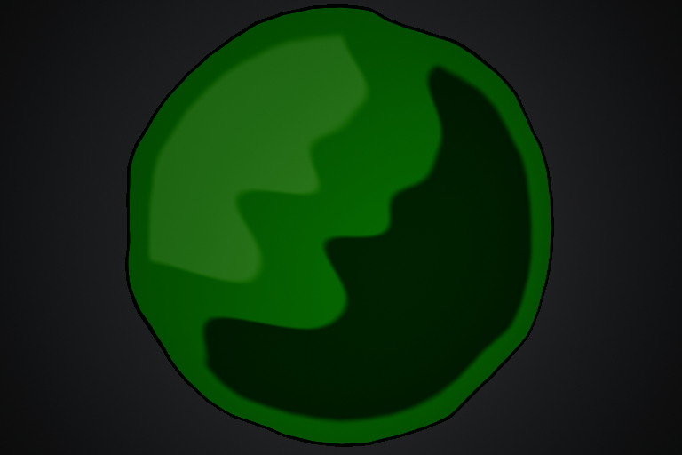

# SlipperyTrail 暗绿色边缘与中间色缓冲 v0.1

2026-11-12，从 `main/9a673e3` 接续。用户反馈三档朝向明暗已非常接近预期，本轮只调整外围：黑边改暗绿色，内部高光与外缘之间保留中间色缓冲。材质已实现并完成本机验证，比赛地图观感待团队调试。

## 表现规则

从外向内为：**暗绿色边缘 → 中间色缓冲 → 内部三档明暗**。缓冲区使朝向高光和暗部都先回到中间色，内部继续按原表面朝向分档。缓冲跟随现有不规则溢边的轮廓信息；仅改变颜色，不改变网格、WPO、覆盖、逻辑区域、碰撞或消散时间。

新增独立边缘色，不覆盖用户原 InkColor、三档配色或笔触。当前颜色取样下，新边缘默认约为线性 RGBA `(0.04123,0.18047,0.03297,1)`，来源为本轮保存的 ToonShadowColor 的 0.55 倍；这是创建时取样，后续可以独立调色。

## 配置入口

打开 `/Game/Assets/FX/Materials/MI_SlipperyTrail_Graffiti`，展开 **07 Three tone shading**。原技能 DA 引用保持，无需重新绑定或 Build；若 Editor 已加载旧母材质，先保存工作并重新打开工程，加载本次保存资源。

| 新参数 | 默认／范围 | 调节含义 |
| --- | --- | --- |
| ToonEdgeColor | 当前暗色档 ×0.55 | 新三档模式的外围暗带颜色。建议保持偏暗绿色，可适当调亮以免比赛曝光下接近黑色 |
| ToonEdgeBufferWidth | 24 cm，0～200 cm | 从现有暗带的名义内侧开始，保持中间色的宽度；0 关闭缓冲，仍使用独立边缘色 |
| ToonEdgeBufferSoftness | 12 cm，0～100 cm | 完整缓冲之后向内部三档明暗恢复的过渡宽度；0 为硬切换 |

1. 先保持 `ToonStrength=1`，使用默认 24／12 cm 重新释放原技能。
2. 高光仍显得靠边时增大 Buffer Width，可先试 32～40 cm；区域大部分只剩中间色时降低它，可先试 12～20 cm。
3. 过渡显得过硬时增大 Buffer Softness；希望分区更干净时减小。窄小的初始区域可能被缓冲占去较大面积，按扩宽前后一起验收。
4. 边缘暗带本身的宽度与向中间色的过渡仍使用 **06 Paint edge → PaintEdgeOutlineWidth／PaintEdgeOutlineSoftness**，原数值保持。本轮没有通过材质透明度把边缘羽化。

`ToonEdgeColor` 控制新模式边缘；原 `InkColor` 继续用于旧模式和网点。原 `ToonShadowColor／ToonMidColor／ToonLitColor` 继续调内部三档。强度小于 1 时会与旧风格混合，因此完整缓冲建议先用 1 验收。

对照方式：

- 仅关闭缓冲：Buffer Width=0。
- 恢复本轮施工前的三档画面：Buffer Width=0，并将 ToonEdgeColor 设为原 InkColor。
- 回到更早的高度分色／旧体积模式：ToonStrength=0，新边缘设置也会随新模式退出。

没有修改原 MI 保存值；新参数从母材质继承即可生效，勾选覆盖框后可继续调试。用户本次调亮的 TopColor／ToonLitColor 保留。

## 材质接口与维护

`PaintEdge.hlsl` 的 Custom 输出从 float3 扩展到 float4：**RGB 保持覆盖／墨线 Alpha／模式的原合同，A 增加该溢边轮廓内的深度，cm**。继续读取同一份固定地面噪声，避免另外生成一个不同的轮廓。关闭 Paint Edge 或强度为 0 时，深度退回原主体边界。

`ThreeToneShading.hlsl` 以这项深度减去当前 PaintEdgeOutlineWidth，得到缓冲参考；完整缓冲内使用 ToonMidColor，再在 Softness 距离内恢复原三档。名义深度来自条带／圆端的插值元数据，并非任意网格的精确欧氏距离场。使用关闭 Paint Edge 的旧比例描边时，暗带实际宽度仍取决于旧权重门槛，较粗时需要相应增加缓冲宽度。

公共 UV0／UV1／UV2、运行时 MID 参数及 C++ 接口均不变，没有新增反射字段、复制、Niagara 或组件。现有 WPO 与 Opacity Mask 根连接保持。保护只作用于原区域外轮廓，不为每个结束消散缺口另建缓冲；既有消散边缘色继续按原配方显示。

更新工具仍为 `Tools/SlipperyTrailGraffiti/UpdateThreeToneMaterial.py`，会一并升级 Paint Custom 的深度输出；`UpdatePaintEdgeMaterial.py` 也兼容 float4，保留原 RGB 使用者。工具通过官方 Editor API 只保存母材质，不保存 Blueprint／MI／DA／地图；Custom 代码已嵌入 uasset，运行时不读取外部文件。

## 验证与下一步

UE **5.8.3-58210709**，保存后重新加载的实际材质 D3D12 shader 编译通过：115 节点，VS179／PS453 指令，1 采样器，为本设置统计。

R1 的 13 帧生产网格＋实际材质检查通过，原生进程退出 0。关闭缓冲／恢复原边缘色与施工前对照逐通道差异 **0**；ToonStrength=0 的旧模式对照差异 **0**；重新恢复新效果差异 **0**。独立 HDR inverse-opacity Alpha 验证所有颜色设置下覆盖均为 **189123** 像素、轮廓差异 **0**；半程消散为 **98262**，与施工前消散遮罩差异 **0**，终点 **0**，回长 **0**。

RGB 诊断色把暗／中／亮分别设为红／绿／蓝，只用于瞬态 MID。外缘保守抽样带 15027 像素中，未保护时暗部／高光合计 **7854**，保护后 **0**；内部三档仍分别检出 **68095／78203／38420** 像素。该抽样带为 900 cm／768 px 正交镜头下的 10 px 四邻域距离带，不冒充整幅画面的精确物理宽度测量。暗绿边缘的近边抽样绿色占比约 **91.4%**。增大宽度、柔和度、波动与反向来光分别改变 **30566／23238／34497／167933** 像素。

实际材质 D3D12 Listen Server／Client 生命周期专项各 **1/1**，0 测试警告／失败／未运行／进行中，两进程退出 0。沿用非默认 12 cm／0.06 溢边、1.2 s 消散与 Host 出站 80 ms 注入，确认 MID、扩宽、消散时钟、尾效可见时玩法来源／GAS 已结束及最终回收。

1246 份原保存资产／Config／uproject 中仅授权母材质变化，其余 **1245** 份及 **349** 份 Source 逐份一致，包含原 MI、技能 DA、地图、轮胎烟尘、纹理和用户开工前的车辆 Definition 改动。本轮不涉及 C++／反射变更，没有重建 Target 或重跑完整原生规则测试；未改 BP，未提交／Push。

原始证据在 `Saved/SlipperyTrail/EdgeBuffer_20261112`，可同步摘要见[验证 JSON](Slippery_Trail_Edge_Buffer_Verification_20261112.json)。下一步由团队在原比赛地图调边缘绿、缓冲宽度及柔和度，检查原地／直行／急弯／绕回重叠／坡面和双端消散；真人、校园多机、发布包及大量区域性能尚未验收。

以下为独立镜头真实渲染，先施工前、后新效果。测试背景和曝光用于验证，亮度不代表比赛地图。

