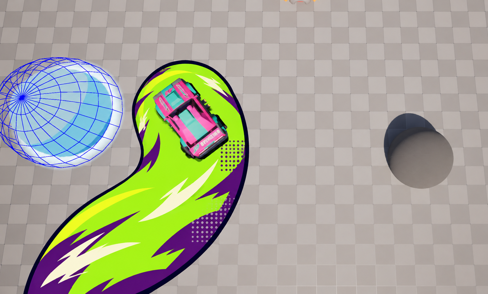
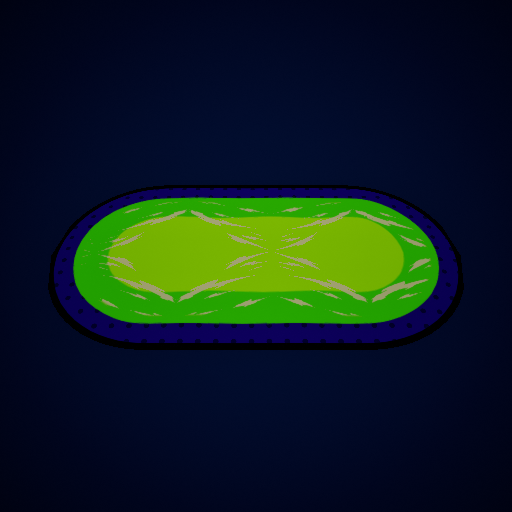
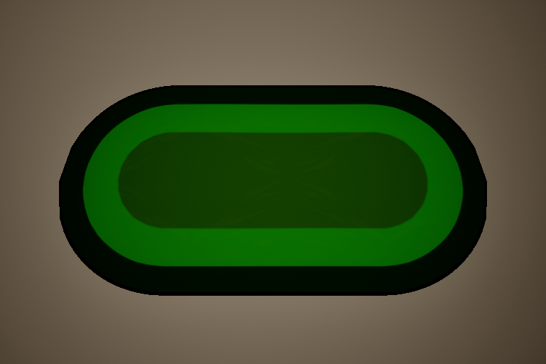
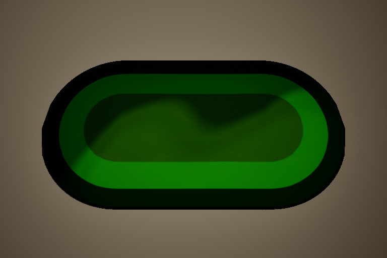

# SlipperyTrail 涂鸦风材质 v0.1

**2026-11-12 边缘更新：** MI **07 Three tone shading** 新增暗绿色 `ToonEdgeColor` 和 `ToonEdgeBufferWidth／Softness`，高光／暗部靠近外缘时回到中间色。原三档配色、溢边、隆起与消散保持，详见[新配置与对照](Slippery_Trail_Edge_Buffer_CN_v0.1.md)。

**2026-11-11 最新主体分色：** 按用户确认先保留 C++ 地面网格，新增表面朝向驱动的暗／中／亮三色，默认开启。使用 MI 的 **07 Three tone shading** 调三色、方向、门槛与柔和度，ToonStrength=0 可恢复旧主体配色及 04 体积倍率。原墨线、笔触、隆起、溢边和消散保留；Niagara／液团暂缓。见[配置、对照与验证](Slippery_Trail_Three_Tone_CN_v0.1.md)。以下按中央权重分色的接线与旧统计保留原时点。

**2026-11-11 当前补充：** 已在原材质上接入体积明暗、分块消散及圆润油漆溢边，原 MI 调色保留。Paint Edge 开启时在 MI **06 Paint edge** 按厘米调整随形描边粗细，完整入口见[油漆／液体溢边](Slippery_Trail_Paint_Edge_CN_v0.1.md)。下文首版节点／固定遮罩描述保留原时点。

## 画风目标

用户指定参考《Need for Speed Unbound》的夸张卡通特效。首版使用粗墨线、鲜明色块、手绘笔触和局部印刷网点，沿用绿紫配色。EA 的官方介绍将该作的驾驶特效描述为街头艺术与动作表达的结合。这里据此设计适合俯视竞技场的地面表现。 [EA 特效风格介绍](https://www.ea.com/games/need-for-speed/need-for-speed-unbound/news/the-world-is-your-canvas)

**2026-11-11 用户反馈与后续纲领：** 新版画风明显接近预期，颜色由用户继续调试；后续保留夸张卡通与手绘涂鸦方向，同时让颜色、纹理和边缘稍柔和、圆润。优先较宽、饱满的笔触，减少针状尖端、细碎噪声与过强色彩反差。分色和轮廓仍需清楚，按比赛镜头验收。此要求适用于后续特效，已同步[特效团队交接中的通用视觉纲领](MVPB_Vehicle_FX_Team_Handoff_CN_v0.1.md#量产特效视觉纲领2026-11-11-补充)。首版图片、数值和生成提示词作为历史起点保留，不代表柔和化已实施。



上图是 imagegen 编辑的风格目标图。实际材质使用下列资源和节点，观感以游戏内新配方验收为准。



上图为 Unreal 的真实渲染：新保存 MI 应用到带中央权重的瞬态地面网格，使用 18 cm 隆起和 4 cm 波动。它用于确认材质分色、笔触与网点已生效；背景、曝光和镜头为独立测试设置。概念图中的线条细节和整体观感仍需在比赛画面中调试，当前没有额外悬空喷溅／烟团层。

## 已创建的资源与挂接

| 资源 | 项目路径 |
| --- | --- |
| 母材质 | `/Game/Assets/FX/Materials/M_SlipperyTrail_Graffiti` |
| 实例 | `/Game/Assets/FX/Materials/MI_SlipperyTrail_Graffiti` |
| 笔触遮罩 | `/Game/Assets/FX/Textures/T_SlipperyTrail_Graffiti_Strokes` |
| 遮罩源图 | `SourceArt/SlipperyTrail/T_SlipperyTrail_Graffiti_Strokes.png` |

在当前 `DA_Ability_SlipperyTrail → Slippery Trail → Presentation → Ground Material` 选择 `MI_SlipperyTrail_Graffiti`，保存后重新释放技能。Deformation 勾选 Enabled，首测可用 Bulge Height=18 cm、Wave Amplitude=4 cm、Wave Period=1.5 s、Wave Length=220 cm，Width Subdivisions=8、Vertex Spacing=40 cm。首测数值由本轮选择，可按比赛镜头调节。

母材质使用 **Surface / Unlit / Masked**，Opacity Mask 当前由完整基础遮罩乘入消散与溢边覆盖。粗线和色块覆盖地面表现轮廓，车辆与球通过正常深度关系显示。材质通过同一技能 DA 引用实例，实例中的画风参数按下表调节，隆起和时间参数由 DA 的 Deformation 传入。

## 日常调参

| MI 参数 | 起点 | 调节目标 |
| --- | --- | --- |
| InkColor | sRGB `#100C23` | 深色轮廓和网点 |
| ShadowColor | sRGB `#6122A8` | 紫色侧面 |
| BodyColor | sRGB `#76E600` | 主色块 |
| TopColor | sRGB `#C5FF24` | 中央亮面 |
| AccentColor | sRGB `#FFF1C9` | 手绘速度笔触 |
| ColorGain | 1 | 整体颜色亮度 |
| DotTiling | 8 | 每个 UV 单元的网点密度，填写正数 |
| DotAmount | 0.45 | 紫色区域的网点强度，0 表示关闭 |
| StrokeMask | 新笔触遮罩 | 大块笔触图形 |
| StrokeTiling | 1.4 | 笔触平铺密度，填写正数 |
| StrokeAmount | 0.85 | 笔触覆盖强度，0 表示关闭 |
| StrokeSteps | 12 | 每个服务器波动周期中的动画步数，填写正数 |

颜色十六进制值以拾色器的 sRGB 输入为准。首轮先看主色块、外轮廓和白色笔触的比例，再调网点。比赛相机下需保留足够安静的主色面积，让车、球和危险范围都清晰。

### 描边粗细与柔和度

当前首版的描边阈值是母材质中的常量，**MI 尚无 Outline Width／Outline Softness 参数**。`InkColor` 只控制颜色。团队可在 Unreal Editor 直接调整母材质，操作如下。

1. 打开 `/Game/Assets/FX/Materials/M_SlipperyTrail_Graffiti`，在材质图中找到注释／描述为 **Ink border threshold** 的 SmoothStep。它的 Value 接 `VertexColor.R`，Min 默认 0.10、Max 默认 0.12，输出控制 InkColor 与 ShadowColor 的混合。
2. 选中该节点，在 Details 修改 Min／Max。保持 `0 ≤ Min < Max`，并让 Max 小于下一层紫色到主体色的起始阈值（首版为 0.40），避免色带互相挤占。
3. Apply／Save，确认技能 DA 引用的 MI 仍以此母材质为父材质；重新释放技能，从比赛镜头检查。

| 调节目标 | Min | Max | 含义 |
| --- | --- | --- | --- |
| 首版 | 0.10 | 0.12 | 当前起点 |
| 更细 | 0.04 | 0.06 | 两值同时减小，深色带更窄 |
| 更粗 | 0.18 | 0.20 | 两值同时增大，深色带更宽 |
| 接近原粗细、过渡柔和 | 0.08 | 0.14 | 保持中心值约 0.11，拉开间距 |

两值的中心大致决定描边宽度，间距决定颜色过渡柔和度。单位为中央权重阈值，实际宽度随区域半宽变化，数值与厘米／屏幕像素并非线性对应。调整只影响显示颜色带，区域形状、碰撞与打滑判定保持原规则。

如需长期在 MI 中调参，可在后续授权修改中将两输入参数化为 `Min=max(0, OutlineWidth-OutlineSoftness/2)`、`Max=OutlineWidth+OutlineSoftness/2`，保留正的 Softness 并限制阈值顺序。该接口仅为后续建议，本次没有新增这些参数。

描边过渡和笔触形状分别调节。现有 `StrokeAmount`、`DotAmount` 可降低笔触／网点对比；针状笔触需通过替换更圆润的 `StrokeMask` 改形。母材质中 **Bold brush shapes** 的 SmoothStep 默认 0.35／0.55，扩大该区间可柔化笔触颜色过渡，但不会自动将尖端变圆。本轮只记录方法，未调整实际资产。

## 体积明暗与投影（2026-11-11）

按用户授权，当前母材质已增加平滑卡通体积明暗，继续使用 **Unlit / Masked**。原有配色、笔触和颜色输出完整保留，在最终颜色上叠加可关闭的明暗倍率。现有 MI 自动继承新参数，无需重新指定材质或新建实例。

打开 `MI_SlipperyTrail_Graffiti`，展开 **04 Volume shading**。勾选相应参数左侧的覆盖框后可调节。

| 参数 | 新增默认值 | 调试方式 |
| --- | --- | --- |
| VolumeStrength | 1 | 总强度，0 恢复原来的颜色输出，建议 0～1 |
| VolumeNormalStrength | 4 | 放大曲面朝向变化，让宽而低的隆起更易读；不改变实际高度，建议 1～5，代码限制 0～8 |
| VolumeLightDirection | `(-0.5,-0.6,0.65,0)` | RGB 表示世界 XYZ 的虚拟来光方向，A 不使用；向量会归一化，修改 XY 符号可对调明暗方向；零向量按向上处理 |
| VolumeBandThreshold | 0.08 | 明暗从接近原色进入亮／暗色块的门槛；减小会让较缓的坡度也显示明暗 |
| VolumeSoftness | 0.12 | 颜色过渡宽度；增大更柔和，可先试 0.18～0.25，建议不小于 0.002 |
| VolumeShadowStrength | 0.45 | 背向虚拟光的部分暗多少；过暗时先降到 0.2～0.3，建议 0～1 |
| VolumeHighlightStrength | 0.15 | 朝向虚拟光的部分亮多少；可试 0.2～0.3，建议 0～1 |

这些是颜色表现参数。实际高度／波幅仍在技能 DA 的 Deformation 中配置，新增 `HAL_GroundInvTileSize` 属于程序写入的参数，团队不手工修改。

建议首测步骤：

1. 保持你当前的颜色和隆起高度，先把 Wave Amplitude 设为 0，比较 VolumeStrength=0 与 1，观察静态隆起的方向明暗。
2. 在 MI 调 VolumeNormalStrength 和 VolumeShadowStrength。先让大形可读，再用 VolumeSoftness 缓和过渡。测试不同方向时以数值编辑 VolumeLightDirection 的 RGB 分量。
3. 把 Wave Amplitude 改为 2～4 cm，观察波峰／波谷的明暗是否随曲面一起移动。若希望缓慢而大块的起伏，可试 Wave Length=400 cm、Wave Period=3 s。参数为首测建议，没有覆盖你的 DA。
4. 在 `DA_Ability_SlipperyTrail → Slippery Trail → Presentation → Deformation` 勾选 **Cast Shadow**，保存后重新释放技能。默认关闭，便于与当前效果对照；重新关闭 Enabled 或移除材质时也会关闭该投影。
5. 从比赛镜头看原地、直行、急弯、绕回、斜坡和两端到期清理。轮廓折线可通过 Width Subdivisions=12／16、Vertex Spacing=20～30 cm 改善；平滑明暗自身已不依赖三角面块的法线。

真实投影需要场景中有投影灯光、地面能够接收阴影。柔和度由灯光与阴影设置决定，MI 的 VolumeSoftness 只调卡通明暗过渡。本轮未新增独立的软阴影图层；开启真实投影后的多区域性能与实际地图画面由团队继续验收。

下图是当前保存材质在瞬态网格／地面上的真实 D3D12 对照，依次为关闭体积明暗、开启体积明暗及投影。测试使用 25 cm 隆起、2 cm 波幅、400 cm 波长、独立灯光／曝光，不能当作正式地图或原截图的最终亮度。





### 实现与验证记录

公共网格 UV1 提供中央权重对世界 XY 的平滑梯度，MID 增加 `HAL_GroundInvTileSize`。材质据此对原隆起／波动公式求导，结合原地面 PixelNormalWS 计算圆润的曲面朝向，再用虚拟来光方向形成柔和的卡通明暗。这里只改变颜色；原 WPO、顶点位置、范围、球／车碰撞、抓地和权威规则保持。相位继续来自服务器时间。

更新脚本为 `Tools/SlipperyTrailGraffiti/UpdateVolumeMaterial.py`，嵌入代码为同目录 `VolumeShading.hlsl`。修改通过 Unreal Editor API 完成，没有手工修改二进制、编辑 Blueprint 或保存 MI／DA／地图。脚本保留现有颜色图和参数，可识别并更新自己创建的 Custom 节点。

基点 `main/0c53a5d`，UE 5.8.3-58210709；最终 Editor／Game R2 完整构建通过，原生专项 R2 **11/11**，原生产组件 D3D12 位移回归 **1/1**，均 0 测试警告／失败／未运行／进行中。保存材质重新加载后的 R3 六幅 D3D12 画面对比通过：体积明暗变化 209547 像素、反向来光变化 239442、波动相位变化 87823、真实投影变化 4346；重新关闭体积明暗后与原画面差异为 **0**。图像为 768×512，颜色通道差异阈值 0.025。最终材质 71 节点，VS 175／PS 225 指令、1 个采样器，为本设置统计。

首轮脚本 CustomInput 构造接口不适配、第二轮将新增方向参数误判为旧配色变化，均在保存前停止；R3 初版能渲染但三角面明暗呈块状，改为平滑梯度后经 R4 更新并完成 R2／R3 渲染复验。原失败和中间画面均保留在 `Saved/SlipperyTrail/Volume_20261111`。1246 份原有保存资产／Config／uproject 中，仅授权的母材质变化，其余 **1245** 份逐份一致，包含原 MI、用户开工前的 Definition DA 修改、技能 DA 与纹理。没有新增真人／双端／发布包验收，本轮未提交／Push。[可同步验证摘要](Slippery_Trail_Volume_Verification_20261111.json)

## 分块蒸发消散（2026-11-11）

当前母材质已接入结束消散。技能 DA 的 `Presentation → Dissolve Seconds` 默认 1 s，决定玩法到期后的视觉时长；MI 的 **05 Dissolve** 提供 `DissolveCellSize`、`DissolveSoftness`、`DissolveEdgeWidth`、`DissolveEdgeStrength`、`DissolveEdgeColor`。原配色和体积参数保持，程序独立驱动 `HAL_GroundDissolveProgress`。零时长使用立即移除，形变关闭时也可消散。见[行为、配置与真实渲染对照](Slippery_Trail_Dissolve_CN_v0.1.md)。最新材质为 84 节点，VS175／PS296／1采样器，下面的首版与 Volume 记录保留各自时点。

计量说明：上节历史 Volume 画面差异使用 `ReadRenderTarget` 返回的 FColor 8 位通道，以 0.025 原值阈值比较，相当于记录任意一级差异；它是整幅画面变化检查，不按 2.5% 阈值或区域覆盖率解释。新的消散覆盖验证使用固定色底、6/255 阈值并严格检查单调性、内部缺口、空覆盖和恢复，指标分别留档。

## 节点结构（首版分色与 WPO）

### 1. 粗轮廓与分块明暗

取网格的 VertexColor.R，记为 `W`。外边缘为 0，中央为 1。三个 SmoothStep 分别使用下面的 Min／Max，Value 都接 W。

| 分支 | Min／Max | 连接 |
| --- | --- | --- |
| 外轮廓 | 0.10／0.12 | Lerp 的 A=InkColor，B=ShadowColor，Alpha=此分支 |
| 主体色块 | 0.40／0.42 | Lerp 的 A=上一步颜色，B=BodyColor，Alpha=此分支 |
| 中央亮面 | 0.78／0.80 | Lerp 的 A=上一步颜色，B=TopColor，Alpha=此分支 |

较窄的过渡形成明确的色带。轮廓宽度按区域宽度的比例变化，区域扩宽时描边一起扩宽。

### 2. 局部印刷网点

`UV0 × DotTiling → Frac → 减去 (0.5,0.5) → Length`，得到每个单元到中心的距离。经过 Min=0.14、Max=0.18 的 SmoothStep，再接 OneMinus，得到圆点。

圆点乘 `外轮廓分支 × (1 - 主体色块分支)`，把网点限制到紫色侧面。再乘 DotAmount，作为从当前颜色向 InkColor 插值的 Alpha。

### 3. 手绘笔触与分步运动

`HAL_GroundWavePhase × StrokeSteps → Floor → 除以 StrokeSteps`，作为 Panner 的 Time。Panner 的 Coordinate 接 `UV0 × StrokeTiling`，Speed X=1、Y=0。

Panner 输出接笔触 TextureSampleParameter2D 的 UV。纹理采样使用 Masks、关闭 sRGB，X/Y 使用 Mirror，构建尺寸 1024×1024。R 通道经过 Min=0.35、Max=0.55 的 SmoothStep，得到清楚的大笔触。

笔触遮罩乘 `SmoothStep(0.50,0.55,W)`，再乘 StrokeAmount，作为从当前颜色向 AccentColor 插值的 Alpha。结果乘 ColorGain 后接 Emissive Color。

这条动画沿地面 UV 移动，由已复制的服务器相位驱动。每个周期分为若干步，表现手绘动画的节奏。

### 4. 隆起

新材质已接入 `HAL_GroundBulgeHeight`、`HAL_GroundWaveAmplitude`、`HAL_GroundWavePhase`、`HAL_GroundWaveUV` 四个现有参数，WPO 公式与公共组件一致。具体含义及手工接线见[通用地面变形说明](Ground_Surface_Deformation_CN_v0.1.md#材质接线)。

## 验收与交接

1. 将 Ground Material 选为新 MI 后，重新释放技能。在原地、直线和弯道确认深色轮廓、紫色侧面和亮色主体能从比赛镜头读清。
2. 将 StrokeAmount 和 DotAmount 分别设为 0，再逐项打开，调整笔触与网点的覆盖比例。
3. 从低视角确认隆起，再回比赛镜头调节高度和对比。检查车辆、球及场地边界的可见性。
4. 让车辆腾空后继续铺设，检查断口和共同消失。Host／Client 使用同一材质资源，检查分步动画及生命周期。

悬空的涂鸦图形、喷溅和卡通烟团可以通过额外的 Niagara 或网格层接入。当前材质资源提供地面轮廓、色块、网点、运动笔触与隆起。

## 本轮记录

基点 `main/a5dfa12`，UE 5.8.3-58210709。使用工程已有的 Unreal Editor Python API 流程创建三个新资源，母材质 59 个节点、67 条已检查连接。没有编辑 Blueprint 或覆盖旧材质／技能 DA。开始时已有的三份资产修改与文档修改已保留。

本轮保存后重新加载，D3D12 着色器编译通过；统计为 VS 173、PS 151 条指令、1 个采样器，统计随平台／编译设置变化。独立渲染 R5 通过：512×512 像素中检测到 38145 个绿色像素与 13911 个紫色像素，已人工查看实际导出图片。该检查确认保存资源可编译及渲染，不替代技能运行、双端或比赛镜头的美术验收。未修改 C++／配置，未新跑 Game／Editor Target 构建或玩法自动化；上一轮 WPO 程序测试保持原有含义。

R1～R3 的临时验证脚本因 Python 未暴露接口失败；R4 同步创建后立即抓取时仅得到天空。修正接口并等待 Editor 更新后，R5 实际抓取通过。所有原始记录在 `Saved/SlipperyTrail/Graffiti_20261111` 本地保留。1243 份原有保存资产／Config／uproject 的 SHA-256 与开工保护基线逐份一致。团队下一步仅将技能 DA 的 Ground Material 切换为新 MI，完成原地／弯道／绕回及 Host／Client 到期清理检查。本轮未提交／Push。

## 生成资源的提示词

两张源图由内置 imagegen 生成，模式为 built-in。概念图以本轮用户截图为编辑输入，笔触遮罩为独立生成。以下保留最终提示词，便于队友延续。

概念图提示词如下。

```text
Use case: style-transfer. Asset type: a preview concept for an Unreal Engine top-down vehicle party game's slippery trail ground material. Edit target is the supplied actual gameplay screenshot. Change ONLY the existing green oil trail surface under and behind the pink-and-turquoise car. Preserve the camera, tile floor, pink car, blue wireframe sphere, gray sphere, shadows, composition and all surrounding objects exactly. Keep the trail's existing curved footprint and clear gameplay border, with decorative art contained in the footprint. Redesign that trail in an exaggerated hand-illustrated street-art racing VFX aesthetic inspired by the graffiti-driving-effects language of Need for Speed Unbound. Broad acid-lime green fill, deep-purple side/shadow color blocks, thick near-black indigo ink border around its perimeter, a few broad sharp ivory brush streaks, restrained printed halftone dots in the purple shadow areas. Bold clean graphic shapes readable at this camera distance, crisp two/three-tone cel-style shading and slightly raised rounded gummy volume. Preserve wide quiet areas so the car and boundary remain readable. The result should look like deliberately drawn animated paint/graffiti laid onto the ground, with sparse irregular punchy strokes. Avoid realistic oil interference filaments, tiny busy noise, smooth glossy gradients, excessive bloom, floating particles, added UI, extra cars, labels or words. This is an illustrative target for a new material, not a claim of an implemented engine screenshot.
```

笔触遮罩提示词如下。

```text
Use case: stylized-concept. Asset type: square seamless grayscale alpha mask texture for bold hand-drawn graffiti speed strokes in a stylized racing-game ground trail material. A flat edge-to-edge 2D texture tile on solid pure black. Only white and very slightly anti-aliased white edges. Sparse large sharp, chunky, irregular dry-marker brush swooshes and tapered lightning-like paint slashes, arranged diagonally flowing from lower-left to upper-right. Roughly 8 to 12 distinct elongated marks at varied lengths, grouped into 3 or 4 small clusters, with 80 percent of the image remaining black negative space. Shapes readable when the tile occupies only 100 pixels in a top-down game. The white strokes are broad at their roots and taper sharply with occasional notched brush-cut ends, energetic illustrated street-art VFX feel. Repeatable seamless tile with periodic edge behavior. No real-world oil reflections, thin filigree, dots, gradients inside strokes, soft smoke, colored pixels, checkerboard, border, letters, logos, symbols or text. A production mask, not a concept painting.
```
