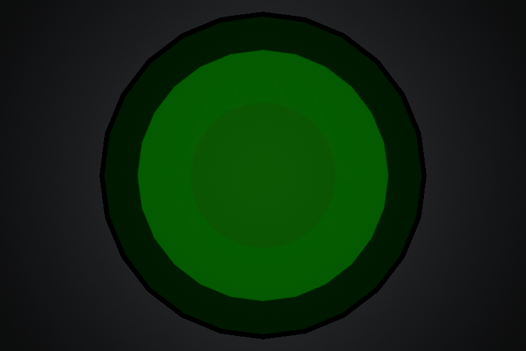
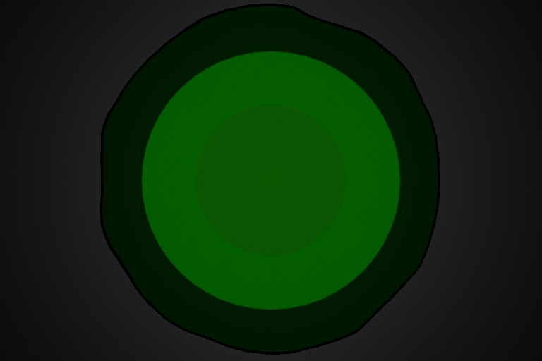

# SlipperyTrail 油漆／液体溢边 v0.1

2026-11-11 从 `main/53d3fa2` 接续。程序与材质已实现，并完成本机编译、原生、真实材质像素及双端专项；下一步由团队在原比赛地图验收观感。保持稍柔和、圆润的夸张卡通／涂鸦方向。

## 效果与边界

在原有地面主体外增加薄的纯表现余量，再用固定于地面的平滑低频噪声裁剪，形成圆润凸瓣、相对浅凹和短溢边。原主体覆盖保留，不在有效范围内部制造边缘缺口；内部缺口仍由既有结束消散控制。主体色块、隆起与体积明暗沿用原配方，新外轮廓继续使用原 `InkColor`。

视觉余量为 `min(Maximum Outset, 当前半宽 × Maximum Half Width Fraction)`。默认上限为 **15 cm／8% 半宽**，例如半宽 70 cm 时最多外扩 5.6 cm，半宽 900 cm 时最多外扩 15 cm；材质再在余量内形成不均匀轮廓。该薄带没有碰撞、重叠或导航影响，**不会扩大打滑逻辑查询范围**。不要用视觉边缘反向注册玩法来源。

同一次释放的噪声不随时间滚动，扩宽时自然显露；结束时与原分块蒸发共同消失。玩法寿命、GAS、抓地恢复、摆动、所有者清理规则保持。首版没有独立小滴、飞溅粒子或额外贴花 Actor。

## 打开后如何配置

1. 使用本轮完整构建重新打开 Editor。原技能 DA 和 MI 可以继续使用，无需重建 GA、BP 或接 Event Graph。
2. 打开 `/Game/Data/Abilities/DA_Ability_SlipperyTrail`，展开 **Slippery Trail → Presentation → Paint Edge**。Enabled 在 SlipperyTrail 的默认值为开启；Maximum Outset=15 cm，Maximum Half Width Fraction=0.08。
3. `Presentation → Ground Material` 继续引用 `/Game/Assets/FX/Materials/MI_SlipperyTrail_Graffiti`。打开这个 MI，展开 **06 Paint edge**，勾选需要覆盖的参数再调节。
4. 保存修改并重新施放技能。DA 参数由发动时快照决定，已有区域不随 DA 编辑自动改变。

已只读加载当前保存技能 DA，确认新字段读取为开启／15 cm／0.08、原涂鸦 MI 引用和 1 s 消散时长保持；没有保存或覆盖该 DA。母材质继续 **Unlit／Masked**。

| 配置位置／参数 | 默认／范围 | 用途 |
| --- | --- | --- |
| DA / Enabled | 开启 | 关闭时不生成外余量，恢复旧轮廓与原描边路径 |
| DA / Maximum Outset | 15 cm，0～30 cm | 纯表现外扩的厘米上限 |
| DA / Maximum Half Width Fraction | 0.08，0～0.2 | 小区域的比例上限；仍受厘米上限约束 |
| MI / PaintEdgeStrength | 1，0～1 | 余量内溢边强度；0 为规则主体，仍保留较密圆端网格 |
| MI / PaintEdgeCellSize | 100 cm，建议 20～500 cm | 大值形成宽缓凸瓣，小值形成更多细小起伏；首测 60～140 cm |
| MI / PaintEdgeDetail | 0.2，0～0.5 | 第二层细节比例；0 最简洁，建议 0.1～0.3 保持圆润 |
| MI / PaintEdgeSoftness | 0.6 cm，建议 0.1～5 cm | 遮罩阈值过渡；材质仍为 Masked，不会变成半透明羽化 |
| MI / PaintEdgeOutlineWidth | 4 cm，建议 0～20 cm | 新轮廓内侧的墨线宽度；0 关闭新墨线 |
| MI / PaintEdgeOutlineSoftness | 1 cm，建议 0.1～10 cm | 墨线向侧面色块过渡的柔和程度 |

**想更像溢出的油漆：** 先调 Cell Size 和 Strength，仍不明显时再将 DA 的 Maximum Outset 逐步加到 20～25 cm。小区域可能先碰到比例上限，需同时检查 Fraction。不要直接大幅加宽视觉余量，以免比赛镜头对生效边界产生误解。

**想更柔和：** 先降低 Detail、增大 Cell Size；再适度增加 Outline Softness。Softness 主要调遮罩过渡，圆润的大形由噪声尺度与细节决定。

新模式的描边按厘米调，不再依赖旧 `Ink border threshold` 的比例门槛。关闭 Paint Edge 或把 Strength 调成 0 时，旧描边路径仍可使用。`HAL_GroundPaintEdgeEnabled` 是程序写入的开关，日常不要在 MI 手动覆盖它；直接在静态材质球预览中也不会得到运行时边缘元数据。

## 公共接口与未来复用

`FHALGroundSurfacePaintEdge` 属于公共地面表现配置，通用默认关闭；SlipperyTrail 显式默认开启。未来岩浆、雪地等调用者可将该结构放到自己的技能／区域 DA 中，并将同一配置同时传给 `HALGroundSurface::BuildRibbon` 和 `UHALGroundSurfaceComponent::ConfigureSurface`。只有消费以下合同的材质才应开启余量：

| 通道／参数 | 合同 |
| --- | --- |
| UV0 | 原地面厘米平铺坐标；不挪作形状随机输入之外的移动空间 |
| UV1 | 原中央权重对世界 XY 的平滑梯度，单位 1/cm；保持体积明暗用途 |
| UV2.R | 原主体边界的插值有符号横向／径向距离，cm；主体内部≤0，余量>0 |
| UV2.G | 此处允许的外扩余量，cm；受 DA 双重上限约束 |
| VertexColor.R | 原中央隆起权重；新增外余量顶点固定为 0，UV1 梯度也为 0 |
| HAL_GroundPaintEdgeEnabled | 区域 MID 写入的 0／1 开关；不用每帧复制 |
| HAL_GroundInvTileSize | 1/TextureTileSize，将噪声尺寸换成厘米 |

UV2 是适用于本条带／圆端的插值边缘信息，并非任意网格的精确距离场。新增外带贴同一采样地面平面，主体原顶点、UV0／UV1／权重保持；开启时中低横向细分的圆端角度段数由 12 增至 24，改善旧多边形轮廓。高横向细分保持有界段数，256 源点最坏孤立区段测试仍低于 65536 顶点。此轮没有新增组件 Tick、RPC 或玩法查询。

使用未接入边缘分支的旧材质时应关闭 Paint Edge，否则会直接显示完整外带。移植到其他地面材质需保留 WPO、原颜色和消散分支：边缘覆盖乘入原 Opacity Mask，新墨线只替换原外墨线 Alpha。其他区域的玩法生命周期由其调用方单独管理。

材质源为 `Tools/SlipperyTrailGraffiti/PaintEdge.hlsl`，维护脚本为 `UpdatePaintEdgeMaterial.py`。脚本通过官方 Editor API 更新现有母材质并保护原 MI 有效参数，只保存母材质，不保存 BP、MI、DA 或地图。Custom 代码已嵌入 uasset，游戏运行时不读取这些工具文件；日常调参无需重跑脚本。脚本依赖原图中的描述标记，手工重构母材质后先核对连接再运行。

## 向 TireSkid 卡通烟尘靠拢（方案讨论）

**后续范围已确认并完成首项：** 本轮只实现地面主体的表面朝向三色，保留原地面网格／溢边／隆起／消散，暂缓液团和 Niagara 迁移。当前配置与验证见[三档明暗](Slippery_Trail_Three_Tone_CN_v0.1.md)，下文液团等内容为原讨论备选，未施工。

2026-11-11 用户反馈现有溢边效果不错，并指定当前 TireSkid 新增的卡通烟尘为满意参考，仅讨论方案。只读核对 `main/e1ded4d` 的保存资源：`NS_TireSkid` 的 `DriftSmoke` 使用 `/Engine/BasicShapes/Sphere` 和 `/Game/Assets/FX/Materials/M_FX_ToonSmoke_Mesh`。材质为 Unlit／Opaque，使用 VertexNormalWS 对固定虚拟光向的朝向值切换 ShadowColor／MidColor／LitColor，再乘 ParticleColor.RGB。与截图的圆润立体分色一致；不是靠真实场景照明或半透明烟图产生体积。节点／引用导出保留在 `Saved/TireSkid/20261111_ReadOnly`，没有保存资产。

建议首版保留现有地面油漆与消散，将三色明暗规则接入现有平滑隆起法线，并新增少量低矮、压扁、圆润的液团／泡团。以铺设处短促鼓起为重点，存续期稀疏点缀，可选在退场时短促起团并缩小消失；不建议整片密集冒烟遮住车、球与边界。烟尘的形状／运动语言可复用，油漆团保持自身颜色与较低高度。

技能专用 Niagara 可从 DriftSmoke 的有效模块和材质实例出发，独立于轮胎漂移系统调参；不整套挂接 TireSkid 的 Ribbon／Sparks／漂移触发。C++ 表现层由已有地面轨迹、法线与服务器时间驱动本地世界空间粒子，按空间间隔采样并限制总量，随技能统一清理；不由粒子碰撞参与玩法，也不复制每粒子。资源、尺寸、高度、密度、寿命等技能控制项建议集中到原技能 DA。现有 SlipperyTrail 只有地面网格接口，还需开发 Niagara 引用／管理／参数桥接，当前没有这些新参数。

Opaque 烟尘材质没有消费 ParticleColor Alpha，不能直接靠 Scale Color 的透明度退场；首版可用尺寸归零，需溶解时另做技能专用 Masked 变体。地面母材质仍保留 WPO／UV2／消散合同；使用同一三色规则时应使用现有隆起的平滑法线，直接使用原平面顶点法线不会获得同样的体积色块。精确追踪每个消散孔洞需额外采样与匹配，首版建议只同步退场进度与大致分布。这些均为方案，未施工，未新增测试结论。

## 验证与下一步

UE **5.8.3-58210709**，Editor／Game Development 最终 R2 构建通过。原生专项 **13/13**，公共 WPO D3D12 回归 **1/1**，实际涂鸦材质 D3D12 Listen Server／Client 各 **1/1**，均 0 测试警告／失败／未运行／进行中。联机使用非默认 12 cm／0.06 余量、1.2 s 消散及 Host 出站 80 ms 注入，检查配置复制、本地 MID 开关、无碰撞、完整扩宽、尾效期间来源／GAS 已结束与最终清理。

实际生产 BuildRibbon 导出网格＋保存材质的 D3D12 R2 十帧像素检查通过，原生退出 0：主体丢失 0，越出外包络 0；增加溢边 10279 像素，裁掉规则外带 11532 像素；同参重复差异 0，消散回长 0，终点残留 0，关闭恢复差异 0。圆斑每 5° 抽样测得外扩约 1.17～14.65 cm，说明轮廓并非统一放大。母材质 98 节点，VS179／PS373 指令、1 采样器，为本设置统计；不是大量区域性能结论。

首次截图夹具因 Python Rotator 位置参数顺序导致测试相机朝向错误，得到空画面并失败；改为目标点求朝向后 R2 通过，原记录保留。早期受限进程未生成材质报告，不作为验证结果。完整证据在 `Saved/SlipperyTrail/PaintEdge_20261111`，可同步摘要见[验证 JSON](Slippery_Trail_Paint_Edge_Verification_20261111.json)。

1246 份原保存资产／Config／uproject 中仅授权母材质变化，其余 1245 份逐份一致；5 份区域玩法／GA／接收者／移动源码逐份一致。原 MI 调色、技能 DA、地图、纹理与用户开工前 Definition 修改保持。没有代改 Blueprint，未提交／Push。

团队下一步在原地图通过原技能释放，分别检查原地、直行、急弯、绕回／重叠、坡面和断段；对照开关确认仅边缘外观变化；调描边与尺度后检查球和车辆可读性。再用 Host／Client 比较同一区域扩宽、消散与淘汰／换车／返房清理。真人、校园多机、发布包及大量重叠区域性能尚未验收。

以下是独立正交测试镜头的真实渲染。先为关闭、后为开启的固定配置；测试背景与曝光用于覆盖检查，亮度不代表比赛画面。

