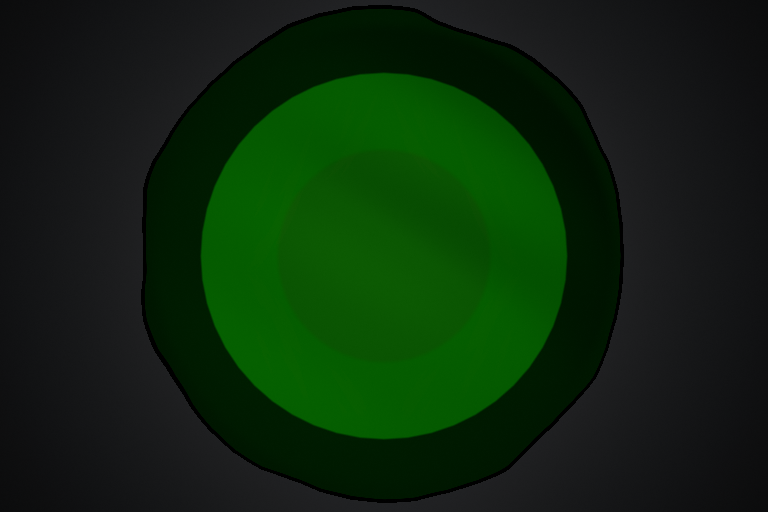
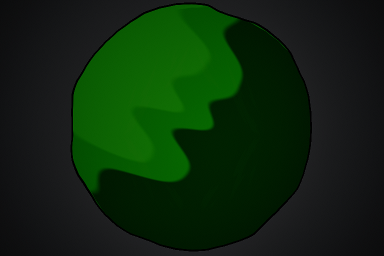

# SlipperyTrail 表面朝向三档明暗 v0.1

**2026-11-12 补充：** 用户反馈三档效果非常接近预期，后续已增加独立暗绿色边缘与中间色缓冲。新模式用 `ToonEdgeColor` 控制边缘，`ToonEdgeBufferWidth／Softness` 控制高光退让；原三档调色和消散保持。见[最新边缘配置与验证](Slippery_Trail_Edge_Buffer_CN_v0.1.md)，下文原首版统计保留原时点。

2026-11-11，从 `main/e1ded4d` 接续。用户确认本轮只尝试地面主体的暗／中／亮三档明暗，暂时保留 C++ 地面网格；液团、Niagara 地面迁移与新的退场演出均不进入本轮。材质已更新并完成本机 shader、像素及双端专项，比赛镜头观感待团队验收。

## 当前效果

主体颜色由隆起／波动后的平滑表面朝向决定，采用与 `NS_TireSkid → DriftSmoke` 相同的卡通三色思路。地面使用既有 UV1 权重梯度计算平滑朝向，保留原 WPO；没有用原平面法线或逐三角面法线代替曲面朝向。

相对于虚拟来光更背向的表面进入暗色档，更朝向的表面进入亮色档，其余为中间色。以原采样地面的朝向为中间基准，避免整片平地只剩一档亮色；过渡宽度可调，0 为硬分档。继续使用 **Unlit／Masked**，配色不随场景真实灯光改变；原可选真实投影仍按原配置控制。

本轮保留原地面范围、溢边与随形墨线、隆起、波动、笔触、网点及分块蒸发。满强度时主体原来的同心高度分色改为朝向分色；强度为 0 可精确恢复施工前的配色与旧体积明暗。玩法、GAS、复制、碰撞和清理代码均未修改。

## 配置流程

1. 关闭并重新打开材质编辑窗口；若 Editor 已加载旧母材质，保存当前工作后重新打开工程，加载本轮保存的材质。此次没有 C++／反射字段变更，无需为本轮重新 Build。
2. 打开 `/Game/Assets/FX/Materials/MI_SlipperyTrail_Graffiti`，展开 **07 Three tone shading**。原 `DA_Ability_SlipperyTrail → Presentation → Ground Material` 引用保持，无需换材质或重建 DA／GA／BP。
3. `ToonStrength` 新默认值为 **1**，已启用。勾选左侧覆盖框后可设为 0／1，对照旧版／新版。
4. 使用下面三个 `Toon...Color` 调主体颜色；保存后通过原技能测试。先用当前隆起参数；需要单独判断静态大形时，可暂把技能 DA 的 Wave Amplitude 设为 0，再恢复波动。

| MI / 07 Three tone shading | 默认值 | 调节方式 |
| --- | --- | --- |
| ToonStrength | 1 | 0～1；0 恢复旧配方，1 使用新朝向分色，中间值混合两种效果 |
| ToonShadowColor | 初始取当前 ShadowColor | 暗色档颜色 |
| ToonMidColor | 初始取当前 BodyColor | 中间色档颜色 |
| ToonLitColor | 初始取当前 Body／Top 每通道较大值的 1.15 倍，限制到 1 | 亮色档颜色；保持当前色系，之后独立调节 |
| ToonLightDirection | `(0.30,-0.35,0.89,0)` | RGB 表示世界 XYZ 的虚拟来光方向，A 不使用；对应轮胎烟尘的来光方向。翻转 XY 符号可对调明暗侧 |
| ToonNormalStrength | 4 | 0～8；放大曲面朝向变化，不改变实际高度；0 时平滑回中间色，可先在 2～5 调试 |
| ToonShadowThreshold | -0.04 | 建议 -1～1；暗色进入门槛，向 0 提高时暗色范围通常增加，降低时减少 |
| ToonLitThreshold | 0.04 | 建议 -1～1；亮色进入门槛，减小时亮色范围通常增加，增大时减少 |
| ToonSoftness | 0.015 | 建议 0～0.5；0 为硬切换，可先用 0.01～0.03 保留卡通分档并略柔和 |

新颜色默认值是从开工时的保存 MI 取样，**不是对旧 BodyColor／TopColor 的持续链接**。三档模式开启后，请在 07 中调主体色。11-12 补充后用 `ToonEdgeColor` 控制新模式边缘，原 `InkColor` 保留旧模式和网点作用；`ColorGain` 继续控制整体亮度，原笔触／网点／消散边缘色保留。

满强度时自动关闭旧 **04 Volume shading** 的额外明暗倍率，避免再次压暗或提亮；新模式的朝向、强度与过渡使用 07 的参数。ToonStrength=0 时，04 与旧主体配色参数恢复原作用。

阈值单位为 `dot(曲面朝向, 来光方向) - dot(原地面朝向, 来光方向)`，属于无量纲的朝向差。建议保持 ShadowThreshold<0<LitThreshold。实现会整理反向阈值、保留最小间距并限制过渡宽度，避免两段柔化把中间色完全挤掉；零来光向量按向上处理。画面中三档面积仍取决于实际曲面，低矮／宽阔区域可先调 Normal Strength 和阈值。

## 实现与维护

新增 `Tools/SlipperyTrailGraffiti/ThreeToneShading.hlsl` 与 `UpdateThreeToneMaterial.py`。脚本通过官方 Unreal Editor 材质 API 更新原母材质，只保存该母材质；没有手工修改二进制或编辑 Blueprint。Custom 代码已嵌入 uasset，运行时不读取工具目录，日常调参无需执行脚本。

新分支接在原主体配色之后、网点和笔触之前：读取原随形墨线 Alpha，计算三色主体，按 ToonStrength 与旧配色混合，再沿原笔触、整体亮度、结束消散输出。旧体积倍率乘 `1-saturate(ToonStrength)`。原 Opacity Mask／WPO 分支和所有运行时参数合同保持，UV0／UV1／UV2 的用途不变。

这次只改变材质颜色，不新增 Niagara 引用或参数。未来液团等粒子层可使用 Niagara；当前不预建相关 C++ 接口。维护脚本依赖现有节点描述，手工重构母材质后需先核对连接。

## 本轮验证

- UE **5.8.3-58210709**，保存并重新加载实际母材质后 D3D12 shader 编译通过：111 节点，VS179／PS438 指令，1 采样器，为本设置统计。
- 修改前先捕获真实对照。保存后的 D3D12 R2 十帧检查通过且原生进程退出 0。ToonStrength=0 与修改前对照逐通道差异 **0**；重新恢复新模式后的像素差异 **0**。
- 主体换色、反向来光、波动与柔和度分别改变 **156447／166590／44637／19752** 像素。RGB 诊断色下暗／中／亮分别检出 **97931／36524／49513** 像素，确认三档均实际显示；诊断色只写瞬态 MID，没有保存到资源。
- 独立 HDR 逆透明度读回排除地面，以 Alpha 检查覆盖：旧版、新版、反向来光、波动、诊断色、柔和度及恢复均为 **189123** 像素，各次轮廓差异 **0**。半程消散为 **98262**，终点 **0**，回长 **0**。
- 实际材质 D3D12 Listen Server／Client 生命周期专项各 **1/1**，均 0 测试警告／失败／未运行／进行中，两个原生进程退出 0。沿用非默认 12 cm／0.06 溢边、1.2 s 消散和 Host 出站 80 ms 注入，确认扩宽、尾效可见时玩法／GAS 已结束以及最终清理。
- 1246 份原保存资产／Config／uproject 中，只有授权母材质变化，其余 **1245** 份逐份一致；**349** 份 Source 文件逐份一致。保留原 MI 调色、技能 DA、地图、纹理、轮胎烟尘和用户车辆 Definition 已有改动，没有代改 BP，未提交／Push。

R1 像素夹具用颜色差判断覆盖，换色后把旧版边缘 67 像素及波动边缘 2 像素误计为范围变化，未作为通过。R2 改为独立 SceneColor HDR 的 inverse-opacity Alpha，原地面不参与该捕获，复核覆盖严格一致。失败报告保留在 `Saved/SlipperyTrail/ThreeTone_20261111`。完整可同步摘要见[验证 JSON](Slippery_Trail_Three_Tone_Verification_20261111.json)。

本轮没有 C++／反射变更，没有重新构建 Editor／Game Target 或重跑完整原生规则测试。当前结果不是原比赛地图真人、校园多机、发布包或大量区域性能验收。下一步由团队对照 ToonStrength=0／1，检查直线、弯道、绕回、坡面、波动和消散，再用 07 调色；Niagara／液团继续暂缓。

以下是 20 cm 隆起／2 cm 波幅的独立正交镜头真实对照，先旧版、后新版。测试背景与曝光用于验证，亮度不代表比赛地图。

